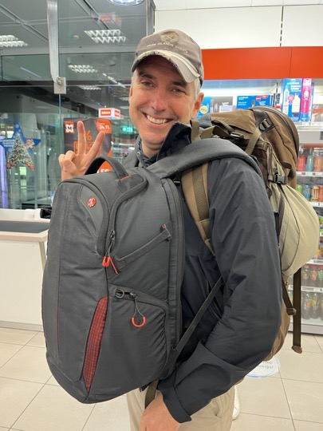
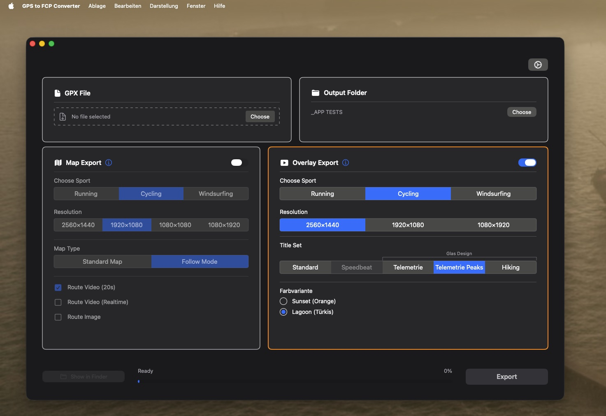
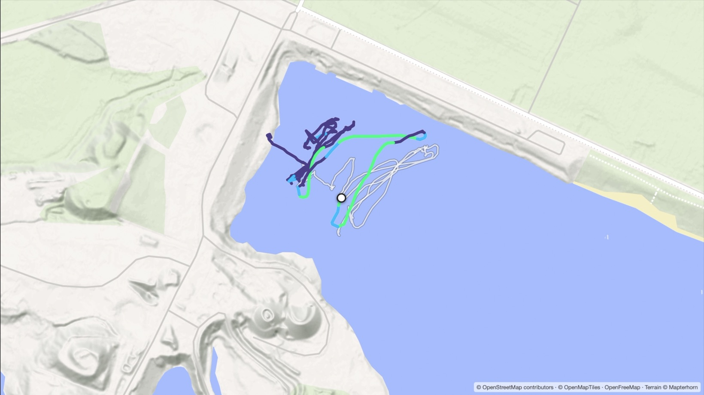
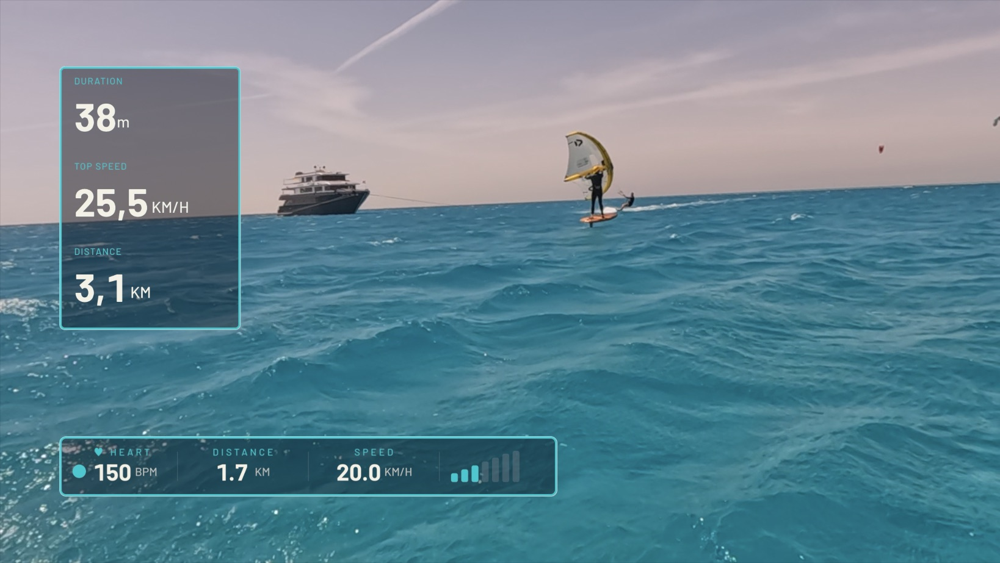
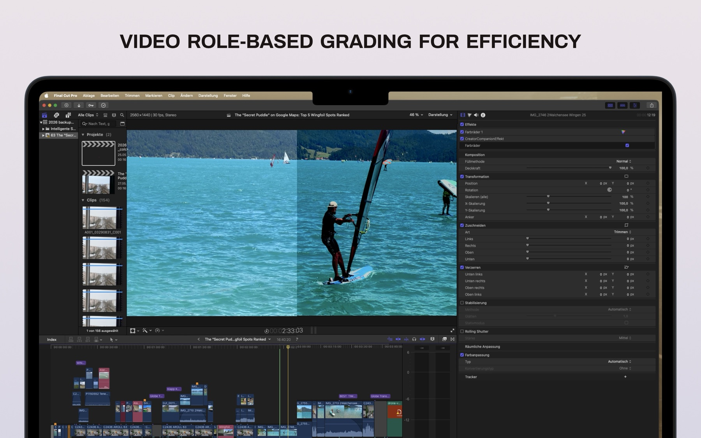
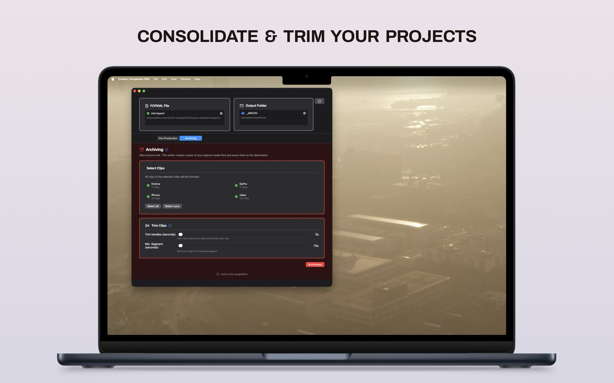
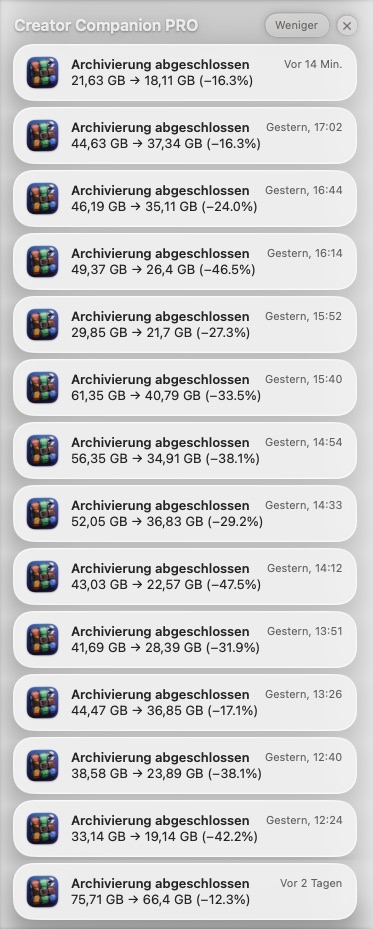
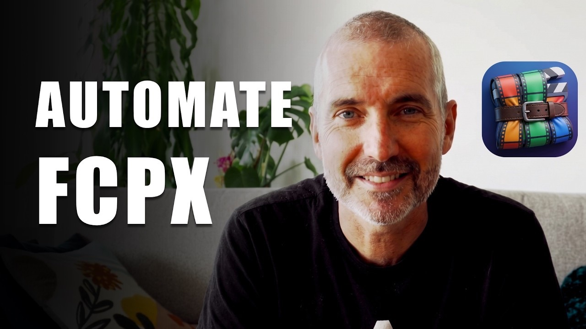

# Building Creator Companion & GPS to FCP Converter

How a travel and sports YouTuber with too many hours of GoPro footage ended up building two Final Cut Pro tools with Claude.

---

## Where I come from

I'm Dirk, and since January 2025 I've been running the YouTube channel [21hemoon](https://www.youtube.com/@21hemoon). It's a travel and sports channel: windsurfing, wing foiling, canyoning, hiking, and the trips around them.

The name started on a walk. We were talking about the wonders of the world and counted 28 of them. We had already seen 4, and the number 21 has a personal meaning for us, so the plan became a journey to 21 wonders. The name is also a pun: read the "1" as a "t" and you get "2 the moon", the ultimate travel destination.

That kind of channel produces a lot of footage. Action cams run for the whole session, the drone goes up whenever the light is good, and an iPhone or an Insta360 fills the gaps. A single video easily brings 30 to 70 GB of raw media into Final Cut Pro. In the end, maybe a few minutes of each long GoPro clip make it into the edit.

I'm not a professional developer. I have some IT background and I've been following AI closely, but before this year I had never shipped a Mac app.

---

## The gaps in my workflow

Three things kept annoying me, project after project.

**I graded the same way every time.** Once the edit and the music are done, I grade. My drone, my GoPro and my iPhone each need their own correction. In Final Cut Pro I already tag clips by role, so applying the same effect to every clip of a role by hand felt like work a computer should do.

**My drives kept filling up.** Once a video was published, I wanted to keep the project, but not 50 GB of footage of which I used 10 %. Final Cut Pro can consolidate a library, but it copies every file in full. There was no simple way to keep only the parts I actually used.

**My GPS data never made it into the video.** My watch and GPS recorders log speed, distance and heart rate for every session. Getting that into Final Cut Pro as a map or a data overlay meant keyframing titles by hand, or using tools that weren't built for an FCP timeline.

---

## Building it with Claude

I built both apps with Claude on a Claude Max plan, working in Visual Studio Code and Xcode.

The way it works best for me: I act as the product manager, Claude acts as the senior developer. I describe the workflow and what the result must look like in Final Cut Pro. Claude proposes how to build it and writes the code. I keep a short rules file for every project. The most important rules are "analyse before you change anything", "no changes I didn't ask for", and "stop and ask instead of guessing".

Claude is really good at writing code. But more than once it ran into a dead end. In the archiving feature, it spent days trying to cut long-GOP H.264 and HEVC files frame-accurately without re-encoding them. As it turned out, nobody has really solved that: macOS offers no public developer API for it, and even commercial tools list the resulting offsets as a known issue. It tried one approach after another, and at some point I noticed I was back where we had started. I had read some of those suggestions before. The AI was going in circles. In the end, a different AI told me plainly that I would never solve this with the tools I had chosen. That was about a week of work for nothing.

I'm telling this because it changed how I see my role. Being the product manager isn't enough. You need to understand the code a little, you need to understand the architecture, and you need to break the work into small, self-contained tasks. Otherwise you can't tell when the AI is going in circles.

What AI also doesn't do for you is the testing. Every feature in these apps was checked on real projects: my own footage and my own GPX files, imported back into Final Cut Pro, clip by clip. Most of the interesting problems only showed up there.

---

## GPS to FCP Converter

[GPS to FCP Converter](https://apps.apple.com/app/gps-to-fcp-converter/id6772071749) takes a GPX file from a Garmin, Apple Watch, Strava or DJI Osmo and renders two kinds of media for Final Cut Pro: animated map videos and transparent data overlays. Both land on the timeline as regular clips, with no plugins and no keyframing.

The route is drawn in seven colour levels based on speed, and each sport has its own levels, because 20 km/h means something different on a bike than on a windsurf board. In Follow Mode the camera flies above the track on a relief map and turns with the direction of travel. The maps use OpenStreetMap data, so they can be used in monetised videos as long as the map data is credited.

The overlays are not Final Cut Pro titles. Each title set is rendered frame by frame as HEVC with alpha, in the full project size, so Final Cut Pro places it 1:1 without rescaling. The Telemetry Peaks set finds the two fastest moments of a session by itself and writes the timecode into the file name, so you know where the clip goes.

**The hard part was the data, not the graphics.** Real GPS recordings contain glitches, jumps, double timestamps, and recorders that only log twice per second. If the map and the overlay each cleaned the data in their own way, the speed on the map wouldn't match the number in the overlay. So both run through one shared data pipeline, and speed, distance and elevation always agree.

[GPS to FCP Converter](https://apps.apple.com/app/gps-to-fcp-converter/id6772071749) is free on the Mac App Store, with additional title sets as in-app purchases.

---

## Creator Companion PRO

[Creator Companion PRO](https://21hemoon.com/creatorpro/) is for the end of a project, when the edit and the music are done. You export the project as FCPXML and work through three steps in the order you need them: grade, prepare the YouTube upload, archive.

### 1. Grading by role

Colour grading is one of my last steps. Creator Companion assigns a colour effect to each video role, for example one grade per camera, and writes a new FCPXML with every clip graded. You can save those assignments as presets and reuse them on the next project.

### 2. YouTube chapters and description

The app turns your chapter markers into YouTube chapters and writes a ready-to-paste description. If you have a script as a TXT file, the chapter names and descriptions come from there.

### 3. Archiving

When the video is published, the app builds a lean archive. Every clip is trimmed down to the parts used in the edit, plus a handle you choose (5 to 30 seconds). If the same clip is used several times, the app joins those parts into one file. It then writes a new FCPXML bundle that points to the trimmed files. You import that bundle into a fresh library, and the project opens with every edit in place.

You decide per role what gets trimmed. My A-roll stays complete, while drone, GoPro and Insta360 footage is cut down. These are real archive runs from my own projects over the last weeks:

Between 12 % and 47 % less storage per project. The more B-roll, the bigger the savings.

**Stream copy wasn't good enough.** This is where the dead end I mentioned above happened. My first version cut the files without re-encoding. That's fast and lossless, but long-GOP H.264 and HEVC can only be cut cleanly at keyframes. In Final Cut Pro some clips were off by up to 20 frames. So the app now re-encodes the used parts on the Apple Silicon hardware encoder, as HEVC with constant quality. The first re-encoding version used all-intra frames, which made fine textures like sand or water flicker. The current version is long-GOP without B-frames, and multi-part clips line up frame-accurately on the timeline.

**Some things it doesn't touch.** RAW formats, multicam and compound clips, speed ramps, and clips where more than 70 % is used anyway are copied in full. Audio files are copied 1:1. I'd rather have a slightly bigger archive than a broken one.

### Why there are two versions

The archive feature needs a bundled ffmpeg, and Mac App Store rules don't allow that. So [Creator Companion PRO](https://21hemoon.com/creatorpro/) is sold directly as a notarised download, and [Creator Companion for FCP](https://apps.apple.com/app/creator-companion-for-fcp/id6772694748) is the Mac App Store version with role-based grading and the YouTube tools. It's free with a default effect, and custom effects come with an in-app purchase.

---

## What I learned

Building with AI works, but it doesn't replace understanding. The AI writes the code. You still have to know where you're going, keep the tasks small, and notice when it's going in circles.

The two apps filled the gaps in my workflow, and now I'm testing the next step. An AI classifies all my footage with keywords like windsurfing, hiking, city or beach. It reads the GPS data and transcribes every clip named A-roll. Then it hands me an FCPXML with all the A-roll and with overlays, already rendered in my design, at the right places. The first results look promising.

So AI can take over certain tasks. What it can't do is my own creativity, the way I like to cut a video. Not yet.

You can find my videos on [YouTube](https://www.youtube.com/@21hemoon). If you have questions or ideas, I'd love to hear from you.

---

## Discuss this page

