### [4th November 2026](/news/20261104)

...and just like that, it's November. 🤯

Apologies again for the radio silence, and complete lack of posts in October. 😬

Ironically, it's actually been a pretty busy and interesting period for Final Cut Pro editors!

On 29th September, **Final Cut Pro v12.4** was released.

It included the following enhancements and fixes:

- Edit videos with Cinematic mode effects recorded in Final Cut Camera to adjust focus points and depth of field. (Requires macOS 27 Golden Gate.)
- Fixes an issue that could cause a title's font type to revert after being changed.
- Fixes an issue that could cause Final Cut Pro to quit when importing a project created in Final Cut Pro for iPad.
- Fixes an issue that could cause Final Cut Pro to quit unexpectedly when closing a project.
- Fixes an issue that prevented pasting keyframes in the Animation Editor.
- Fixes an issue that could cause multicam angle switches to be delayed when clicking angles in the angle viewer during playback.
- Fixes an issue that caused audio waveforms to take a long time to generate, or fail to generate, in the timeline.
- Fixes an issue that prevented backing up a library to a network volume.

Unfortunately though, soon after release the community started [reporting issues](https://discussions.apple.com/thread/256371421) with exports using the **Voice Isolation** - there's inconsistent and random audio pops/clicks on export.

There's also been [reports](https://discussions.apple.com/thread/256385777) of issues with **SMB shares** on macOS 27 and Final Cut Pro v12.4.

I've installed Final Cut Pro 12.4 on our non-production testing machine, and have been able to reproduce the issues.

As a result, we've stuck with **Final Cut Pro v12.3** on our main editing machines, and hope that Apple will push out a bug fix for this soon.

**Final Cut Pro for iPad v3.4** was also released.

It included the following features and enhancements:

- Edit videos with Cinematic mode effects recorded in Final Cut Camera to adjust focus points and depth of field.
- Focus on your edits with a redesigned Liquid Glass interface that adapts to your content and expands your timeline.

**Improvements and bug fixes:**
- Easily access App Settings and Project Settings from within an open project.
- Adds new menu bar options to delete, duplicate and rename projects.
- Fixes an issue that caused undo and redo to be cleared after using Montage Maker.
- Addresses an issue that prevented the Go to Range Start/End keyboard shortcuts from updating the timecode for media browser clips.
- Improves reliability and accuracy when switching multicam angles.
- Resolves an issue that prevented Final Cut Pro for iPad from controlling a Final Cut Camera angle after it reconnected in a Live Multicam session.
- Fixes an issue that caused audio fade timing to unexpectedly change while modifying multiple clips with different audio fade timings.
- Addresses an issue that caused the microphone permission prompt to not appear when microphone access was disabled in Settings.
- Resolves an issue that caused the keyboard to unexpectedly disappear while using Voice Control to search in the media browser.
- Improves Voice Control accessibility support for navigating and browsing the content browser.
- Improves the VoiceOver accessibility description for the Project Menu button.
- Improves Larger Text and Bold Text accessibility support in the VoiceOver feature.
- Includes stability and performance improvements.

**New keyboard shortcuts:**
- Add Basic Title: `Control-T`
- Add Basic Lower Third: `Control-Shift-T`
- Copy Effects: `Option-Command-C`
- Paste Effects: `Option-Command-V`
- Copy Keyframes: `Option-Shift-C`
- Cut Keyframes: `Option-Shift-X`
- Paste Keyframes: `Option-Shift-V`
- Play Rate .5: `Option-L`
- Play Rate -.5: `Option-J`
- Delete Project: `Command-Delete`
- Duplicate Project: `Command-D`

**Compressor v5.4** was also released.

It includes the following enhancements and fixes:

- Convert regular video with Cinematic mode effects recorded in Final Cut Camera to previous Cinematic mode format. (Requires macOS 27 Golden Gate.)
- Create HEVC MPEG-4 files to upload to social platforms with new export presets, including 10-bit options recommended for HDR content.
- Includes new optimisations for Liquid Glass.
- Improves VoiceOver navigation functionality.
- Improves Voice Control related to Preview controls.
- Fixes an issue where the app would crash when submitting a job that includes a job action.
- Fixes an issue where the app would hang when playing back an image sequence.
- Fixes an issue where job failures occurred when adding chapter markers to longer movies with high frame rates.
- Removes distributed processing functionality.
- Includes stability and performance improvements.

**Motion v6.4** was also released.

It includes the following enhancements and fixes:

- Edit Cinematic mode videos recorded with Final Cut Camera and adjust focus points and depth of field. (Requires macOS 27 Golden Gate.)
- Fixes an issue that could cause Motion to unexpectedly quit after dragging an mTracker 3D Group into a project.
- Fixes an issue that prevented the “Go to App Store” button from opening the App Store when Pixelmator Pro isn’t installed.

**Final Cut Camera v2.4** was also released.

It includes the following features and enhancements:

- Explore a beautiful new design featuring easy-to-access settings, customisable overlays, two-finger tap to put focus on the viewfinder, a tally light to indicate recording, and much more.
- Capture stunning video using the 48MP Fusion Main camera with variable aperture from F1.48 to F4, with aperture priority, shutter priority, and manual modes. (Requires iPhone 18 Pro.)
- Monitor your video with the RGB parade and histogram. (Requires iOS 27.)
- Dial in your exposure with false colour and clipping indicators with threshold settings.
- Nail focus using improved focus peaking with sensitivity control.
- Get Cinematic mode effects from regular video, including support for ProRes and Apple Log, to achieve beautiful bokeh you can adjust in Final Cut Pro. (Requires iPhone 18 Pro.)
- Send a clean video signal using an HDMI-to-SDI converter for broadcast quality streams. (Requires iPhone 17 Pro or later and iOS 27.)
- Set your genlock frame delay to compensate for image artefacts from a recorded display or latency differences between your iPhone and other genlocked cameras. (Requires iPhone 17 Pro or later.)

**Improvements and bug fixes:**
- Easily see your camera settings like aperture, shutter angle, ISO, and more at a glance.
- Tap a camera setting to quickly open the corresponding controls and make adjustments.
- Swipe overlays to minimise them, tap to expand them for more information, or two-finger tap to clear the viewfinder.
- Adds the option to use Shutter Angle for manual exposure setting.
- Adds tint controls for precise white balance adjustments.
- Adds sensitivity and colour settings to focus peaking lines.
- Adds exposure threshold settings to clipping and zebra indicators.
- Fixes an issue that prevented settings from being saved after Final Cut Camera was closed.
- Addresses an issue that prevented Audio Mix from working with Spatial Audio video captured in Final Cut Camera.
- Resolves an issue that prevented Final Cut Pro for iPad from controlling a Final Cut Camera angle after it reconnected in a Live Multicam session.
- Includes stability and performance improvements.

The **FxPlug** SDK wasn't updated - it remains on `v4.3.5`.

The **Workflow Extensions** SDK wasn't updated - it remains on `v1.0.3`.

I'll dig deeper into Final Cut Pro v12.4 over the coming weeks and hopefully share my findings here, as there seems to be quite a few under-the-hood changes.

So that you can get from Final Cut Pro on Mac to iPad, I've finally released **Transfer Toolbox v2.0.0**!

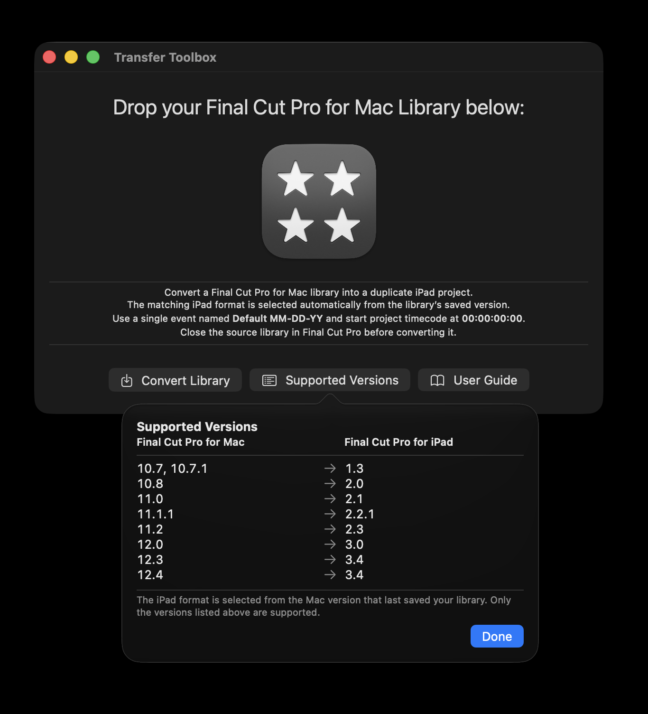

You can now export from Final Cut Pro v12.4 (on Mac) to Final Cut Pro v3.4 (on iPad).

You can learn more on the [Transfer Toolbox website](https://transfertoolbox.fcp.cafe).

Of course, Final Cut Pro v12.4 wasn't the big news - Apple also announced the upcoming **Final Cut Pro v13**.

You can read Apple's official press release: [Apple Creator Studio adds powerful new AI features and even more creative tools](https://www.apple.com/au/newsroom/2026/10/apple-creator-studio-adds-powerful-new-ai-features-and-even-more-creative-tools/).

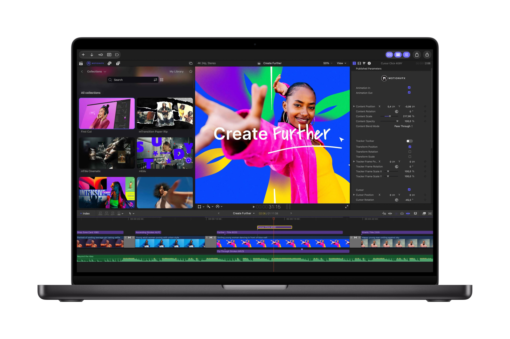

> Final Cut Pro for Mac now includes built-in MotionVFX — an expansive collection of visual effects, plug-ins, transitions, templates, and motion graphics tools — as well as seamless editing in Pixelmator Pro.

Apple bought MotionVFX in March, and everyone's been wondering what they're going to do with it. It seems like a lot, if not most of their products will be included in Apple Creator Studio! 🤯

It seems that the only tools not coming across are **mCaptionsAI** and **mUpscalerAI**.

It's super interesting that Apple has decided to keep the MotionVFX brand alive, and has literally placed a MotionVFX button in the Browser.

> If you are an active subscriber to any of the MotionVFX plans, your workflow stays the same — all tools included in your plan are accessible through mExtension.

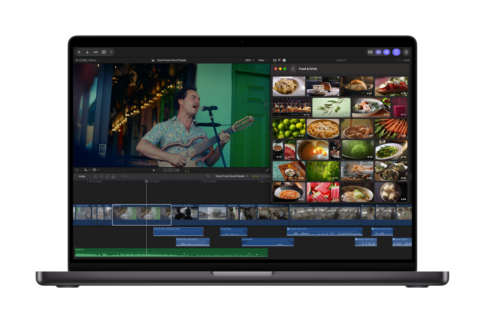

> Apple’s curated Content Hub now includes video assets and is available in Final Cut Pro.
> Editors can tap into the Content Hub directly within Final Cut Pro and access a library of Apple-curated stock video, photos, and backgrounds to fill gaps, add polish, or spark new ideas without leaving their workflow.

Given Apple's video production quality is always top notch (just look at the Apple TV screen savers!) - it'll be super interesting to see what video content they include in the new Content Hub.

> Final Cut Pro introduces powerful workflow improvements, including more keyframe easing options for finer animation control

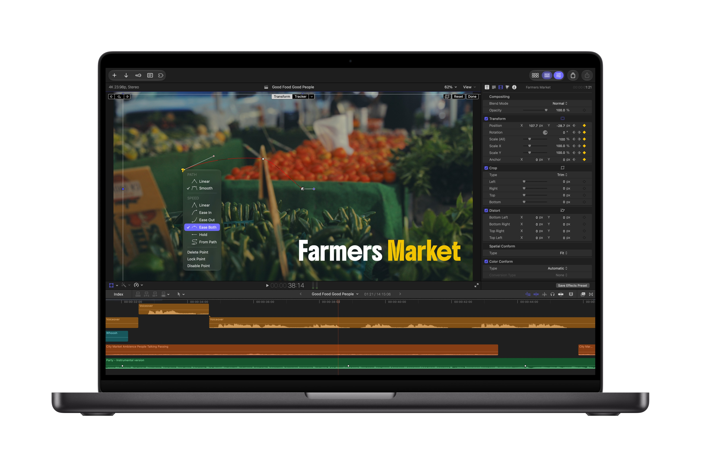

Back in March, we released [Keyframe Toolbox](https://keyframetoolbox.fcp.cafe) into the world, finally adding powerful keyframing tools to Final Cut Pro - and it seems like Apple is now playing catch up.

> 23 new transcription languages, making it easier than ever to caption and search footage

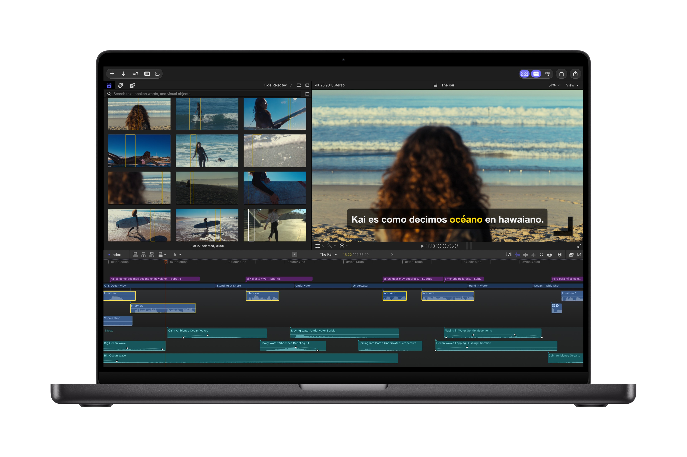

More transcription languages is great news!

> the ability to disconnect clips from the primary storyline to place them anywhere on the timeline

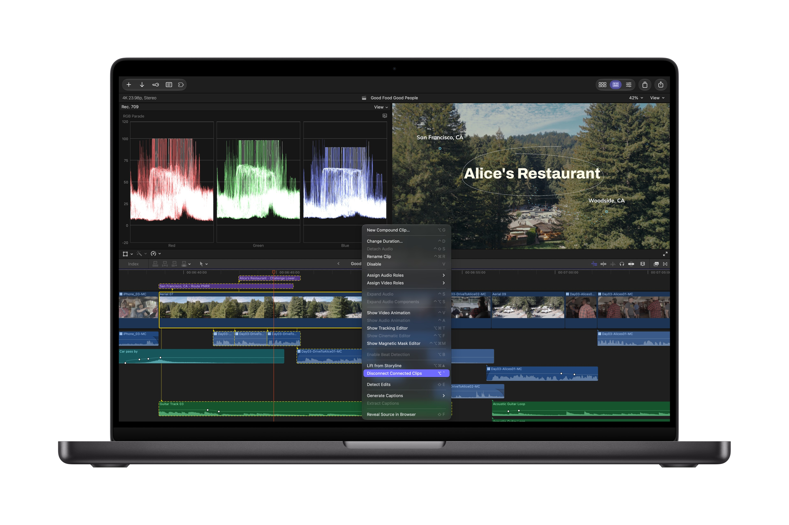

The ability **Disconnect Connected Clips** is a super interesting one - I can't wait to test this out and see if it's actually useful.

One of the most powerful things, and one of the things I love most about Final Cut Pro is the magnetic timeline, so I'll be very curious to see how this feature works.

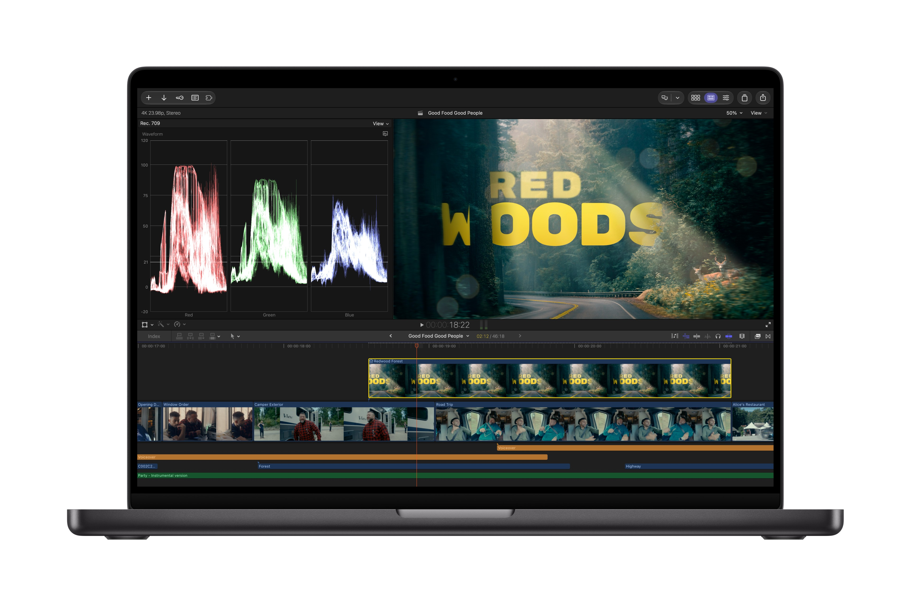

> Cross-app workflows and visual creation also take a major leap forward in Final Cut Pro. Editors can open any image from their timeline directly in Pixelmator Pro, take advantage of advanced editing tools, and save changes back to the project automatically — no reimporting required. With advanced image generation, users can create stunning images from text descriptions right inside their project, apply quick edits, and adjust visual styles.

Admittedly, I'm not currently a big Pixelmator Pro user - but I really need to dig into it deeper.

Whilst Keynote, Pages, and Numbers all get Model Context Protocol (MCP) support - it seems that Final Cut Pro will have to wait for that - maybe next year.

Overall, whilst not a particularly surprising update - it's a big one, simply because you get all the MotionVFX content as part of your Apple Creator Studio subscription.

Of course, the other big news is **hardware**.

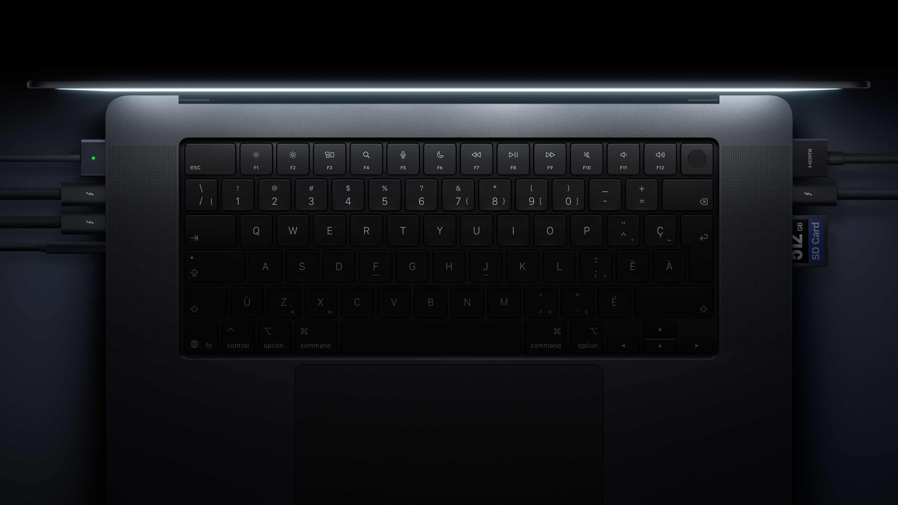

You can read Apple's official press release: [Apple unveils groundbreaking MacBook Pro with PROLED XDR Display and Touch for the first time on Mac](https://www.apple.com/au/newsroom/2026/10/apple-unveils-groundbreaking-macbook-pro-with-proled-xdr-display/).

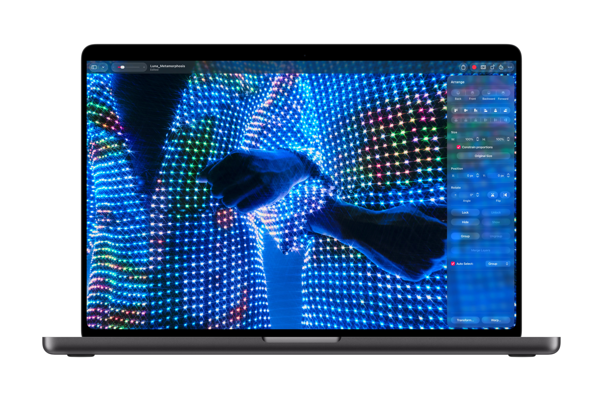

Funnily enough, I've been predicted a Mac Touch Screen [since 2009](/blog/mac-hardware-predictions-death-to-the-mouse/)!

I would absolutely LOVE to buy this fully-kitted out MacBook Pro - but oh boy, it's expensive.

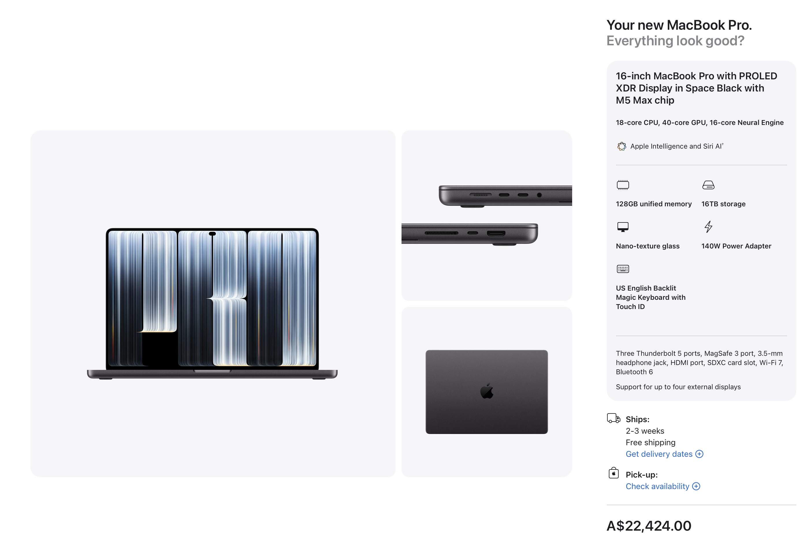

I think I'll be stuck with my trusty **2021 16-inch MacBook Pro (M1 Max, 64GB, 8TB SSD)** for a while to come, haha.

In other news, I also updated **CorridorKey by LateNite v2**.

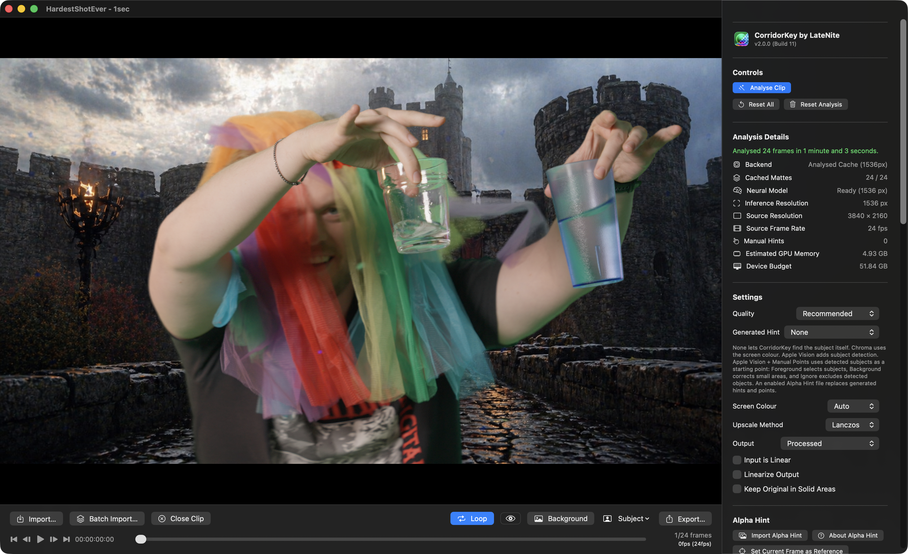

It now uses the [CorridorKey 2.0](https://github.com/nikopueringer/CorridorKey2.0/) model, which was designed and trained by Zachary Harris, in direct collaboration with Niko & Corridor Digital.

It brings an Effect directly into Final Cut Pro, as well as a Standalone Editor - optimised for ProRes in and out.

It has been built and optimised for Apple Silicon Mac's - written in Swift & SwiftUI, built around Metal and MLX.

If you're working with ProRes or HEVC, it makes use of Apple Silicon's hardware encoders and decoders.

It uses Apple's Vision Framework to use machine learning to "cut out" any foreground people, to use as a "hint" for CorridorKey. You can also add manual hints.

It's totally free and open source.

You can learn more on the [CorridorKey by LateNite website](https://corridorkeybylatenite.fcp.cafe).

**Jumper v2026.10.25** was also a MASSIVE update. It included:

**🥳 New Features:**
- Timeline search: search the timeline open in Premiere, Resolve, Avid or FCP. Jumper shows how much of the timeline is analyzed, analyzes only the parts the timeline uses, and clicking a visual or speech match moves the playhead there. Visual and speech search supported.
- Drag visual and speech search results onto the Premiere, Resolve, Avid and FCP timeline. Only the matched range is placed.
- Avid: send a clip’s transcript into Media Composer from the Script panel. It shows up in Avid’s Transcript Tool and PhraseFind AI with its language, speakers and word timings.
- Export transcripts as SRT subtitles or Avid SubCap captions, and export many transcripts at once from the Script Editor.
- People: delete a face collection or a single person, jump from a face to the frame it was found in, and choose a profile picture for each named person.
- Search results: select individual visual results so batch actions (Tag, Add to timeline, Add to project, Export subclips, Copy to clipboard) apply only to those.

**🔨 Improvements:**
- Speech Analysis now transcribes every audio track of multi-track files (e.g. MXF and multi-track MOV), and the channel picker lists the channels of every track.
- Choose where exported subclips are saved.
- Choose face grouping when starting an analysis. The new Auto default keeps an existing collection’s grouping.
- Media tab: new “Reload shared analysis” option picks up analysis that teammates added to a shared Analysis folder.
- Search result card settings are saved separately for each editor, and buttons that don’t fit on a card move into a More menu.
- Summary Analysis and AI agents now see named speakers instead of SPEAKER_00-style IDs.
- Summary Analysis now recommends the Large model on every Mac, since Extra large is much slower.
- Faster media table in large libraries, and imports show real progress bars.
- AI agents can read word-level timings of new transcripts, put far less load on NAS Analysis folders while analyzing, and use Bionic as well as LM Studio for local thumbnail descriptions.

**🐞 Bug Fixes:**
- Tag Collections: fixed other collections being deleted when the tag file couldn’t be read (e.g. a NAS timeout) while creating or sharing a collection.
- Shared Analysis folders: a brief NAS hiccup during a search no longer removes clips from everyone’s searches, a Standard-license machine re-analyzing a clip no longer deletes another machine’s analysis, and naming a speaker no longer erases names saved on another machine.
- People: faces found while the collection file is in use on a network share are kept instead of thrown away, and adding files to a collection no longer resets its grouping or drops names.
- Exported subclips of phone, camera and screen-recording footage now start and end exactly where requested, instead of up to several seconds early.
- Transcript PDF exports now show Japanese, Chinese, Korean, Russian, Greek and other non-Latin text.
- Speech model downloads no longer hang on a stalled connection.
- Avid: fixed media import and linking failures.
- Premiere: fixed the panel plugin failing to install in some setups.
- Agent-built timelines: music with embedded album art now lands on audio tracks, and OTIO import/export handles mixed frame rates in Resolve.
- Plus various minor bug fixes!

Being able to drag-and-drop from Jumper to the Final Cut Pro timeline is SUPER cool, and something I've wanted in Jumper from day one.

You can learn more on the [Jumper website](https://getjumper.io/?ref=fcpcafe).

In other very exciting news, next week I'll be attending Apple's **Create immersive media experiences for spatial computing** event in Cupertino! 🛫

> Throughout the day, you'll hear directly from Apple engineers and designers, and from creators like you. You'll get the latest on visionOS 27 and be among the first to see new tools designed to streamline how you create. Exclusive guest speakers will share the experiences creators are shipping today, and you'll dive into advanced production workflows for Apple Immersive Video. We'll also give you a first look at how to produce Live in Apple Immersive.
> In the afternoon we'll be hosting intimate breakout sessions where you can go deeper on specific technical topics with Apple teams, connect with fellow experienced creators, and get hands-on with advanced workflows and equipment from Apple Immersive technology partners.

You can [apply to attend in person](https://developer.apple.com/events/view/K4R8XALMM3/dashboard) and [apply to watch online](https://developer.apple.com/events/view/7BV2U53325/dashboard).

I'll definitely be posting about it all next week!

In other news...

There's been a million updates to the large collection of [Studio Malibu Berlin apps](https://www.studiomalibu.de/apps/):

- Malibu SyncSlate v0.17.21
- SyncScript Pro v1.2.85
- Malibu Meter v1.31
- MalibuMesh v0.1.128
- MalibuBurn v0.3.63
- Malibu Conform v0.1.11
- MalibuClip v2.6.0
- MalibuDictate v0.10.7

**EMUL8 v3 Film Emulation for Final Cut Pro** is out now!

> The Film Emulation we always wanted. So we built it.
>
> If you're looking for a real Dehancer alternative that doesn't slow your Mac down or break the bank, this is it. We've used Dehancer for years. And yes, the looks are solid. But the performance is terrible. The price? Ridiculous. And half the settings are just useless.
>
> So we built a Film Emulation Plugin for Final Cut Pro that does what matters. Instant results: Cinematic looks with rock-solid color science and the aesthetics of analog film in under 2 minutes.
>
> Blazing fast performance. At a fraction of the cost of Dehancer.
>
> Real-time playback with bloom, halation, chromatic aberration, film grain and beautiful film looks. No lagging sliders. No features you don't use anyway.

You can learn more on the [EMUL8 website](https://cinem8.co/products/film-emulation-for-final-cut-pro-dehancer-alternative).

**PostLab 26.2** is out now, and it's a big update! You can read all about it on the [Hedge blog](https://hedge.co/blog/postlab-26-2).

**Doza Cuts** for Final Cut Pro is now on [FxFactory](https://fxfactory.com/info/dozacuts/)!

There's an interesting read over at Pro Video Coalition: [Desert Palms captured with Blackmagic URSA Cine Immersive](https://www.provideocoalition.com/desert-palms-captured-with-blackmagic-ursa-cine-immersive/).

**Sebastian** from **FidelityFuze** writes:

> I’ve been quiet, but busy. **Since March, I’ve been building the next major version of FidelityFuze.**
> Version 2.8 never really shipped. I ran into some obstacles along the way, and I’m sorry for leaving you waiting.
> What’s coming has grown quite a bit. More on that soon. 🙂
>
> **A little help with footage**
> For testing and new website examples, I’m looking for original 720p or 1080p footage you’re happy for me to use in public before-and-after comparisons and promotional material.
>
> Stock footage hasn’t been a great fit. Most of it is already very clean or over-sharpened, and the 720p downloads are usually downsampled from higher resolutions. I’d like to work with the actual limitations of the original recording.
>
> **What would be useful?**
> Nicely composed shots with fine detail, movement, or real low-light noise would be great. Clean footage is welcome too. 5–20 seconds is enough.
>
> Thank you!

You can jump on the [FCP Cafe Discord](https://ltnt.tv/discord) to chat with Sebastian and follow along with [FidelityFuze](https://www.fidelityfuze.com).

**Erik Lindgren** at **Mira Contents** has released **Cutler**, a Mac app that turns Claude or ChatGPT into an assistant editor for Final Cut Pro.

> **Turn hours of raw footage into an editable Final Cut Pro first cut**
>
> Cutler lets Claude or ChatGPT work through a folder of raw footage the way an assistant editor would. It transcribes everything locally, syncs cameras and separate audio recorders by waveform (no timecode needed), and logs every shot, including soft, dark and shaky takes, from still frames the AI actually looks at.
>
> The AI then writes a paper edit with a reason for every clip and asks about the judgement calls. Cutler delivers it as a normal Final Cut Pro project on your original media, with keyword collections, roles and native multicam. Every FCPXML is checked against Apple's DTD before Final Cut sees it.
>
> Cutler runs inside the Claude or ChatGPT plan you already have, through MCP, so there are no credits or API keys.

It's available now for **€25** (founder price for the first 100 licences) as a one-time purchase with no subscription, with a free 7-day trial. It requires an Apple silicon Mac running macOS 14 or later.

You can learn more on the [Cutler website](https://cutler.miracontents.com).

**Antonio Marogna** at **evrApps** writes:

> EVRApps has released Readback Check 1.0, a free, open-source macOS app. It answers a question that matters to anyone who copies camera cards: **when an offload app verifies a copy, does it actually read the data back from the destination device?**
>
> **Why it matters**
>
> Verification is what crews rely on before formatting a card, and it's the one step nobody sees working.
> Right after writing, macOS may keep recently written data in its file cache, as much as available memory allows. When an app verifies that data, macOS can satisfy the read from memory instead of requesting it from the destination device. In that case, the app checks the data returned from the cache, not necessarily what was actually stored on the destination.
> This is particularly relevant for the files written last, or when an entire card fits within the available cache. Potential problems with a cable, enclosure, card reader or destination drive may therefore go undetected, until the original card has been formatted.
>
> **How it works**
>
> Readback Check never looks inside the offload app and doesn't rely on what its maker says.
> It measures how many bytes each storage device reads and writes while the app copies a folder of generated test files. It then validates its measurements against two reference-copy tests, designed to distinguish cached reads from reads reaching the destination device.
> A guided test takes a few minutes and ends with a plain answer: the copy was read back from the destination device, it wasn't, or it can't be determined on that device.
>
> **Why open source**
>
> EVRApps also makes offload software, evrExpanse. Readback Check grew out of an internal tool we built to test the verification of evrExpanse's offload module.
> Making it open source lets anyone inspect how it measures, run it with any offload app, and check the results for themselves.
> It doesn't rank or grade apps: a result describes one app, on one device, with one set of settings.
>
> **Key facts**
> - Free and open source (GPL-3.0)
> - macOS 14 or later, Apple silicon and Intel; signed and notarized, nothing else to install
> - Works with any offload app
> - No data leaves the Mac

You can learn more on [GitHub](https://github.com/evrApps/ReadbackCheck).

**Jan Weiner** writes:

> We've released tuu, a Mac app for card offloads that ends in Final Cut Pro – maybe something for FCP Cafe's news:
>
> - Copies each card to the main drive and any number of backups at once, reads every file back (XXH3, optionally MD5/SHA/C4) and writes ASC MHL v2.0 and an offload certificate on every drive.
> - Recognizes camera and operator by serial number and sorts cards into a folder template per project.
> - Syncs picture and recorder sound by timecode or waveform and creates an FCPXML with the synced clips – also XML for Premiere Pro and Resolve.
> - 14-day trial with every feature, then tuu Free; subscription $89/year, license $219.

You can learn more on the [tuu website](https://tuuapp.de).

**Alex** at **Praxlane Resources** writes:

> I made Presenter Push after we kept rebuilding the same presenter-and-graphic moves for weekly host videos at our midsize church. We wanted something simpler for staff who aren’t deeply trained in Final Cut Pro.
>
> It’s a native Motion title that moves the presenter aside while a photo or video slides in. There’s a keyframeable push slider, separate zoom and framing controls, and media selectors for each side. It’s $7 once, with no helper app needed. Framing and keyframes are manual; there’s no face tracking.

You can learn more on the [Presenter Push website](https://payhip.com/b/eHcXp).

And that's it for today. I'm sure there's a billion other things I forgot to include from the last month, so I'll try and update FCP Cafe a bit more regularly towards the end of the year!

Onwards & Upwards! Thanks team!