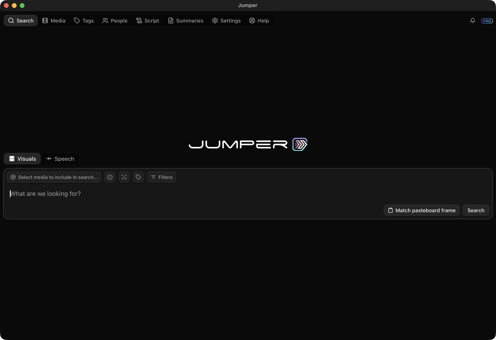
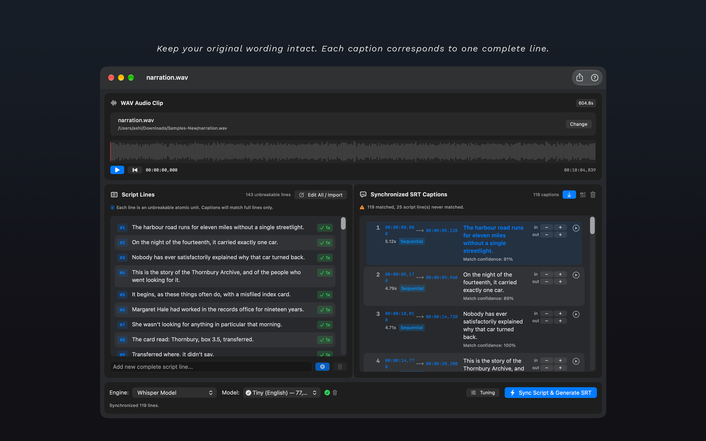
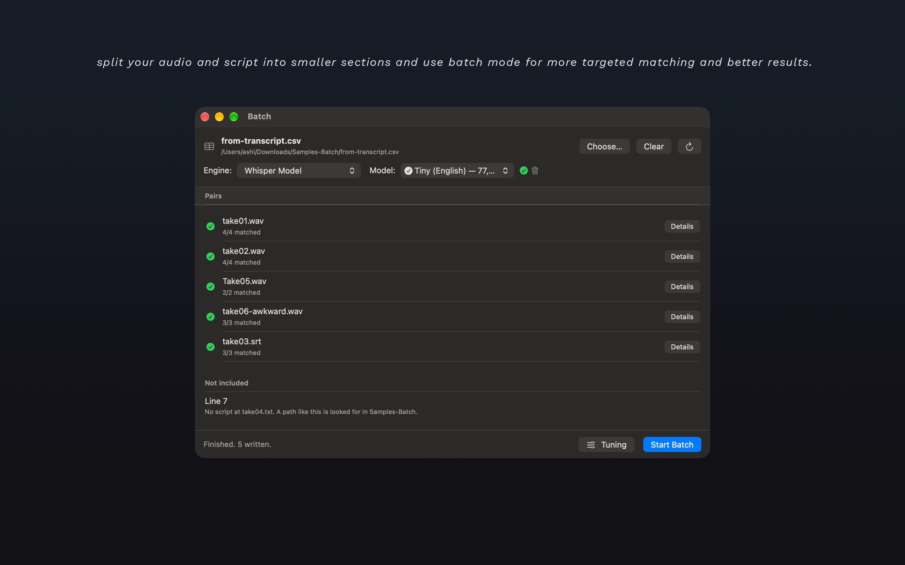
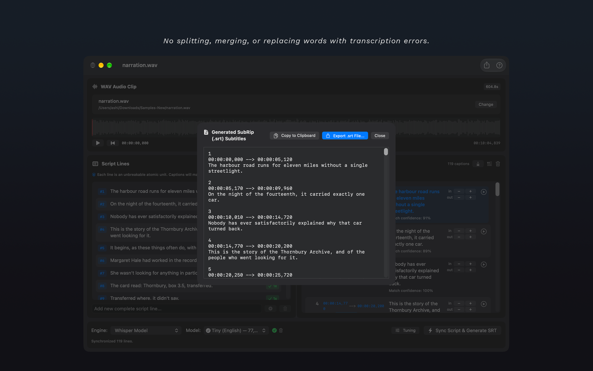

### [21st November 2026](/news/20261121)

Happy Saturday! 👋

I recently was going through Apple's Feedback Assistant (previously Radar) to look at all my unresolved issues... there's a lot, haha.

```
FB25636450: Quick Look in Finder spins forever on a QuickTime reference movie whose media is on an SMB volume
FB25636418: [Final Cut Pro] Final Cut Pro doesn't treat Blackmagic HyperDeck / Cloud Store recordings as growing files
FB25628258: [FxPlug] Views from effects get cut off when an FxPlug plugin is using a full-width parameter + Hidden parameters break first inspector layout height after launch
FB25511023: [Final Cut Pro] A/V Output should support metadata tracks
FB25511001: [Final Cut Pro] A/V Output should support full timeline resolution
FB22574049: Icon missing for Media Extensions
FB22227341: [FxPlug 4] Add ability for an EFFECT to behave like a GENERATOR/TITLE
FB22046427: [Final Cut Pro v12] Unexpected FCPXML Output
FB22029579: [Final Cut Pro v12] Crashes Exporting FCPXML #521
FB21982683: [Motion v6.0] Launching Motion is painfully slow #519
FB21950978: [Final Cut Pro 12] Library is damaged
FB21937500: [Final Cut Pro 12] Batch sync audio and video clips using timecode/audio waveform all at once
FB21914652: [Final Cut Pro 12] One pixel boundary at the frame edges on Viewer and in Export #511
FB21914564: [Final Cut Por 12] Downscaling within FCPX leaves edge bleed from clips below top one
FB21885502: [Final Cut Pro 12] Viewer freezes when rapidly hovering thumbnails generated by FxPlug #510
FB21878003: [Final Cut Pro 12] Crash in -[PEAppController validateUserInterfaceItem:] on quit #509
FB21876245: [Final Cut Pro 12] Regression - Effects Inspector painfully slow when scrolling #507
FB21807751: [Final Cut Pro 11.2] Unexpected behavior for blade cuts and markers
FB21807628: [Final Cut Pro 12.0.0] Add Focus Mode to Beat Detection Grid
FB18138320: [Final Cut Pro 11.1.1] Fails to Copy All Project Media to a New Location After a Previously Cancelled or Failed Copy Operation
FB15896946: [Final Cut Pro 11] Custom Overlays no longer working
FB15658613: [Final Cut Pro 10.8.1] Add ability to reorder auditions
FB15619066: [Final Cut Pro 10.8.1] Background Tasks - Sharing - Percentage Error with Multiple Export: Resets after each completes + lack of "completed" exports
FB15619054: [Final Cut Pro 10.8.1] Background Tasks - Sharing View - Pending exports should be re-arrangeable by drag-and-drop
FB15619039: [Final Cut Pro 10.8.1] Pending Exports disappear if/when Final Cut Pro crashes or Force Quit required
FB15619026: [Final Cut Pro 10.8.1] Export and Real Time Performance Issues with Clips of Alpha=0, not optimized out of render pipeline
FB15619021: [Final Cut Pro 10.8.1] Maximum Performance Mode? Using more than 2 cores... What about others? Does Metal Matter?
FB15619012: [Final Cut Pro 10.8.1] Batch Export all (or select) Picks in an Audition
FB15619009: [Final Cut Pro 10.8.1] New Export Settings Option for H.264 10 bit (Re-label existing H.264 appending "8-bit")
FB14069164: [Final Cut Pro 10.8] Freezing when making adjustments in the Viewer using Transform Tool
FB14069085: [Final Cut Pro 10.8] No audio when going frame-by-frame via arrow keys
FB13773396: [Final Cut Pro 10.7.1] Can't extend compound clip length in timeline
FB13569363: [Final Cut Pro 10.7.1] Change Audio Role of Sync Clip
FB13569343: [Final Cut Pro 10.7.1] Crash when copying Project to a different Library
FB13563506: [Final Cut Pro 10.7.1] Crashes when importing BRAW Toolbox FCPXML on macOS Sonoma 14.3
FB13550229: [Final Cut Pro 10.7.1] Internal Stabilisation issues and resulting crashes
FB13547810: [Final Cut Pro 10.7.1.] When all Libraries are closed the Viewer doesn't go black/transparent
FB13545557: [Final Cut Pro 10.7.1.] Crashed when exporting to ProRes
FB13525033: [Final Cut Pro 10.7.1] Renders being lost/missing after restart
FB13525010: [FCXPML / Final Cut Pro 10.7.1] Missing smooth position keyframes in FCPXML
FB13524991: [FxPlug 4 / Final Cut Pro] Add API for setting the font
FB13515704: [Final Cut Pro 10.7.1] Repeated crashing during export
FB13515702: [Final Cut Pro 10.7.1] File Storage Issue when Transferring Projects between Libraries
FB13502566: [FxPlug 4 / Final Cut Pro 10.7.1] Crash when trying to set a Font Menu string in FxPlug
FB13500590: [FxPlug4 / Final Cut Pro 10.7.1] Can't collapse or uncollapse Parameter SubGroup's programatically
FB13500385: [FxPlug / Final Cut Pro 10.7.1] Bad documentation for FxOnScreenControl keyDownAtPositionX
FB13500374: [FxPlug / Final Cut Pro 10.7.1] Can't change ParameterSubGroup Name in parameterChanged
FB13486195: [Final Cut Pro 10.7.1] Incorrectly shows "Missing Plugin" Red Error Message when Media if Offline
FB13477747: [Motion 5.7/Final Cut Pro 10.7] FxPlug Parameter with an parameterID of 300 incorrectly shows a slider
FB13477599: [Motion 5.7] Creating a new Motion Category is painfully slow
FB13472516: [Final Cut Pro 10.7] Crash when exporting a FCPXML via Menu and drag from Browser
FB13464670: [Final Cut Pro 10.7] Hanging when updating Libraries from older versions
FB13459536: [Final Cut Pro 10.7] Dragging files in the Browser window to a Keyword Collection incorrectly switches projects
FB13456780: [Final Cut Pro 10.7] Crash when creating a Snapshot
FB13454447: [Final Cut Pro 10.7] Cannot Detect Blackmagic Video Monitoring Card for AV Output
FB13453542: [Final Cut Pro 10.7] Plug-Ins from various developers stop working and crashing in FCP
FB13453528: [Final Cut Pro 10.7] Crash when using Color Wheels
FB13453507: [Final Cut Pro 10.7] Crash when exporting a FCPXML due to TextStyleExport
FB13441881: [Final Cut Pro 10.7] Imports wrong asset when importing from Photos stored on an external drive
FB13436367: [Final Cut Pro 10.7] Scrolling Timeline Misbehaves at certain Zoom Levels
FB13435050: [Final Cut Pro 10.7] "Send to Compressor" does not use third-party Audio Units
FB13435003: [Final Cut Pro 10.7] Inspector Button Tooltips no longer show
FB13434993: [Final Cut Pro 10.7] Random Red Lines in Timeline Render Bar
FB13434977: [Final Cut Pro 10.7] Font Variation Popup Menu is not functional in Text Inspector
FB13434162: [Final Cut Pro 10.7] FCPXML doesn't support all Title Parameters
FB12877339: [Final Cut Pro 10.6.8] Crashed after creating transition
FB12877328: [Final Cut Pro 10.6.8] Crash when right-clicking on library
FB12812982: [Final Cut Pro 10.6.7] Retiming in secondary timeline borks the primary timeline
FB12812962: [Final Cut Pro 10.6.7] Crash on launch
FB12698894: [Final Cut Pro 10.6.7] Some 4K H264 10bit 422 Footage is blurry when paused on M1 Ultra Mac Studios
FB12684321: [Final Cut Pro 10.6.7] Imported iMovie picture in picture border and drop shadow does not rotate with picture
FB12683841: [Final Cut Pro 10.6.7] Viewer Goes Black Requiring Restart of Final Cut Pro
FB12683338: [Final Cut Pro 10.6.7] Ignores Opacity of 0% in Motion Template
FB12434013: [Final Cut Pro 10.6.6] Avid MXF Audio File Fails to Import
FB12384661: [Final Cut Pro (for iPad) v1.0.1] Add support for Custom Fonts
FB12377845: [Final Cut Pro (for iPad) v1.0.1] Add ability to set custom start timecode for timeline
FB12359669: [Final Cut Pro 10.6.6] Changing Color Adjustments Sliders via Accessibility API do not update correctly
FB12359441: [Final Cut Pro 10.6.6] Generator with Effect doesn't update correctly during playback
FB12209024: [Final Cut Pro 10.6.6] FCPXML v1.11 doesn't support Soundtracks
FB12208094: [Final Cut Pro 10.6.6] Audio Presets don't migrate correctly from earlier versions of Final Cut Pro
FB12179692: [Final Cut Pro 10.6.5] Add ability to trigger commands in Final Cut Pro via Workflow Extension
FB12100432: There's no "area" for Final Cut Pro, FxPlug4 or Workflow Extensions on Feedback Assistant
FB12100407: [Final Cut Pro 10.6.5] Improve AV Output
FB12051540: [Final Cut Pro 10.6.5] No Accessibility Object for Audio Group in Audio Effects Browser
FB12043900: [FxPlug4] Add methods to access source clip timecode & frame number
FB12015616: [Final Cut Pro 10.6.5] User Interface Glitch When Renaming Folders
FB11982829: [Final Cut Pro 10.6.5] Red Lines Above Syncronised Clip from BRAW Toolbox
FB9963855: [Final Cut Pro 10.6.1] Pan Mode Dropdown has wrong AXValue
FB9954787: Finder's "Go to folder" AXSheet Lacks Accessibility Action to "Go"
FB9006078: [Final Cut Pro 10.4.10] Accessibility Issue with detecting selected clips when Video Animation visible
FB7383600: [Final Cut Pro] Missing an accessibility method for applying an individual effect/transition
FB6159440: No Accessibility Object for Audio Fade Handles in Final Cut Pro
FB6158831: Color Mask Controls in Final Cut Pro has no Accessibility Objects in the Viewer
FB6151156: Changing a slider value in Final Cut Pro via the Accessibility API doesn't update correctly
FB6151137: Accessibility Object for "Show/Hide" buttons in Final Cut Pro Inspector disappear when mouse is not hovering
FB6151118: Cannot detect when Final Cut Pro is playing or paused using the Accessibility API
```

However... on a happier note, there's more fixed, than there is outstanding! 🥳

Make sure you post your Final Cut Pro bugs on FCP Cafe's [Bug Tracker](/bugtracker/)! It really does help!



**Jumper v2026.11.20** is out now with Final Cut Pro v13 Creator Studio support!

**🥳 New Features:**
- Face Collections use a new storage format, so renaming, merging, moving and deleting people and adding clips are much faster in large collections. Collections from earlier versions stay searchable. Jumper asks to upgrade one the first time you change it, or use "Upgrade collection" in the People tab's collection menu. Earlier Jumper versions can't use new or upgraded collections, so update every computer that shares an Analysis folder.
- New UI for reading Summary Analysis which uses a timeline you can scrub.
- Summary Analysis can now be started via Watch Folders. Thanks for reporting steve62179!

**🔨 Improvements:**
- Many UI improvements across the whole app, plus a unified look and feel of UI components across standalone apps and NLE plugins.
- Visual analysis of long, high-resolution videos is much faster, since each file is decoded once instead of once per batch. Thanks for reporting Awakening!

**🐞 Bug Fixes:**
- Final Cut Pro: Add to timeline no longer inserts one-frame clips on French and other keyboard layouts when Paste Timecode has no shortcut. If the playhead doesn't move, Jumper stops and tells you. Thanks for reporting ro1960!
- Final Cut Pro: clicking a speech result no longer shows "Failed to start playback". The clip opens at that point in the Viewer, and Space plays and pauses.
- Final Cut Pro: fixed finding Libraries and Events in Final Cut Pro 13 (Creator Studio edition).
- Final Cut Pro: Events and Libraries with accented letters in their names are now found.
- Premiere Pro: Copy buttons now work in Script, search results and the AI Agents settings.
- Dragging results onto the timeline no longer leaves placeholder files piling up. In Premiere Pro, unused placeholders are cleared from the "Jumper drag placeholders" bin when the panel starts.
- Tags: a visual search result that's already tagged now shows as tagged, and ticking it again no longer adds a duplicate.
- Search results you removed no longer come back when you show more.
- Typing @ in a search field opens the people picker again on keyboards that type @ with Option or AltGr, such as Swedish and other Nordic layouts.
- Summary Analysis now find visual analysis made with older visual models.
- Plus many other small improvements and bug fixes!

You can download and learn more on the [Jumper Website](https://getjumper.io/?ref=fcpcafe).

In other news from the community...

First up, my amazing co-worker, the fabulous **Kevin Luk** has released his first Mac App Store app for the Final Cut Pro community, called **Simple Script Sync**.







> Turn an existing script and WAV recording into timed SRT subtitles. Keep every script line intact with local processing on your Mac.
>
> **Simple Script Sync: Script-Based Subtitles for macOS**
>
> Simple Script Sync turns your existing script and a recording into accurately timed SRT subtitles. Instead of generating subtitle text from automatic speech recognition, the app uses your script as the source of truth and determines when each line was spoken.
>
> **SCRIPT-BASED SUBTITLE SYNCHRONIZATION**
>
> Keep your original wording intact. Each caption corresponds to one complete line of your script, with no splitting, merging, or replacing words with transcription errors.
> Import a plain text script with one caption per line, or use an existing SRT file to retime subtitles for a different take. You can also import a transcript created with another tool and synchronize its timing without running speech recognition.
> The recording does not need to be a perfect read. Retakes, pauses, stumbles, and variations in delivery are expected.
> Simple Script Sync matches the spoken audio to the script and shows you where lines could not be matched.
>
> **MORE CONTROL OVER MATCHING**
>
> Review the engine output and matching scores to understand why a line did or did not match. Adjust the matching effort and settings to suit the recording, then check captions against the audio and fine-tune their timing before exporting.
> For more targeted matching and better results, split your recordings and scripts into smaller sections where practical.
> Use batch mode to process multiple takes in one go, with each recording matched to its corresponding script. Simple Script Sync matches recordings with their corresponding script files by filename, processes each take, and writes the resulting captions alongside the recording. Long recordings are processed in chunks.
>
> **A WORKFLOW FOR FINAL CUT PRO**
>
> Use Simple Script Sync to prepare script-based subtitles for your editing workflow. Together with our Caption to Keywords app (coming soon!), it can also support a script-based approach to searchable media organization in Final Cut Pro, as an alternative to workflows such as Avid Media Composer's ScriptSync.
>
> **LOCAL PROCESSING AND PRIVACY**
>
> Your audio stays on your Mac. Simple Script Sync does not upload your recordings to external servers.
> The app supports several speech recognition options, including Whisper Model, Whisperkit on Apple silicon, and Apple's on-device speech recognition. If you choose a Whisper model or Whisperkit, an internet connection is needed to download the required model. You can also import an existing SRT transcript and skip speech recognition entirely.
>
> **DESIGNED FOR SCRIPTED PRODUCTIONS**
>
> Simple Script Sync is built for video editors working with prepared scripts and recorded dialogue. It is especially useful when the wording is already known and subtitle accuracy matters, from scripted videos and presentations to productions with multiple takes.
> Synchronize your script, review the timing, and export an SRT subtitle file ready for your next editing step.

You can download and learn more on the [Mac App Store](https://apps.apple.com/app/simple-script-sync/id6820304943).

**Watch Import v1.5.0** is out now with the following improvement:

> - Re-order the watches assigned to a library.

You can download and learn more on the [Mac App Store](https://apps.apple.com/app/watch-import/id6805610470).


All products at **FxFactory**, including [Metaburner](https://metaburner.fcp.cafe) and Automatic Duck products, are **30% off** for Black Friday. Sale ends November 30.

You can learn more on the [FxFactory website](https://fxfactory.com).

**Dylan Bates (The Final Cut Bro)** is having a sale...

> MY BIGGEST SALE OF
> THE YEAR STARTS NOW!
> EVERYTHING in my store is
> 35% off with code BF35
>
> BUT! That's not all!
> BUNDLES = BIG SAVINGS!
> This year I'm offering several
> bundle packs with an even
> BIGGER DISCOUNT - 40% OFF!

You can learn more on [Dylan's website](https://fcbplugins.com).

**Sebastian** writes:

> **FidelityFuze v3.0** is available today. I've been working on it since February, and it grew into the biggest release I've made so far.
>
> At its core is a complete rebuild of Temporal Upscaling. Temporal is hard: lean on the wrong neighboring frame, and you get ghosting. Lean on none, and you lose the detail it was holding. So 3.0 asks a new question: is this difference more than your footage's own noise would explain? FidelityFuze no longer guesses where the line between detail and noise sits. It measures it, in your footage.
>
> Use code `BLACKFRIDAY2026` for **40% off**! Valid until Monday, November 30th. If you know someone who might benefit, feel free to pass it on.

You can learn more on the [FidelityFuze website](https://www.fidelityfuze.com).

**Vigneswaran Rajkumar** writes:

> Hey everyone! **Production Data v1.0.4** and **Shot Data v1.0.1** are now live on the Mac App Store.
>
> Both apps now support FCPXML v1.15 and have been tested and verified with Final Cut Pro 13.

You can learn more on [The Acharya website](https://tech.theacharya.co).

**Robbie Patton** writes:

> I made a previs app that’s super simple to use called Scene Planner. It allows you to build a set quickly, and move lights and cameras around and then save the stills so you can send them to your team. It even supports camera and character movement and lets you export those as video clips. It’s available on iOS, iPad and Mac.
>
> If you try it and have feedback please let me know, I’d love to improve it quickly.

You can learn more on the [Scene Planner website](https://sceneplanner.app).

**Erik Lindgren** writes:

> **Cutler**
>
> Until **Cyber Monday (30 November)**, the Cutler founder licence is **€25 instead of €59** (one-time, no subscription), limited to the first 100 licences.
>
> No code is needed: the founder price is applied at checkout.
>
> After that, you can get **€10 off** the €59 licence until **31 December** with the discount code: `FCPCAFE`.
>
> You can learn more on the [Cutler website](https://cutler.miracontents.com/?ref=fcpcafe).

Have a great weekend! 👋