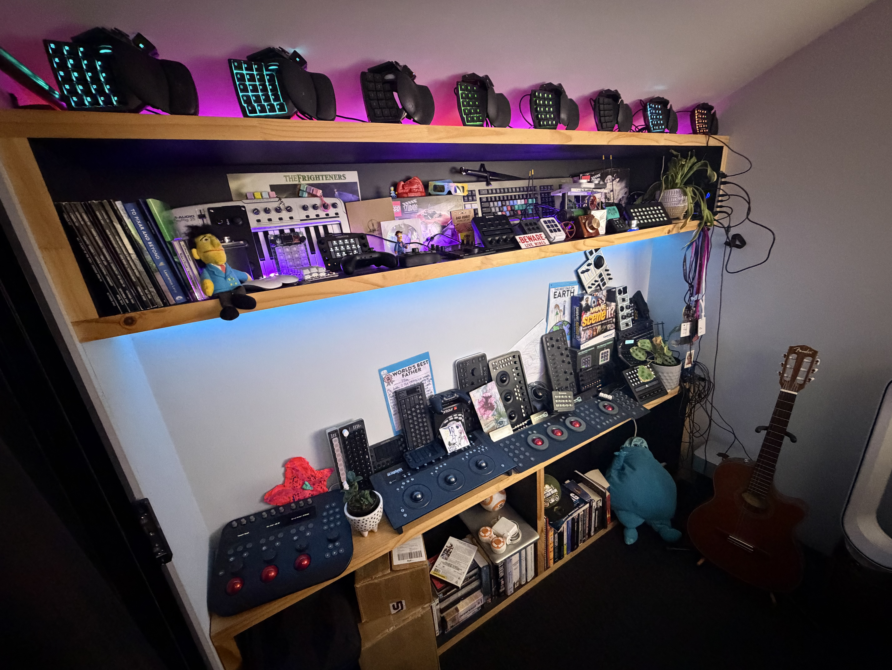
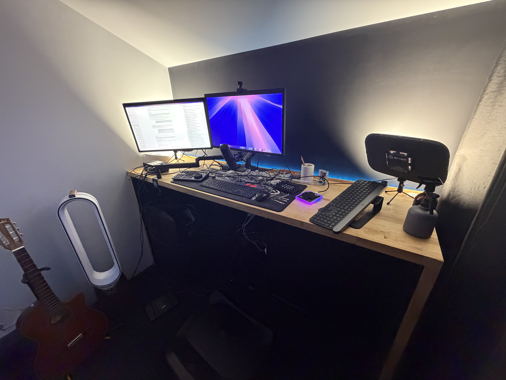
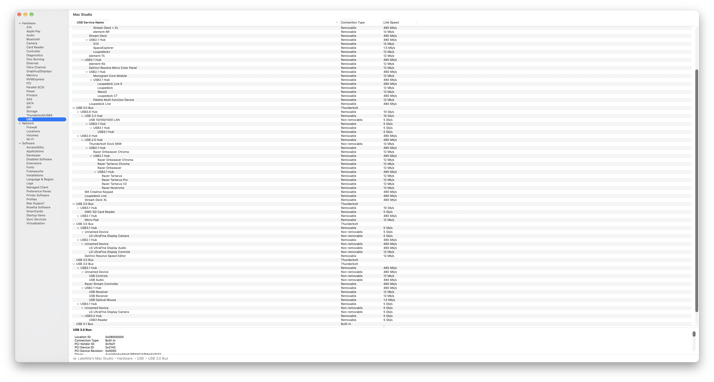

### [25th November 2026](/news/20261125)

Happy Wednesday! 👋

**Jumper** is currently **30% off**! 🥳

If you haven't played with Jumper yet, it's totally worth downloading the free trial and taking it for a spin!

You can learn more on the [Jumper website](https://getjumper.io/).

The amazing **Jonny Elwyn** has all the latest Black Friday deals on his [website](https://jonnyelwyn.co.uk/film-and-video-editing/the-best-black-friday-post-production-deals-2026/).

**CommandPost v3.1.0** is now available to purchase for iOS on the App Store! 🤯

It's is a one-time payment of **AUD$79.99** in Australia and **USD$79.99** elsewhere in the world. Sorry - there's no Black Friday sales or anything like that.

This single payment gives you access to the **Mac**, **iPhone**, **iPad**, **Apple Watch** and **Vision** Pro versions of CommandPost v3.

Alternatively, you can download the open-source [CommandPost v2](https://commandpost.fcp.cafe/commandpost-v2/introduction/) - although I will no longer be updating or maintaining this.

To be honest, there's been many times when I've never thought the CommandPost icon would make it to the App Store - but here we are. Amazing.

Unfortunately however, the Mac App is still "waiting for review" and the Vision Pro App is "ready for review".

I've already been rejected once for the Vision Pro app, because App Review request a demo video, which I've since sent.

Fingers and toes crossed we can get both those apps approved over the next couple of days.

There's also been LOTS of improvements since we first submitted these builds to TestFlight, so we'll try and do fairly regular updates once we're approved and live.

Until then, I'm busy testing all the control surfaces and building out new features and functionality.

Here's a look at my crazy testing lab - most of these devices are connected:







Thanks to EVERYONE who's [given feedback](https://github.com/CommandPost/CommandPost/issues) on CommandPost v3 - it's a MASSIVE undertaking.

Now in nerdy news...

We have a new Developers Case Study on FCP Cafe! 🥳

Check out [Building Creator Companion & GPS to FCP Converter](/developer-case-studies/creator-companion/). Thanks Dirk!

Beginning with **FxFactory v9.0.8**, it is now possible to build and distribute native plug-ins that use custom FxCore plug-ins created through the FxCore SDK! 🤯

You can learn more on the [FxFactory developer website](https://fxfactory.com/developer/distribute-fxcore-plugins-in-fxpacks/).

Also, a reminder that FxFactory is having a Black Friday sale - get **30% off** with the offer code `BLACKFRIDAY`.

You can learn more on the [FxFactory website](https://fxfactory.com).

And this is SUPER interesting...

**Robbie Tilton** (Designer/Founder/Reinventing the computer) writes:

> I made a video editor that lets you cut by hand or with AI agents. It's called **Editroom**.
>
> It's 100% free and open source. I built it for myself since I found iMovie unusable, Resolve too complicated, and Premiere too heavy.
>
> the app includes:
> • Color grading + LUTs, with HDR and Log support
> • Speed ramps, transitions and fades
> • Auto captions, timed word by word
> • Search footage by what's said or what's in the shot
> • AI editing: on-device, or with Claude and ChatGPT
> • Built-in MCP server
>
> Editroom is 23 MB. Premiere is 6.95 GB, Resolve 6.34 GB, and iMovie 4.29 GB

You can learn more on [Robbie's website](http://robbietilton.com/editroom).

**Wes Plate** at Automatic Duck writes:

> **Clip Exploder v1.2.2** is now on available on the Mac App Store and on FxFactory.
>
> Clip Exploder answers the question "How can I export each timeline clip as a separate movie, with added handles and clip effects intact?" by creating a separate FCP project for each timeline clip, with the original effects intact (only effects that round-trip via FCPXML) and user-defined handles added.

You can learn more on the [Automatic Duck website](https://automaticduck.com/#clip-exploder).

A few days ago I posted a whole bunch of Feedback Assistant topics.

I was then asked by a few people what my priorities would be... so... here you go:

```
**GENERAL:**
FB12100432: There's no "area" for Final Cut Pro, FxPlug4 or Workflow Extensions on Feedback Assistant

**APPLE IMMERSIVE FEATURE REQUESTS:**
FB25511001: [Final Cut Pro] A/V Output should support full timeline resolution
FB25511023: [Final Cut Pro] A/V Output should support metadata tracks
FB22574049: Icon missing for Media Extensions
FB22227341: [FxPlug 4] Add ability for an EFFECT to behave like a GENERATOR/TITLE

**FINAL CUT PRO BUGS:**
FB7383600: [Final Cut Pro] Missing an accessibility method for applying an individual effect/transition
FB6151118: Cannot detect when Final Cut Pro is playing or paused using the Accessibility API
FB6159440: No Accessibility Object for Audio Fade Handles in Final Cut Pro
FB6151137: Accessibility Object for "Show/Hide" buttons in Final Cut Pro Inspector disappear when mouse is not hovering
FB6151156: Changing a slider value in Final Cut Pro via the Accessibility API doesn't update correctly
FB6158831: Color Mask Controls in Final Cut Pro has no Accessibility Objects in the Viewer
FB12359441: [Final Cut Pro 10.6.6] Generator with Effect doesn't update correctly during playback
FB12359669: [Final Cut Pro 10.6.6] Changing Color Adjustments Sliders via Accessibility API do not update correctly
FB12051540: [Final Cut Pro 10.6.5] No Accessibility Object for Audio Group in Audio Effects Browser
FB9006078: [Final Cut Pro 10.4.10] Accessibility Issue with detecting selected clips when Video Animation visible
FB9963855: [Final Cut Pro 10.6.1] Pan Mode Dropdown has wrong AXValue
FB13434162: [Final Cut Pro 10.7] FCPXML doesn't support all Title Parameters
FB21876245: [Final Cut Pro 12] Regression - Effects Inspector painfully slow when scrolling #507
FB25636418: [Final Cut Pro] Final Cut Pro doesn't treat Blackmagic HyperDeck / Cloud Store recordings as growing files
FB25636450: Quick Look in Finder spins forever on a QuickTime reference movie whose media is on an SMB volume
FB21914652: [Final Cut Pro 12] One pixel boundary at the frame edges on Viewer and in Export #511
FB21914564: [Final Cut Por 12] Downscaling within FCPX leaves edge bleed from clips below top one
FB21885502: [Final Cut Pro 12] Viewer freezes when rapidly hovering thumbnails generated by FxPlug #510
FB13547810: [Final Cut Pro 10.7.1.] When all Libraries are closed the Viewer doesn't go black/transparent
FB13525033: [Final Cut Pro 10.7.1] Renders being lost/missing after restart
FB13525010: [FCXPML / Final Cut Pro 10.7.1] Missing smooth position keyframes in FCPXML
FB13486195: [Final Cut Pro 10.7.1] Incorrectly shows "Missing Plugin" Red Error Message when Media if Offline
FB13477599: [Motion 5.7] Creating a new Motion Category is painfully slow
FB12209024: [Final Cut Pro 10.6.6] FCPXML v1.11 doesn't support Soundtracks

**FINAL CUT PRO FEATURE REQUESTS:**
FB12100407: [Final Cut Pro 10.6.5] Improve AV Output
FB12377845: [Final Cut Pro (for iPad) v1.0.1] Add ability to set custom start timecode for timeline
FB21937500: [Final Cut Pro 12] Batch sync audio and video clips using timecode/audio waveform all at once
FB21807628: [Final Cut Pro 12.0.0] Add Focus Mode to Beat Detection Grid

**FXPLUG/WORKFLOW EXTENSIONS REQUESTS:**
FB12043900: [FxPlug4] Add methods to access source clip timecode & frame number
FB12179692: [Final Cut Pro 10.6.5] Add ability to trigger commands in Final Cut Pro via Workflow Extension
FB13524991: [FxPlug 4 / Final Cut Pro] Add API for setting the font
FB13500590: [FxPlug4 / Final Cut Pro 10.7.1] Can't collapse or uncollapse Parameter SubGroup's programatically
FB13500385: [FxPlug / Final Cut Pro 10.7.1] Bad documentation for FxOnScreenControl keyDownAtPositionX
FB13500374: [FxPlug / Final Cut Pro 10.7.1] Can't change ParameterSubGroup Name in parameterChanged
FB13477747: [Motion 5.7/Final Cut Pro 10.7] FxPlug Parameter with an parameterID of 300 incorrectly shows a slider
```

Fingers and toes crossed Apple can tick some of these off the list.

That's it for today - hopefully I'll have some more CommandPost news tomorrow! Thanks team!