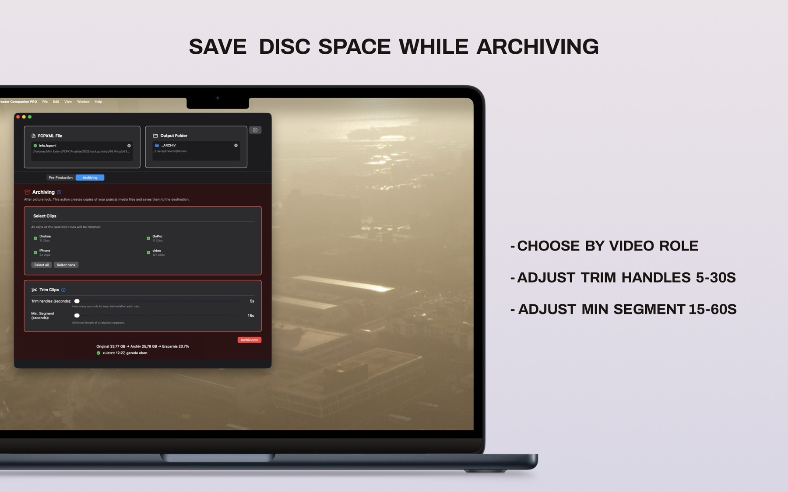
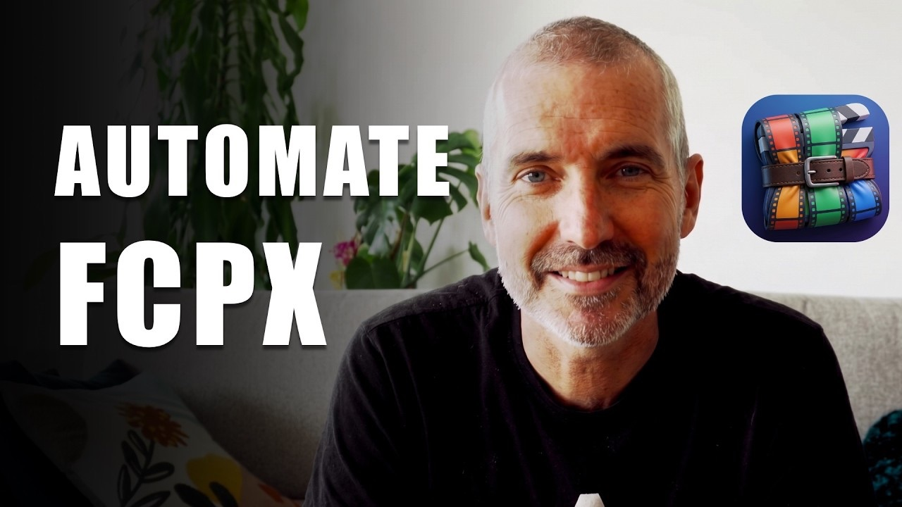

### Creator Companion PRO

Grade by video role, build YouTube chapters, and archive only the media your edit actually uses.

Creator Companion PRO is a Mac app for the end of a Final Cut Pro project, when the edit and the music are done. It reads your FCPXML export and writes a new one. No plugins are involved.

- **Grading by video role:** one colour effect per role, for example one grade per camera, applied to every clip at once. Save the assignments as presets for the next project.
- **YouTube chapters and description:** chapter markers become YouTube chapters and a ready-to-paste description. Optionally, chapter names and descriptions come from your script as a TXT file.
- **Archiving:** every clip is trimmed to the parts used in the edit, plus a handle of 5 to 30 seconds, and re-encoded as HEVC on the Apple Silicon hardware encoder. You get an `.fcpxmld` bundle that opens with every edit in place. You choose per role what gets trimmed, so A-roll can stay complete. On my own projects this saved 12 % to 47 % of storage.
- **What it leaves alone:** RAW formats, multicam and compound clips, speed ramps and audio files are copied in full.

Creator Companion PRO is a one-time purchase of $49.99, sold as a notarised download. It requires macOS 26.3 or later and an Apple Silicon Mac. The grading and YouTube tools are also available as [Creator Companion for FCP](https://apps.apple.com/app/creator-companion-for-fcp/id6772694748) on the Mac App Store: free with a default effect, custom effects via in-app purchase. Archiving is PRO only, because it needs a bundled ffmpeg that the Mac App Store doesn't allow.

Made by Dirk Roder, a travel and sports YouTuber ([21hemoon](https://www.youtube.com/@21hemoon)). How and why he built it: [Developer Case Study](/developer-case-studies/creator-companion).

[!button text="Visit Website" target="blank" variant="info"](https://21hemoon.com/creatorpro/)
