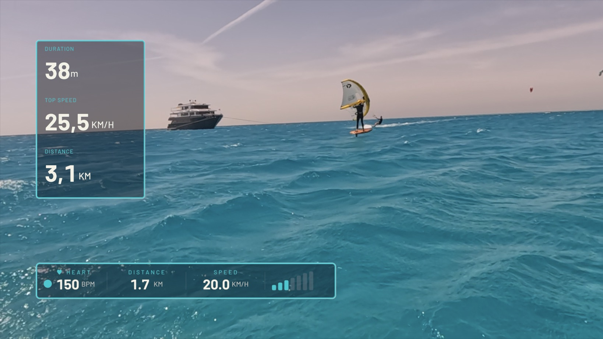
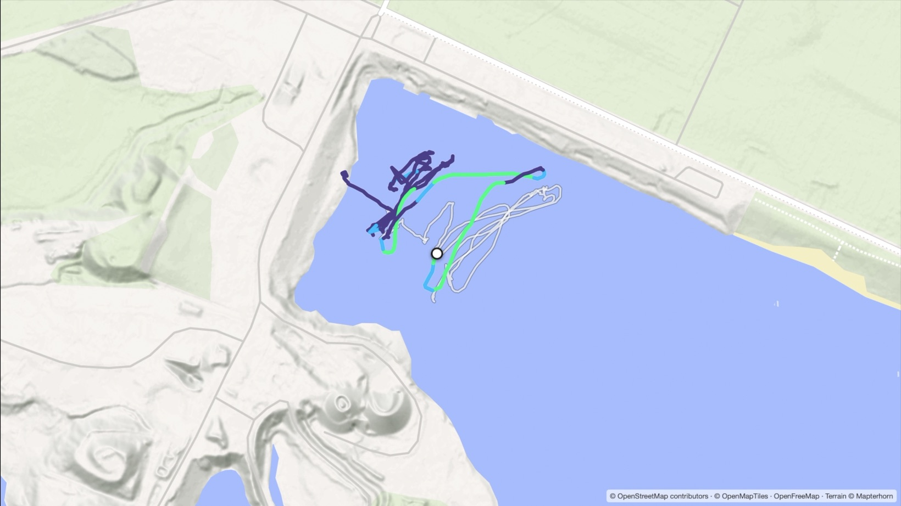

### GPS to FCP Converter

Turn a GPX file into animated maps and transparent data overlays for Final Cut Pro.

GPS to FCP Converter takes a GPX file from a Garmin, Apple Watch, Strava or DJI Osmo and renders two kinds of media: animated map videos and transparent data overlays. Both land on the timeline as regular clips, with no plugins and no keyframing.

- **Maps with a speed heatmap:** the route is drawn in seven colour levels based on speed, with separate levels for each sport. In Follow Mode the camera flies above the track on a relief map and turns with the direction of travel. The maps use OpenStreetMap data, so you can use them in monetised videos as long as you credit the map data.
- **Overlays rendered as video:** each title set (Standard, SpeedBeat, Telemetry Glass, Hiking, Telemetry Peaks) is rendered frame by frame as HEVC with alpha, in the full project size, so Final Cut Pro places it 1:1. Telemetry Peaks finds the two fastest moments of a session and puts the timecode in the file name.
- **One data pipeline:** GPS glitches, double timestamps and 2 Hz recorders are cleaned once, so speed, distance and elevation match between map and overlay.
- **Formats:** 2560×1440, 1920×1080, 1080×1080 and 1080×1920 for vertical video.

GPS to FCP Converter is free on the Mac App Store, with additional title sets as in-app purchases. It requires macOS 15.6 or later.

Made by Dirk Roder, a travel and sports YouTuber ([21hemoon](https://www.youtube.com/@21hemoon)). How and why he built it: [Developer Case Study](/developer-case-studies/creator-companion).

[!button text="Mac App Store" target="blank" variant="info"](https://apps.apple.com/app/gps-to-fcp-converter/id6772071749)
