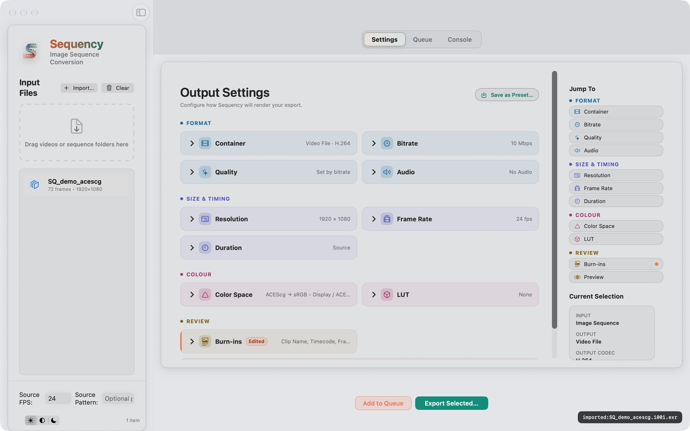

### Sequency

Convert camera RAW and image sequences to ProRes, H.264 or EXR on a Mac, without a Resolve project.

Sequency is a native Mac converter for camera RAW and image sequences. It turns Blackmagic RAW, ARRIRAW/ARRI MXF, EXR, DPX, TIFF and MKV into ProRes, H.264, HEVC or EXR, with OpenColorIO/ACES colour management, LUTs, burn-ins with timecode, a batch queue and a command-line tool. Everything is processed locally on your Mac.

It's a one-off purchase on the Mac App Store. Made by George Antonopoulos, a compositor.

[!button text="Visit Website" target="blank" variant="info"](https://www.sequencyapp.com)
