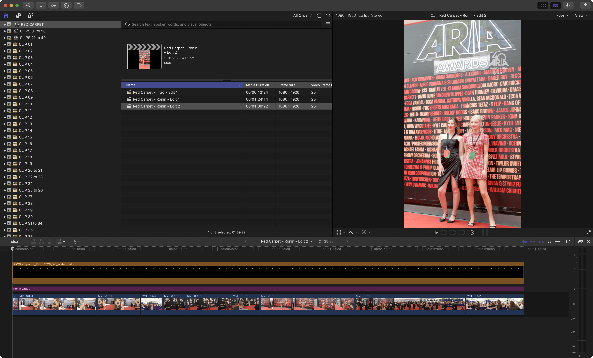
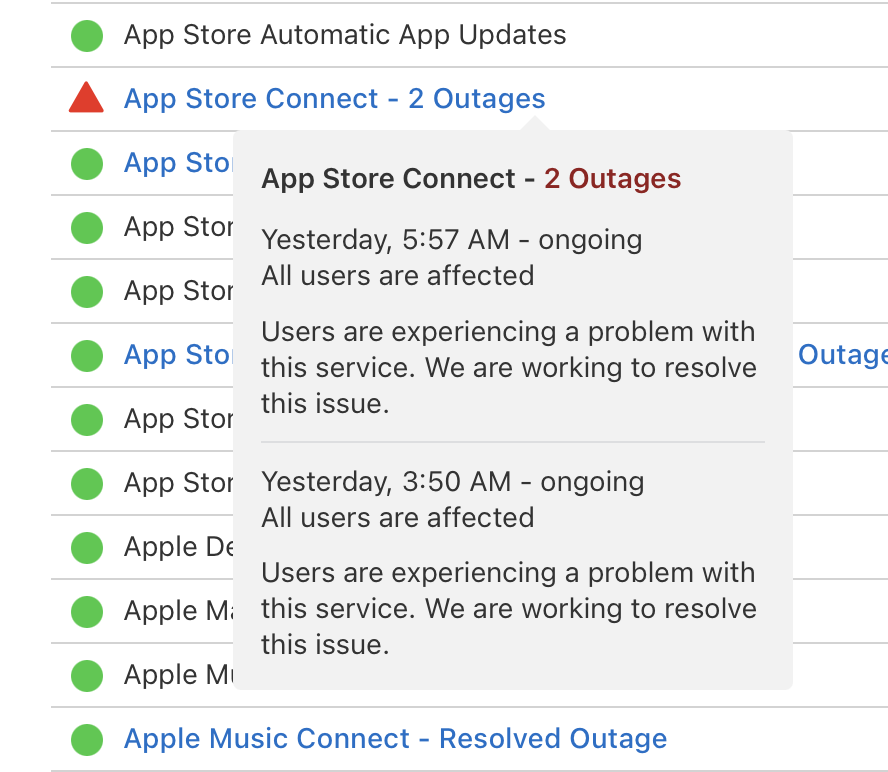
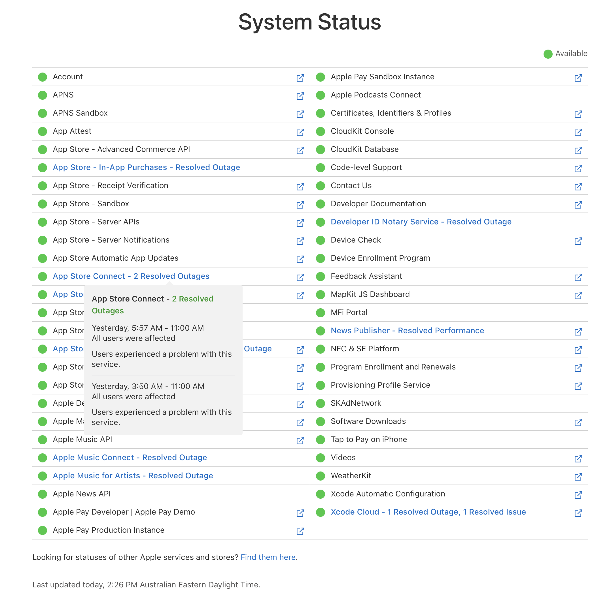
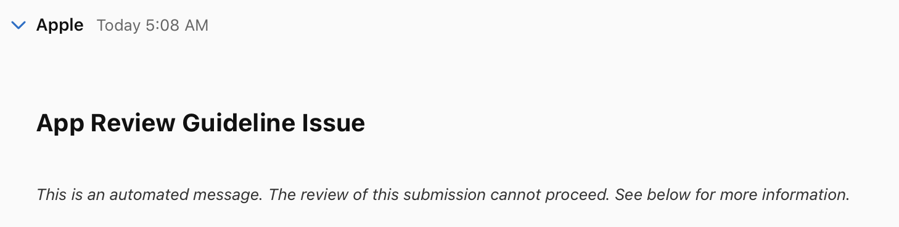
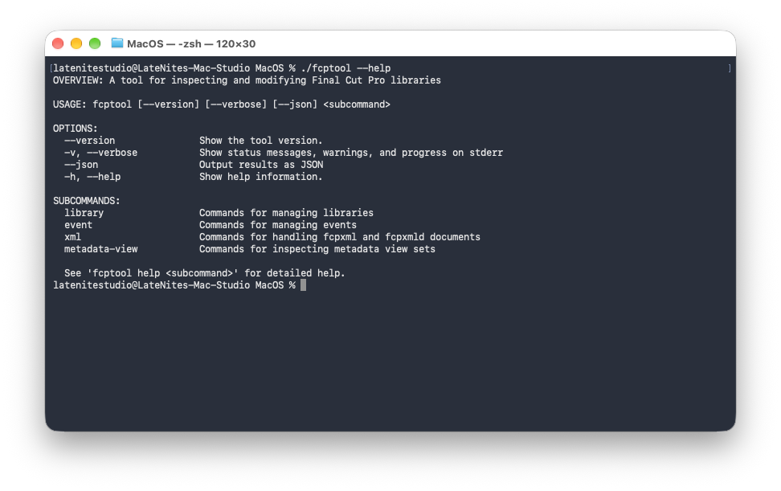
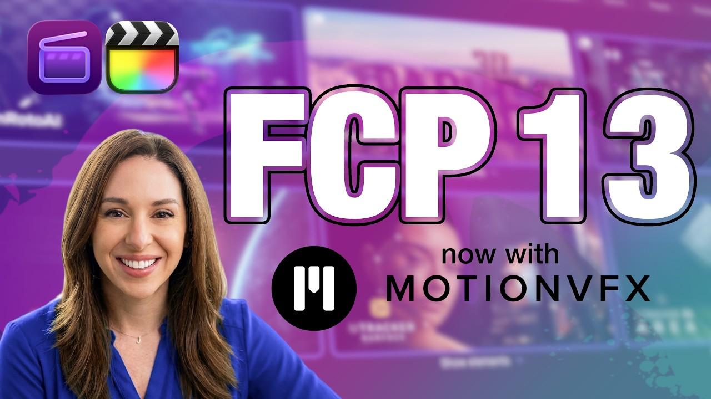
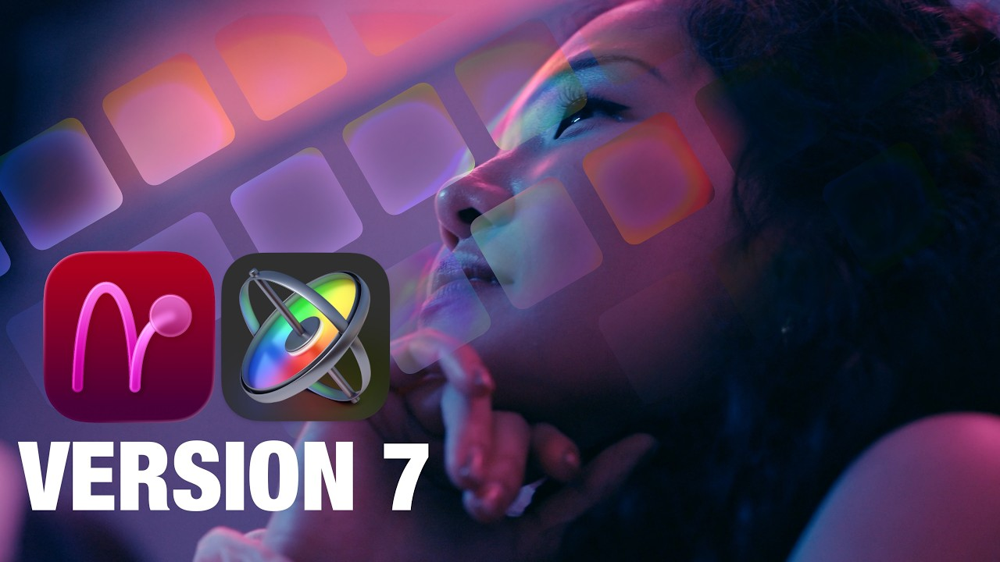

Happy Thursday! I'm back in beautiful Melbourne. Home at last! 🥳

Yesterday I was up in Sydney for the [ARIA Music Awards](https://www.aria.com.au) - doing fast turnaround edits in Final Cut Pro (although the rest of the team was in Blackmagic DaVinci Resolve). 🎸



Everything worked perfectly - however, one REALLY annoying thing about Final Cut Pro that's a big deal is that Final Cut Pro doesn't support Blackmagic **growing files** that DaVinci Resolve can use.

This SUCKS. Whilst Final Cut Pro can support SOME growing files - the fact it can't support growing files from Blackmagic HyperDeck's is a MAJOR workflow pain.

As usual, Apple has it's own method for growing files - see: [Sending media to Final Cut Pro as it’s recorded](https://developer.apple.com/documentation/professional-video-applications/sending-media-to-final-cut-pro-as-it-s-recorded?language=objc).

Sadly, Blackmagic doesn't use this method - so no growing files in Final Cut Pro. 😭

I've started creating an app to workaround this - but I really shouldn't have to - HOPEFULLY this is something Apple can easily fix. Otherwise, maybe I'll just push the fix to [SpliceKit](https://splicekit.fcp.cafe).

I've filed feedback to Apple via Feedback Assistant ID: **FB25636418**

Here's what it says:

> **SUMMARY**
> Final Cut Pro can edit a QuickTime movie while it is still recording only if the recorder writes movie fragments ("Sending media to Final Cut Pro as it's recorded"). Blackmagic HyperDeck recorders writing to a Blackmagic Cloud Store keep the file editable in a different way, so Final Cut Pro imports their in-progress recordings as ordinary fixed-length clips. DaVinci Resolve edits the same files while they record. Please recognise this kind of file as a growing file.
>
> **HOW THE RECORDER WRITES THE FILE**
> Observed on ProRes 422 1080p50 recordings (2-channel 24-bit PCM, timecode track):
> - Layout: ftyp (24 bytes), one mdat with a 64-bit size, then a complete moov as the last box. Ordinary sample tables (stts, stsc, stsz, co64). No mvex and no moof.
> - Every 5 seconds of recording, the new media is written over the previous moov, a new complete moov is appended, and the mdat size in the header is patched. Between updates the file is a complete, self-contained movie containing everything recorded so far. Existing samples never move.
> - While recording, the file has the extended attribute com.blackmagicdesign.metadata:recording = {"r":1, "uuid":"..."} and an empty .mcc sidecar next to it. Both are removed when recording stops.
>
> **STEPS TO REPRODUCE**
> With Blackmagic hardware:
> 1. Record ProRes QuickTime on a HyperDeck to a Blackmagic Cloud Store and mount the share on the Mac.
> 2. While it records, import the clip into Final Cut Pro with "Leave files in place".
>
> Without hardware, using the attached files:
> 1. Run: python3 bmd_growing_sim.py seed_prores422_1080p50.mov ~/Movies/GrowingTest/TEST_0001.mov --seconds 300
>    It writes a test pattern in real time with the layout, 5-second update, extended attribute and sidecar described above.
> 2. While it runs, import TEST_0001.mov into Final Cut Pro with "Leave files in place".
>
> **EXPECTED RESULTS**
> The clip is treated as a growing file: it gets longer as recording continues, the same as a fragmented QuickTime movie or a growing MXF file.
>
> **ACTUAL RESULTS**
> AVAsset.containsFragments is NO for these files. From what I can see in Final Cut Pro 12.3, QuickTime media is only marked as growing when that property is YES (FFAVFMediaReader::initMetadata in Flexo).
>
> **NOTES**
> 1. Opening the file during an update can fail. AVURLAsset returned AVFoundationErrorDomain -11829 "Cannot Open" (underlying OSStatus -12848) on 2 of 6 opens of a live recording over SMB. The simulator has the same window on every update (its --torn option sets the length), and opening the file inside it gives the same error. A refresh would need to retry instead of treating the clip as damaged.
> 2. The media itself works as a growing file. The attached growbridge.py writes a second, small QuickTime file that holds only an index: a moov with mvex, then a moof every 10 seconds, with data references that point into the Blackmagic file. For that file AVFoundation reports containsFragments = YES, the duration increases every 10 seconds while recording, and the sample data read through it is byte-identical to the source. I checked this on live and finished HyperDeck recordings.
>
> **REQUEST**
> Treat a QuickTime movie as growing when either:
> (a) the recorder has marked it, using the Blackmagic extended attribute above or a marker Apple documents for recorders that don't write fragments (the QuickTime equivalent of the MXF "duration unknown" rule), or
> (b) its modification date changes after import and re-reading it gives the same tracks with a longer duration.
> Then refresh it on the same schedule as a fragmented growing file.
>
> **CONFIGURATION**
> Final Cut Pro 12.3, macOS 26.5 (25F71), MacBook Pro (M1 Max, MacBookPro18,2).
> Recorder: Blackmagic HyperDeck recording to a Blackmagic Cloud Store Max 24TB, mounted over SMB.

Fingers and toes crossed Apple can fix! 🤞

I also have a Feedback Assistant submission **FB25636450** for: **Quick Look in Finder spins forever on a QuickTime reference movie whose media is on an SMB volume**.

So work adventures aside... yesterday was... interesting. 😬

**Final Cut Pro v13** was SUPPOSED to ship, and Apple Marketing gave all the influencers and media people permission to post, but alas, Apple had some MAJOR outages, and App Store Connect was totally busted.



Apple said:

> “Many of our systems are back up and running after an internal update caused some outages this morning,” an Apple spokesperson had told NBC News early in the afternoon. “We’re working to get the remaining systems online as soon as possible.”

Whilst most services were restored pretty quickly... **App Store Connect** took a long while to finally get fixed.



It's pretty scary and crazy that it can take over a day to fix an outage like this.

Putting on my conspiracy theory hat, today was also the first time I've ever seen this:



Apple adds AI review to App Store Connect... then... boom. 💥

It's pretty disappointing that Apple hasn't said anything or sent out an apology letter to developers.

We're giving them 15-30% of all our income when we sell stuff on the Mac App Store, and we get NO explanation or help with a MAJOR update that spans multiple days. That's pretty poor form.

But, the good news is... the outage is fixed, and **Final Cut Pro v13** is out now on the Mac App Store! 🥳

There's already [some bug reports](https://www.youtube.com/shorts/IuIH_0Yui0o) in Final Cut Pro v13 - so tread with care.

Our [Upgrade Guide](/update-guide/) has been updated.

The handsome, talented and clever Iain Anderson has posted a detailed blog post over on ProVideo Coalition: [Final Cut Pro 13 — a deep dive](https://www.provideocoalition.com/final-cut-pro-13-a-deep-dive/).

**Always make a backup of the Final Cut Pro application and your libraries before updating!**

Ok... let's go... 🚀

The official release notes say:

**New features in Final Cut Pro in Apple Creator Studio:**

- **Built-in Motion VFX:**
 - Transform your video projects with the full power of MotionVFX, with access to a large collection of effects, titles, transitions, and more.
 - Elevate your edits with powerful visual effects, featuring advanced AI rotoscoping, intelligent 3D camera and surface tracking, and dynamic 2D animation tools.
 - Browse, preview, and apply MotionVFX assets right from a dedicated tab, or pop the panel out into a standalone floating window for a flexible multi-display workspace.

- **Integrated Media Library and Advanced Image Tools:**
 - Tap into the Content Hub, a library of Apple-curated stock videos, photos, and backgrounds to finish your edits or spark new projects.
 - Generate high-quality images from a text description right in your project, apply quick edits, and adjust the style.
 - Open an image from your timeline in Pixelmator Pro to use advanced editing tools, then see your changes in Final Cut Pro.

- **New features for Final Cut Pro (one-time purchase) and Final Cut Pro in Apple Creator Studio:**
 - **Workflow Enhancements:**
  - Keep timeline clips in place by disconnecting them from the primary storyline, combining precise control with the full power of the Magnetic Timeline.
  - Animate your footage with more precise keyframe easing options to fine-tune speed, position, scale, and more.
  - Add realistic, optical-flow-based Natural Motion Blur to any video clip using an intuitive shutter angle slider with full support for retimed footage.
  - Generate captions and search transcripts in 23 new supported languages.*
  - Closed captions now default to the SRT format when adding them manually or using Generate Captions.
  - Use intuitive two-finger trackpad gestures to zoom and navigate the viewer.
  - Updates FCPXML to version 1.15.

**Bug Fixes:**
- Fixes an issue where creating a new event left the search field active, preventing keyboard shortcuts from working.
- Fixes an issue that prevented on-screen controls from appearing when editing titles in the viewer.
- Fixes an issue where ease settings for the Ken Burns effect were not saved.
- Fixes an issue where Match Color applied incorrect adjustments in Wide Gamut HDR libraries when clips contained prior color corrections.
- Fixes an issue where searching transcripts in the browser failed if words did not include accents or special characters.
- Fixes an issue that caused an unnecessary warning alert to appear when importing an FCPXML with retimed clips.
- Improves playback performance and memory efficiency when working with RED RAW media.
- Fixes an issue where third-party A/V output devices failed to reconnect after waking a Mac from sleep.
- Improves touch responsiveness and timeline gesture navigation when using Final Cut Pro on an iPad with Sidecar.
- Includes stability and performance improvements.

**Motion v7.0** includes new features, enhancements, and fixes:

- **New features for Motion in Apple Creator Studio:**
 - **Built-in MotionVFX:**
  - 3D object tracking
  - Lens flares
  - Animated graphics from static images
  - Stylized visual effects
- **Advanced Image Tools:**
  - Generate high-quality images from a text description right in your project, apply quick edits, and adjust the style.
  - Open an image from your project in Pixelmator Pro to use advanced editing tools, then see your changes in Motion.

- **New features for Motion (one-time purchase) and Motion in Apple Creator Studio:**
 - **Creative and Animation Enhancements:**
  - Animate your graphics with more precise keyframe easing options in the Canvas and Keyframe Editor to fine-tune speed, position, scale, and more.
  - Add dynamic visual distortion to your graphics and video using the new Displacement filter, featuring customizable refraction, chromatic aberration, and preset styles.

- **Bug Fixes:**
 - Fixes an issue that prevented using the Space bar to pan in the Keyframe Editor.
 - Fixes an issue where adjusting curve handles in the Keyframe Editor could cause the view to jump when Auto-Scale was disabled.
 - Fixes an issue where choosing Ease Both on a keyframe caused its curve setting to display incorrectly in the Keyframe Editor.
 - Fixes an issue where adding keyframes across multiple selected layers could cause Motion to stop responding.
 - Fixes an issue where moving an animated object before its first keyframe could unexpectedly change the shape of an animation path.
 - Fixes an issue where onscreen controls failed to display motion paths created by Behaviors.
 - Improves performance and responsiveness when scrubbing clips with a Magnetic Mask applied.
 - Fixes an issue where replicators did not display at full HDR brightness when using Automatic color processing.
 - Fixes an issue that could cause Motion to quit when adding the Unstabilize tracking behavior to a clip.
 - Fixes an issue that could cause Motion to quit when opening a project that contains missing text styles.
 - Improves touch responsiveness and drawing accuracy when using Motion on an iPad with Sidecar.
 - Includes stability and performance improvements.

**Compressor v6.0** includes the following enhancements and fixes:

- Apply Cinematic mode effects to video recorded with iPhone 18 Pro or iPhone Duo. (Requires macOS 27 or later.)
- Use the Update Droplets button in Advanced settings to convert existing droplets to watch folders.
- Fixes an issue preventing batches from starting for Add to TV Home Videos job action.
- Fixes an issue where the Run Automator Workflow job action failed.
- Fixes a crash that occurs when caption text dictated using Siri is used in a batch.
- Fixes an issue where the Privacy & Analytics window does not appear when selected from the Compressor menu.
- Fixes an issue where video preview is not shown when file is selected using VoiceOver.
- Fixes an issue where VoiceOver plays on a loop in the Active tab while a job is processing.
- Transcoded files save to the Movies folder by default; the Source and Automatic built-in locations are no longer available.
- Removes Save as Droplet option.
- Includes stability and performance improvements.

**Final Cut Pro for iPad v4.0** includes the following features and enhancements:

- Tap into the Content Hub, a library of Apple-curated stock videos, photos, and backgrounds to finish your edits or spark new projects.
- Generate high-quality images from a text description right in your project, apply quick edits, and adjust the style.
- Open an image from your timeline in Pixelmator Pro to use advanced editing tools, then see your changes in Final Cut Pro.
- Keep timeline clips in place by disconnecting them from the primary storyline.
- Animate your footage with more precise keyframe easing options to fine-tune speed, position, scale, and more.
- Generate captions and search transcripts in 23 new supported languages. (Requires iPadOS 27 or later.)

**Improvements and bug fixes:**
- Reveal the source of any timeline clip in the browser.
- Fixes an issue that prevented the inspector from updating when the active video angle of a multicam clip was changed.
- Addresses an issue that caused crop values to not be applied after the onscreen keypad was closed.
- Resolves an issue that prevented audio fade values from updating after an undo.
- Improves reliability when entering audio fade values in languages that use a comma as the decimal separator.
- Fixes an issue that caused opening the browser to take focus away from a timeline selection.
- Addresses an issue that prevented media analysis from resuming after a browser clip was selected while analysis was paused.
- Resolves an issue that caused Cinematic mode focus points to not appear after leaving and then returning to Final Cut Pro.
- Fixes an issue that caused the Edit button in the Keywords panel to disappear after all keywords were deleted.
- Addresses an issue in the angle editor that allowed the viewer to be dragged offscreen.
- Improves reliability when tapping a Live Multicam angle’s camera settings.
- Resolves a Live Multicam issue that interrupted the video preview from a connected device after its color space was changed.
- Improves VoiceOver support for moving onscreen keyboards and settings panels.
- Improves VoiceOver support for navigating a browser clip’s Media Info settings in the inspector.
- Fixes an issue that caused VoiceOver navigation to stop at the viewer options when the inspector was open.
- Addresses an issue that caused the playback controls to scale inconsistently when enabling the Larger Text accessibility setting.
- Resolves an issue that prevented Background Tasks from being dismissed with Voice Control.
- Adds caption support to the Introducing Allie Sherlock demo project preview.
- Includes other stability and performance improvements.

**New keyboard shortcuts:**
- Disconnect Connected Clips: Option-Grave Accent (\`)
- Go to Range Start: Shift-I
- Go to Range End: Shift-O
- Select Clip Above: Command-Up Arrow
- Select Clip Below: Command-Down Arrow
- Show/Hide Keyword Editor: Command-K
- Show/Hide Video Animation Editor: Control-V
- Show/Hide Angles: Shift-Command-7
- Show/Hide Video Scopes: Command-7
- Clip Mode: A
- Range Mode: R
- Edge Mode: T
- Reveal Source in Browser: Shift-F
- Apply Dialogue Role: Control-Option-D
- Apply Effects Role: Control-Option-E
- Apply Music Role: Control-Option-M
- Apply Titles Role: Control-Option-T
- Apply Video Role: Control-Option-V
- Exit Full-Screen Playback: Escape
- Copy Keyframes: Option-Shift-C
- Cut Keyframes: Option-Shift-X
- Paste Keyframes: Option-Shift-V

**Final Cut Camera v3.0** includes the following improvements and bug fixes:

- Improves the appearance of the false color overlay when monitoring HDR footage.
- Fixes an issue that caused the timecode to always switch to External Source after quitting and reopening the app.
- Addresses an issue that caused the monitoring panel to open incorrectly after a two-finger tap was used to hide and show the interface.
- Resolves an issue that caused monitoring tools to turn off after the media browser was opened and closed.
- Fixes an issue that prevented settings from switching to manual when locking AE/AF in a priority mode.
- Addresses an issue that caused the ISO slider to not appear when switching from the front camera to the rear camera with manual exposure enabled.
- Resolves an issue that prevented the zoom level from returning to 1x after turning off digital zoom while zoomed in.
- Includes stability and performance improvements.

For the developers amongst us...

There's a new [Creator Studio Document Format](https://github.com/apple/creator-studio-doc-format).

The **FxPlug v4.3.6** SDK includes the following:

- Improved stability and reliability.
- FxPlug SDK requires macOS 14.6 or later.
- `FxRemoteWindowAPI_v4` allows plug-ins to request a remote window by specifying its minimum and maximum size, style mask, appearance, and background color.
- FxGenerator plug-ins should not use parameter IDs 300, 301, or 302. These are reserved for the generator's Width, Height, and Pixel Aspect Ratio parameters. The host currently allows them and logs a warning, but a future version will reject them.
- Fixed an issue where setting the interpolation type of one keyframe with `FxKeyframeAPI` changed all keyframes on the parameter.
- Fixed an issue where custom parameter data set more than once at the same time created an extra keyframe.
- Fixed an issue where exported FCPXML files for effects with custom parameter data could grow excessively large.
- Fixed an issue where custom UI parameters could corrupt the Inspector layout on launch in Final Cut Pro.
- Fixed an issue where Inspector controls were clipped for effects stacked with an effect using full-width custom parameter UI.
- Fixed an issue where FxAnalysisAPI plug-ins could use another app's analyzer extension when multiple versions of Final Cut Pro or Motion are installed.
- Fixed an issue where Final Cut Pro could consume excessive memory while running FxAnalysisAPI plug-ins.
- Fixed memory leaks during dynamic plug-in registration.
- The `FxAnalysisAPI` start methods now return YES when the host accepts an analysis request, which may be before analysis actually begins. While a pass is running, the host can queue one more request, including one made from `-cleanupAnalysis:`. Wait for `-setupAnalysisForTimeRange:frameDuration:error:` before you expect frames. Don't call a start method a second time to check whether analysis is already running.
- Added the `-setRemoteWindowFrame:` and `-remoteWindowWithContentRect:minimumSize:maximumSize:windowCentered:windowStyleMask:appearance:backgroundColor:reply:` methods to `FxRemoteWindowAPI_v4`.
- Updated the XPC connection version to 12.

**Workflow Extensions SDK v1.0.3** remains the latest - no updates there sadly.

**FCPXML v1.15** is out now with some additions:

```
<!ENTITY % ao_attrs "
	lane CDATA #IMPLIED
	offset %time; #IMPLIED
	flags CDATA #IMPLIED
">

<!ATTLIST keyframe interp (linear | ease | easeIn | easeOut | hold | bezier | passthrough) "linear"> <!-- interpolation type for point. -->

<!ATTLIST pan-rect interp (linear | ease | easeIn | easeOut ) "ease">

<!-- An 'adjust-natural-motion-blur' defines the intrinsic Natural Motion Blur effect. It is supported only on primitive 'video' elements. -->
<!ELEMENT adjust-natural-motion-blur (param*)>
<!ATTLIST adjust-natural-motion-blur enabled (0 | 1) "1">
<!-- amount is #IMPLIED (0-100); when absent the application assumes the effect's default. -->
<!ATTLIST adjust-natural-motion-blur amount CDATA #IMPLIED>

<!-- The primitive video intrinsic params are a superset of intrinsic-params-video, adding adjustments supported only on 'video' elements. -->
<!ENTITY % intrinsic-params-primitive-video "(%intrinsic-params-video;, adjust-natural-motion-blur?)">


<!ELEMENT video (param*, note?, %timing-params;, %intrinsic-params-primitive-video;, (%anchor_item;)*, (%marker_item;)*, (%video_filter_item;)*, reserved?)>

<!ATTLIST gap flags CDATA #IMPLIED>

<!ENTITY % mask_item "(mask-shape | mask-isolation | mask-semantic)">

<!-- The 'mask-semantic' element describes a semantic mask used for a mask filter. -->
<!ELEMENT mask-semantic (param*)>
<!ATTLIST mask-semantic name CDATA #IMPLIED>
<!ATTLIST mask-semantic enabled (0 | 1) "1">
<!ATTLIST mask-semantic blendMode (add | subtract | multiply) "add">
<!ATTLIST mask-semantic type CDATA #IMPLIED>

<!ATTLIST conform-rate frameSampling (floor | nearest-neighbor | frame-blending | optical-flow-classic | optical-flow | optical-flow-frc | vsa-motion-blur) "floor">

<!ATTLIST timeMap frameSampling (floor | nearest-neighbor | frame-blending | optical-flow-classic | optical-flow | optical-flow-frc | vsa-motion-blur) "floor">
```

This is AWESOME, and ticks off a bunch of stuff we requested for [Metaburner](https://metaburner.fcp.cafe). THANK YOU APPLE!

But the big/interesting news is under the hood with a new addition of `fcptool` CLI:



This isn't MCP, and it really isn't for end users - it's for developers and companies like Hedge to improve [PostLab](https://hedge.co/products/postlab).

It'll be super interesting to see what happens with this!

FWIW - **CommandPost v3** will have full support of the CLI.

Ok... we'll get REALLY nerdy in a sec, but first...

The amazing **Jenn Jager** has posted some great videos on YouTube:

[](https://www.youtube.com/watch?v=OjHScukQhk0)

[](https://www.youtube.com/watch?v=WrdvrmVqhIU)

**Rafael Ludwig** has posted a video titled: **Apple Actually Did It... MotionVFX in Final Cut Pro**:

[](https://www.youtube.com/watch?v=cwN4BJ5YF1o)

Ok, with the fun videos out of the way... let's get REALLY nerdy...

YES - I used various internal tools and LLMs to put this together...

A few things to know before we dive in:

- This compares what's inside the **Final Cut Pro 12.4** (build 454072) and **Final Cut Pro 13.0** (build 460023) app bundles. Both are the one-time purchase version (`com.apple.FinalCut`), so the Apple Creator Studio version isn't covered here.
- Almost all of it comes from reading the two app bundles, not from running the apps.
- Anything marked **Inferred** is an educated guess based on class names, strings or disassembly. It's not something Apple has documented.
- Not a developer? Read the summary below, then skim the *In short* line at the top of most sections.

Here's the big nerdy under-the-hood changes:

1. **There's a new command-line tool.** `fcptool` lives inside the app at `Contents/MacOS/fcptool`. It's a sandboxed Swift tool that loads Flexo (the core Final Cut Pro framework) directly, with 12 commands in four groups (`library`, `event`, `xml` and `metadata-view`), each with a `--json` option. Two more groups, `timeline` (5 commands) and `access` (4 commands), are compiled in but not registered. The code is in there, but you can't run them.
2. **FCPXML 1.15 is here, and it's now the export default.** It adds two elements, a `flags` attribute on every anchored item, three keyframe interpolation values and one frame sampling value. The 1.13 and 1.14 DTDs are byte-identical to the ones in 12.4.
3. **Five new commands.** Four are added to `NSProCommands.plist` (572 to 576) and one to `NSProCommandsAdditional.plist` (0 to 1). None is removed or renamed. Every language's default command set grows from 398 to 402 entries.
4. **The main menu gains six items and loses none.** No existing item changes its title, shortcut, action or tag in `MainMenu.nib`.
5. **Seven new frameworks** (54 to 61 top-level entries): `AppEditIn`, `ArgumentParser`, `ArgumentParserToolInfo`, `MVFXAuth`, `MVFXContentKit`, `MVFXDecrypt` and `ProAppUI`. None is removed. Of the 146 binaries (Mach-O files) both releases share, 106 were rebuilt and 40 are the same code.
6. **A lot of new code.** Objective-C classes go from 8,794 to 9,009 (226 added, 11 removed) and protocols from 1,980 to 2,027. In the binaries both releases share, 1,338 selectors (methods) are added and 422 removed. Flexo accounts for 732 and 205 of those.
7. **New subsystems:** MotionVFX content delivered through a Workflow Extension, Edit in Pixelmator Pro, image generation, the Content Hub, unconnected clips (called “static clips” internally), keyframe easing, Natural Motion Blur, transcription languages and regions, and touch input handling.
8. **AppleScript and Shortcuts haven't moved.** The AppleScript dictionary is unchanged (`ProEditor.sdef` has the same SHA-256) and remains read-only. No Shortcuts or App Intents metadata exists in either release. One URL scheme is new: `com.apple.apps.finalCutPro-edit-in`.
9. **Accessibility is almost unchanged in the interface files:** one description changed and two help tags were added across 632 nibs. In code, though, TimelineKit now adds a space after the delimiter in timeline item descriptions, so “AV-Clip:Smoke Clip A” in 12.4 becomes “AV-Clip: Smoke Clip A” in 13.0. Worth knowing if you automate Final Cut Pro through Accessibility.

Before we go deeper, here's a quick cheat sheet for the names that come up over and over:

- **Flexo** is the core Final Cut Pro framework: libraries, the editing model and most of the interface. Its classes start with `FF`.
- **TimelineKit** draws and handles the timeline (`TLK`).
- **Ozone** is the Motion engine that lives inside Final Cut Pro (`OZ`).
- **LunaKit** is the Pro Apps interface toolkit: windows, panels, commands and the Command Editor (`LK`).
- **ProCore** is shared Pro Apps plumbing (`PC`).
- **Interchange** handles FCPXML import and export (`IX`).
- **DeepSkyLite** is the database layer that libraries are saved with (`DS`).
- **ProEditor** is the internal project name for the Final Cut Pro app itself (`PE`).
- A **nib** is a compiled interface file (a window, menu or panel layout), a **selector** is the name of an Objective-C method, a **Mach-O** file is a Mac executable or framework binary, and a **DTD** is the rulebook that defines what a valid FCPXML file can contain.

**Architectures and size:**

*In short: still a universal app (Intel and Apple silicon), and only about 58 MB bigger. About 36 MB of that is a MotionVFX promo video.*

- 12.4 has 146 binaries (Mach-O files) and 13.0 has 154. In both, all but five are universal (`x86_64` and `arm64`). The same five codec binaries are still Intel-only (`x86_64`): `AppleAVCIntraEncoder`, `AppleAVCLGCodecEmbedded`, `AppleHEVCProCodec`, `mc_dec_avc` and `mc_dec_hevc` (checked with `lipo -archs`).
- The file count rises from 38,253 to 38,662, and symbolic links from 319 to 340.
- Added together, the file sizes rise from 7,709,281,215 to 7,767,411,303 bytes. That's an increase of 58,130,088 bytes (about 58 MB), or 0.75%. Disk usage is not comparable, because the installed 13.0 copy is stored compressed by the App Store.
- Comparing every file by its SHA-256 digest: 1,470 files added, 1,040 removed, 1,262 changed and 36,270 identical.
- The growth is mostly in `Contents/Resources` (61,353,830 to 100,854,768 bytes). `MotionVFXPromoBackground.mp4` is 35,923,292 bytes (about 36 MB), `MVFXManifest.bundle` is 1,410,358 bytes and `Assets.car` grows by 1,850,752 bytes. `Contents/MacOS` grows by 5,040,336 bytes: the application binary grows from 6,252,448 to 8,161,200 bytes (+30.5%) and `fcptool` adds 3,131,584 bytes.

**Signing and entitlements:**

*In short: signed and sandboxed exactly as before. Entitlements are the permissions baked into an app's signature, and the only changes are a new app group for MotionVFX and seven entitlements for `fcptool`.*

- Both releases are signed by `Apple Mac OS Application Signing` under `Apple Worldwide Developer Relations Certification Authority` and `Apple Root CA`, team `PTN9T2S29T`, with the hardened runtime flag. Both carry `Contents/_MASReceipt/receipt`.
- The application has 30 entitlement keys in both releases. One value changes: `com.apple.security.application-groups` gains `PTN9T2S29T.com.apple.motionvfx` beside `PTN9T2S29T.com.apple.VAWorkspace` and `PTN9T2S29T.com.apple.videoProApps`.
- The sandbox is otherwise the same: `com.apple.security.app-sandbox`, the absolute path read and write exception for `/`, the Apple events exceptions for `com.apple.itunes`, `com.apple.mail`, `com.apple.motionapp` and `com.apple.TV`, the scripting target `com.apple.Photos` with `com.apple.Photos.spotlight`, the Mach lookup exception `com.newtek.NDIAssistant` and the same fifteen `sbpl` rules.
- The entitlement key counts of the eight nested executables are unchanged: `ProMSRendererTool_sb` 2, `FCPAEHelper` 5, `OOPDebayerService` 3, `OOPProResRawService` 2, `RegisterProExtension` 5, `ProTranscoderTool_sb` 2, `FxAnalyzer` 1 and `InternalFiltersXPC` 1.
- `fcptool` is new, signed as `com.apple.FinalCut.fcptool` with its own seven entitlements (listed in the command-line tool section further down).

**Info.plist:**

*In short: `Info.plist` is where an app declares what it is and what it can open. It has just five differences, and the interesting one is a new URL scheme.*

`Contents/Info.plist` has five differences. Everything else is identical, including `CFBundleDocumentTypes`, `UTExportedTypeDeclarations`, `UTImportedTypeDeclarations`, the four privacy usage strings, `NSAppleScriptEnabled`, `OSAScriptingDefinition` (`ProEditor.sdef`) and `NSPrincipalClass` (`PEApplication`).

| Key | 12.4 | 13.0 |
| --- | --- | --- |
| `CFBundleShortVersionString` | 12.4 | 13.0 |
| `CFBundleVersion` | 454072 | 460023 |
| `CFBundleURLTypes` | absent | one entry: name and scheme `com.apple.apps.finalCutPro-edit-in`, role `Editor` |
| `CKSendToCompressorMatchIndex` | 3 | 4 |
| `SKIncludeConsumableInAppPurchaseHistory` | absent | true |

Neither Info.plist has `NSServices`, `NSUserActivityTypes` or any intents key. Neither bundle contains a `Metadata.appintents` folder, an `.intentdefinition` file or `extract.actionsdata`. So there's still nothing here for Services or Shortcuts.

**Helpers, services and plug-ins:**

The sets are identical in both releases (directory listings):

- XPC services in Flexo: `FCPAEHelper.xpc`, `OOPDebayerService.xpc` and `OOPProResRawService.xpc`.
- `Contents/Helpers/RegisterProExtension.app`, `Flexo.framework/Versions/A/Helpers/ProMSRendererTool_sb` and Compressor's `ProTranscoderTool_sb`.
- `Contents/PlugIns`: `Codecs`, `Codecs-x86-only`, `Compressor`, `DAL`, `FormatReaders`, `FxAnalyzer.appex`, `InternalCodecs`, `InternalFiltersXPC.pluginkit`, `MediaProviders` and `RADPlugins`, with the same bundles inside each.

The only new executable is `Contents/MacOS/fcptool`.

**New frameworks and binaries:**

`Contents/Frameworks` has 54 entries in 12.4 and 61 in 13.0. Nothing is removed.

| New binary | Identifier | Version (build) | Bytes | Linked by | Role |
| --- | --- | --- | ---: | --- | --- |
| `AppEditIn.framework` | `com.apple.AppEditIn` | 1.0 (30) | 748,880 | Flexo, weak | Edit sessions shared between Apple apps, and a Pixelmator document reader |
| `ArgumentParser.framework` | `com.apple.ArgumentParser` | 1.0 (1) | 2,961,424 | `fcptool` | Swift Argument Parser |
| `ArgumentParserToolInfo.framework` | `com.apple.ArgumentParserToolInfo` | 1.0 (1) | 402,992 | `fcptool`, `ArgumentParser` | Swift Argument Parser tool description |
| `MVFXAuth.framework` | `com.apple.motionvfx.mvfxauth` | 1.0 (1) | 415,424 | application | MotionVFX access tokens, kept in the keychain |
| `MVFXContentKit.framework` | `com.apple.MVFXContentKit` | 1.0 (1) | 330,976 | application, `MotionEffect.fxp` weak | MotionVFX manifest, download and install |
| `MVFXDecrypt.framework` | `com.apple.motionvfx.mvfxdecrypt` | 1.0 (1) | 241,216 | application, `MotionEffect.fxp` weak | MotionVFX content decryption |
| `ProAppUI.framework` | `com.apple.ProAppUI.ProAppUI` | 1.0 (460000.0.3) | 366,416 | application | SwiftUI theme tokens |
| `Contents/MacOS/fcptool` | `com.apple.FinalCut.fcptool` | 13.0 (460000.0.23) | 3,131,584 | none | Command-line tool |

The roles are inferred from class and string names. In the “Linked by” column, “weak” means the link is optional, so the binary still loads if that framework is missing.

**Changed binaries:**

Of the 146 binaries both releases have, 40 have the same `LC_UUID` (a build fingerprint) and size, so their code is unchanged and at most the signature differs. They are the whole of EDEL apart from two Swift interface frameworks, `MusicUnderstandingEmbedded`, `AudioMixEngine`, the neural tracker frameworks, `SwiftASN1` and most codecs. The other 106 were rebuilt. Many rebuilt binaries have the same size and differ only in their embedded project version.

The size changes that suggest real work was done:

| Binary | 12.4 bytes | 13.0 bytes | Change |
| --- | ---: | ---: | --- |
| `Final Cut Pro` | 6,252,448 | 8,161,200 | +30.5% |
| `DeepSkyLite` | 585,760 | 745,024 | +27.2% |
| `StompTypes` (Compressor) | 4,220,320 | 5,003,440 | +18.6% |
| `OOPDebayerService` | 145,472 | 162,960 | +12.0% |
| `AppleProResRAWCodecEmbedded` | 459,920 | 509,152 | +10.7% |
| `ProOnboardingFlowModelOne` | 1,526,528 | 1,657,568 | +8.6% |
| `AudioAnalysis` | 673,760 | 726,736 | +7.9% |
| `ProChannel` | 3,625,168 | 3,824,656 | +5.5% |
| `CloudContent` | 5,962,000 | 6,230,560 | +4.5% |
| `TimelineKit` | 6,322,000 | 6,471,632 | +2.4% |
| `ProCore` | 4,455,440 | 4,559,664 | +2.3% |
| `Interchange` | 6,338,080 | 6,480,160 | +2.2% |
| `Ozone` | 29,188,544 | 29,652,176 | +1.6% |
| `Flexo` | 78,772,992 | 79,731,952 | +1.2% |
| `LunaKit` | 5,140,672 | 5,198,560 | +1.1% |
| `FxPlugProvider` | 771,968 | 736,192 | -4.6% |

No binary shrank or grew enough to suggest a rewrite of an existing framework. The application binary grew most because the MotionVFX, feature promotion and launch presentation code lives there. DeepSkyLite, the layer that saves libraries to disk, replaced its save and sync coders (`DSSaveContext`, `DSSyncContext`) with `DSEncoder` and `DSDecoder`.

Notable bundle version changes: `FxPlug` 4.3.5 to 4.3.6, the embedded Compressor frameworks 5.4 to 6.0, `AppleMediaServicesKit` 2026.1.5 to 2026.26.28, `CloudContent` and `PMLCloudContent` build 1 to 41.5.6, `AppAnalytics` build 573 to 595, `MXFExportSDK` 236.1.3 to 237.0.4, `VAML` 45.4.1 to 45.8.1 and the ProRes codecs 60804 to 60810.

**Linked library changes:**

*In short: what a binary links against shows what it has started (or stopped) using. Flexo and Ozone now reach for four image generation frameworks that aren't inside the one-time purchase app.*

- **Flexo** adds weak links to `AppEditIn`, `AppImageGenerationModel`, `AppImageGenerationUI`, `AppsGen` and `AppsGenUI`, and to the Swift overlays `libswiftIntents`, `libswiftCoreLocation`, `libswiftAppleArchive` and `libswiftCompression`. It adds a strong link to `libswiftObservation`. It drops `DeveloperToolsSupport` and its weak link to `MusicUnderstandingEmbedded`.
- **Ozone** adds `SwiftUI` and the same four weak image generation frameworks.
- The four frameworks `AppImageGenerationModel`, `AppImageGenerationUI`, `AppsGen` and `AppsGenUI` are **not in this bundle**. Inferred: they ship only with the Apple Creator Studio version, and the one-time purchase version runs without them.
- **Final Cut Pro** adds `MVFXAuth`, `MVFXContentKit`, `MVFXDecrypt`, `ProAppUI`, `AVFoundation` and `libswiftCoreMedia`.
- **MotionEffect.fxp** adds weak links to `MVFXContentKit` and `MVFXDecrypt`.
- **StompTypes** links the Swift runtime and `CryptoKit` for the first time. **OOPDebayerService** adds `CoreVideo`. **AppAnalytics** adds `AppKit`.
- **fcptool** links `ArgumentParser`, `ArgumentParserToolInfo`, `Flexo`, `ProAppsFxSupport`, `ProCore`, `AppKit` and `Foundation`, with the run path `@executable_path/../Frameworks`.

**Objective-C and Swift code:**

*In short: a rough measure of how much changed, by counting the classes, protocols and methods (selectors) that each binary declares. Flexo saw by far the most work, followed by TimelineKit, Ozone and the app itself.*

| Measure | 12.4 | 13.0 |
| --- | ---: | ---: |
| Objective-C classes | 8,794 | 9,009 |
| Objective-C protocols | 1,980 | 2,027 |
| Categories on classes of another binary | 268 | 270 |
| Swift type descriptors | 4,418 | 4,966 |

226 classes are added and 11 removed. 49 of the added classes are in the eight new binaries. In the binaries both releases share, 1,338 selectors (methods) are added to existing classes and 422 removed.

| Binary | Classes | Added | Removed | Changed classes | Selectors added | Selectors removed |
| --- | --- | ---: | ---: | ---: | ---: | ---: |
| `Flexo` | 3,129 to 3,199 | 77 | 7 | 173 | 732 | 205 |
| `TimelineKit` | 313 to 327 | 14 | 0 | 26 | 123 | 33 |
| `Final Cut Pro` | 193 to 220 | 27 | 0 | 21 | 94 | 13 |
| `Ozone` | 649 to 659 | 10 | 0 | 26 | 107 | 43 |
| `DeepSkyLite` | 26 to 25 | 2 | 3 | 15 | 62 | 34 |
| `Interchange` | 179 to 181 | 2 | 0 | 17 | 33 | 2 |
| `CloudContent` | 245 to 258 | 13 | 0 | 2 | 6 | 0 |
| `ProCore` | 46 to 58 | 12 | 0 | 3 | 3 | 1 |
| `ProExtensionSupport` | 13 to 13 | 0 | 0 | 3 | 19 | 1 |
| `ProCurveEditor` | 58 to 58 | 0 | 0 | 7 | 21 | 11 |
| `ProChannel` | 60 to 60 | 0 | 0 | 5 | 13 | 5 |
| `FxPlug` | 57 to 59 | 2 | 0 | 5 | 13 | 1 |
| `LunaKit` | 217 to 220 | 3 | 0 | 4 | 9 | 3 |
| `ProInspector` | 95 to 95 | 0 | 0 | 1 | 1 | 0 |

A changed class is one that exists in both releases and gained or lost a selector or changed its superclass.

Flexo's method symbols (read with `nm`) also name the category each method came from. A category is a named group of methods added onto a class. Flexo has 561 named categories in 12.4 and 596 in 13.0, with 36 added and one removed (`FFVoiceOverController(macOS)`). The added category names are the clearest map of the new work and are used below.

**New subsystems, grouped by feature:**

*In short: this is where all that new code went, feature by feature. Each one starts with a plain-English line before the class names.*

**Unconnected clips (called “static clips” internally).** A clip can be disconnected from the primary storyline and stay where it is.

- Flexo classes: `FFClipConnectionsFeature`, `FFToggleClipConnectionsCommand`, `FFBreakConnectionsCommand`, `FFRestoreConnectionsCommand`, `FFConnectedItemsCollection`, `FFGapInsertionReverter`, `FFRippleObserver`, `FFTimelineIndexStaticClipsFilterToken`. Protocol `FFClipConnectionsCommand`.
- Flexo categories: `FFAnchoredSequence(StaticCompoundClip)` with 31 methods such as `markObjectAsStaticClip:`, `unmarkStaticClips:`, `restoreStaticClips:` and `isAutoGeneratedGapMark:`, `FFAnchoredCollection(ClipConnections)`, `FFAnchoredTimelineModule(ClipConnections)`, `FFStory(ToggleClipConnections)`, `FFStory(BreakConnections)`, `FFStory(RestoreConnections)`, `FFXMLExporter(StaticExport)` and `FFXMLImporter(StaticImport)`.
- The protocols `FFStoryline` and `FFStorylineClip` gain `staticClips`, `isStatic` and `canBecomeStatic`. The marks are stored under the names `__staticClipMark` and `__autoGeneratedGapMark`.
- TimelineKit classes: `TLKClipConnectionVisibilityPolicy`, `TLKDrawClipConnectionsSuboperation`, `TLKConnectedItemBorderLayer`, `TLKTriangleAnchorTailLayer`. `TLKItemLayoutInfo` gains `isUnconnectedClip`, `canShowConnectionLine` and `showsConnectionLine`. `TLKDataSourceProxy` gains `fetchUnconnectedItemsForTrack:`.

**Timeline selection and hit testing.** The code that works out what you clicked on, and what's selected, was reworked. TimelineKit moves selection into the view model and adds a magnetic selection of connected items.

- New classes: `TLKSelectObjectsCommand`, `TLKSelectionUtilities`, `TLKVerticalSelectionQuery`, `TLKReloadMagneticSelectionSuboperation`, `TLKTimelineHitTester`, `TLKTimelinePermissiveHitTester`, `TLKEventInputDetector`.
- `TLKTimelineViewModel` gains `selectObjects:byExtendingSelection:selectionMask:`, `selectedObjects`, `deselectAll`, `rangeSelection` and `isMagneticSelectionEnabled`. `TLKTimelineHandler` loses nine private selection helpers and `TLKTimelineView` loses `showAnchors` and `setShowAnchors:`.

**Model commands and queries.** Flexo gains small command and query objects that act on the project data directly, without needing a view on screen: `FFAddMarkerCommand`, `FFAddTitleCommand`, `FFBreakApartCommand`, `FFCopyEffectsCommand`, `FFPasteEffectsCommand`, `FFNextEditPositionQuery`, `FFPlaybackSelectionQuery`, `FFSelectedRangesOfMediaQuery`, `FFStoryItemsAtTimeQuery` and `FFStoryItemEnumerator`. `FFStory` gains 20 methods, including `breakApartClipItems:`, `copyEffects`, `pasteEffects`, `deleteClips:error:`, `deleteRanges:error:` and `toggleClipConnectionsForItems:`. Inferred: this is the same move away from view-bound editing code that makes a command-line tool possible.

**Edit in Pixelmator Pro.** Open an image in Pixelmator Pro, edit it there, and see the changes back in Final Cut Pro or Motion.

- `AppEditIn`: `AEICoordinator`, `AEIEditingSession`, `AEISessionFilePresenter`, `AEIUniversalLinkHandler`, `AEIPixelmatorDocumentInfo`, `AEIPixelmatorDocumentPreviewProvider`, `AEIPixelmatorDocumentSQLiteReader` and `AEIPixelmatorDocumentZIPArchive`.
- Flexo: `FFEditInPixelmatorManager`, `FFEditInSession`, `FFEditInSessionState`, `AEICoordinatorBridge`, `AEIEditingSessionBridge`, and a media provider for Pixelmator documents (`.pxd` files), `FFProviderPXD`, with `FFSourceVideoPXD`, `FFStreamVideoPXD`, `FFSourceMetadataPXD` and `FFStreamMetadataPXD`. `FFAnchoredObject` gains `isPXD` and `isEditedInPixelmator`.
- Application: `PEEditInPixelmatorHost`. Ozone: `OZEditInPixelmatorManager`, `OZEditInPixelmatorHost`, `OZEditInPixelmatorButtonController`.

**MotionVFX content.** The plumbing that authorises, downloads, decrypts and installs MotionVFX content.

- Application: `MVFXAuthProvider`, `MVFXDownloadController`, `MVFXOnboardingRecord`, `MVFXRemoteContext`, `MVFXCloudContentCatalog`, `MVFXDownloadRegistry`, `MotionVFXInstallStateProbe`, `PEZipExtractor`.
- `MVFXContentKit`: `MVFXContentService`, `MVFXContentProvider`, `MVFXContentDownloader`, `MVFXInstaller`, `MVFXManifest`, `MVFXManifestFetcher`, `MVFXManifestCache`, `MVFXNetworkClient`. `MVFXAuth`: `MVFXTokenProvider`, `MVFXAccessToken`, `KeychainTokenStore`. `MVFXDecrypt`: `MVFXContentDecryptor`, `MVFXContentKeyStore`.
- Flexo: `MVFXDownloadTask` (a `FFBackgroundTask`), `FFMotionVFXExtensionButtonView`, protocol `FFMVFXContentDownloading`. `FFMotionEffectBundle` gains `installUserTemplateAtRelativePath:` and `isMVFXManagedUserTemplateRelPath:`.
- `ProExtensionHost`: `FCPXMVFXContent`. The application adopts `PXProExtensionHostMVFXContextProtocol`.

**Workflow Extensions in the Browser.** Extensions can be hosted in a Browser sidebar tab and in a floating panel.

- Flexo: `FFMDWorkflowExtensionModule`, `FFProjectExtrasWorkflowExtensionNode`, `_FFMExtensionContainerView`. `FFEventLibraryModule` gains 44 methods such as `showExtensionsSidebarAction:`, `openWorkflowExtensionWithMode:sender:` and `isExtensionsSidebarActive`. `FFExternalProvidersManager` gains `blockedExtensionBundleIdentifiers` and `sidebarExtensionBundleIdentifiers`.
- Application: `PEWorkflowExtensionWindow`, `PEWorkflowExtensionWindowModule` and the category `PEAppController(WorkflowExtension)`. ProCore: `PCWorkflowExtensionBrowserFeature`.

**Image generation and intelligence features.** The code behind File › Import › Generate Image… and the new Intelligence Features menu. Flexo: `FFImageGeneration`, `FFImageGenerationInvocationData`, `FFAppsGenAvailability`, `FFAppsGenConfigurator`, `FFIntelligenceFeatures`, `FFAgeVerificationHelper`, protocol `FFImageGenerationDelegate`. Ozone: `OZImageGenBridge`, `OZAppGenBridge`. `PEWindowModule` gains `openImageGenerationEditorForEvent:` and `ff_imageGenerationInsertItem:imageData:`.

**Content Hub.** Apple's library of stock videos, photos and backgrounds, with downloads you can pause, resume and cancel. Flexo: `FFContentHubImportTask`, `FFContentHubMediaTraits`, `FFEventLibraryNewContentBadgeView`, the category `FFAsset(ContentHub)` with `isContentHubAsset` and `contentHubPersistentID`. `FFOrganizerFilmstripModule` gains `pauseContentHubDownload:`, `resumeContentHubDownload:` and `cancelContentHubDownload:`. `CloudContent` gains 13 classes for model, embedding and service endpoint items.

**Keyframe easing.** Keyframes gain a speed setting and more interpolation types. `FFCurveEditorDataSource` gains 14 methods such as `keyframeSpeedAtTime:isLeft:`, `setKeyframeSpeed:speed:` and `supportsCustomInterpolation`. `ProCurveEditor`, `ProChannel` and `ProOSC` gain speed and interpolation selectors. Ozone adds `OZMoCurveEditorRenderController` and `OZTimingModuleChannelCopyPaste`.

**Natural Motion Blur.** A new built-in effect for video clips. Flexo: `FFMotionBlurEffect` (a `FFHeliumEffect`), `FFMotionBlurEffectNotificationHandler`. `FFEffectStack` gains `addMotionBlurEffect` and `motionBlurEffect`. Interchange: `IXNaturalMotionBlur`.

**Displacement filter.** The Filters bundle adds `PAEDisplacement`. That's the new Displacement filter from the Motion release notes.

**Transcription languages.** Transcription now works with locales (a language plus a region). Flexo: `FFTranscriptionLocalePicker`, `FFTranscriptionLocaleMenuController`, `FFLocaleGrouper`, `FFLocaleGroup`, `FFLegacyTranscriptionCoordinator`, protocol `FFTranscriptionCoordinating`. `FFTranscriptionCoordinator` replaces `supportedLanguagesWithCompletionHandler:` with `supportedLocalesWithCompletionHandler:` and `qualifiedLocalesWithCompletionHandler:`. `FFLibrary` gains `transcriptionLocale`, `shouldTranscribeAudio` and `findOrCreateSubRoleWithLanguageIdentifier:forMainRoleWithUID:`. `FFRole` gains `isLanguageNamedSubRole`. The removed Swift class `FFGenerateCaptionsLanguagePicker` was the 12.4 picker.

**Touch input.** New gesture classes appear across the interface: `FFEffectLibraryTouchLiftObserver`, `FFOrganizerFilmstripTouchLiftObserver`, `TLKRulerTouchOverlayView`, `TLKRulerTouchPanGestureRecognizer` and `LKScrollPanSuppressingGestureRecognizer`. `FFPlayerVideoModule` gains `handlePan:`, `handlePinch:` and `handleDoubleTap:`. `LKContainerView` gains five `touch…SeamResize…` methods and `PECaplessContainerModule` gains `touchSeamPanAction:`. Inferred: the interface is being prepared for direct touch, which fits the release note about better touch responsiveness on an iPad with Sidecar.

**Feedback, notifications and launch.** New plumbing for alerts, notifications and what appears at launch. ProCore adds `PCFeedbackDelegate`, `PCFeedbackPolicy`, `PCFeedbackPolicySet`, `PCFeedbackProviderAppKit`, `PCFeedbackProviderConsole`, `PCFeedbackReply`, `PCFeedbackRequestContext` and `PCFeedbackTemplate`, which let Flexo ask the same question through an alert in the app or through a console (which is how `fcptool` answers them). It also adds `PCNotificationsFeature`. The application adds `PEFeaturePromoHelper`, `PEWhatsNewModalWindowController`, `PELaunchPresentationCoordinator` and `PEDefaultPushNotificationsGate`.

**Other bits and pieces.** `FFVoiceoverSession` and `FFVoiceoverSession_macOS` replace much of `FFVoiceOverController`. `FFDestNonRealTime` becomes the superclass of `FFDestRenderer`, `FFDestQTExporter` and `FFDestProMSExporter`. `FFRoleImportApplier`, `FFModelLockSettingsObserver`, `FFUndoSignpostEmitter` and `FFAutomaticAudioProcessor` are new. `LKSBSavePanel` is a new save panel for the sandbox.

**Removed classes:**

Eleven classes are removed. Seven are in Flexo: `CMIOProducerWrapper`, `FFDestVideoCMIO`, `FFAudioUnitValidationProgressState`, `FFModifyAccessoryLayersOperation`, `FFSearchQuery`, `FFTextField` and `FFGenerateCaptionsLanguagePicker`. Three are in DeepSkyLite (`DSObject_FaultHandler`, `DSSaveContext`, `DSSyncContext`) and one in AudioAnalysis (`UnsupportedSpeechRecognitionModule`). Inferred: the CoreMediaIO video output path is gone.

**Trial support is gone too.** `LKAboutPanel` loses `isTrial`, `setTrial:` and `sharedTrialAboutPanel`. Interchange loses `isFinalCutProTrialWithIdentifier:`. The string `com.apple.FinalCutTrial` is gone from Ozone, ProAppSupport and ProExtensionHost, and twelve `PETrial…` strings are gone from `PELocalizable.strings`.

**Method changes in the areas automation tools care about:**

*In short: if you build tools that poke at Final Cut Pro, this is where things moved. The timeline and the Browser changed a lot, while the Inspector and AppleScript classes barely changed. These are private, undocumented methods, so they can change in any release.*

| Area | Class | Change |
| --- | --- | --- |
| Timeline | `FFAnchoredTimelineModule` | 22 added, 9 removed. Adds `toggleClipConnections:`, `editInPixelmator:`, `pasteAdjustmentsMotionBlur:`, `gotoAdjacentEdit:`, `generateCaptionsByTranscribingSelectionWithLocaleIdentifier:`. Removes `gotoAdjacentEdit:includeAnchored:`, `setOverrideConnections:`, `generateCaptionsByTranscribingSelectionWithLanguage:`, `addBasicTitleOrLowerThirdFromPasteboard` |
| Timeline | `FFAnchoredSequence` | 53 added, 4 removed. The paste attributes operation gains a `customEffect:` argument. `pasteWithSelection:atTime:error:` is removed |
| Timeline | `FFTimelineEditor` | 13 added, 1 removed. Adds `enableOverrideConnectionsMode`, `toggleOverrideConnectionsMode`, `playSelected`. `initWithTimelineViewModel:` becomes `init` with `setTimelineViewModel:` |
| Timeline Index | `FFTimelineIndex` | `reloadDataWithRootItem:` and `reloadDataWithRootItem:filterText:` become `reloadData`, `reloadDataWithFilterText:` and `reloadItems` |
| Browser | `FFEventLibraryModule`, `FFOrganizerFilmstripView`, `FFOrganizerFilmstripModule`, `FFMediaDetailContainerModule` | 44, 17, 4 and 11 added, none removed. All for the extensions sidebar, MotionVFX, Content Hub downloads and touch lift |
| Inspector | `FFInspectorModuleVideoChannels` | No selector change. One new outlet, `_editInPixelmatorButton`. No other `FFInspector…` class changes |
| Share and export | `FFDestRenderer` | Superclass `FFDestVideo` becomes `FFDestNonRealTime` and 22 selectors move out. No `FFShare…` class changes |
| Library management | `FFLibraryDocument` | Adds `cancelAndWaitForBackgroundTasksWithCompletionHandler:`, `initWithCatalog:store:ofType:validate:libraryItem:error:`, `writeBackupWithOptions:validate:backupURL:error:`. The menu helpers move to the new category `FFLibraryDocument(AppKitSupport)` |
| Library management | `FFLibrary`, `FFStorageManager`, `FFStorageLocation` | `FFLibrary` adds `importItemsFromURLs:intoEvent:error:` and drops `openOrSaveAllowedFileTypes` and `proposedLibraryName:usingLocation:`. Storage locations are keyed by volume URL in place of a volume reference number |
| Library management | `FFModelDocument` | Adds `compiledCatalogBranchID` and `withCustomCatalogBranchID:block:` |
| Command handling | `PEAppController` | 32 added, 1 removed. Adds `toggleOrganizerWithExtensionsSidebarTab:`, `toggleWorkflowExtensionFloatingPanel:`, `toggleUsageStatusWindow:`, `resetImageGenPermissions:`, `suppressMenuItemsForCompiledOutFeatures`, `openFirstTimelineInLibraryWithURL:`. Removes `_registerDefaults` |
| Command handling | `PEEditorContainerModule` | Adds `stepForward10Frames:`, `stepBackward10Frames:`, `stepForwardField:`, `stepBackwardField:`, `stepForwardSubframe:`, `stepBackwardSubframe:` |
| Command handling | LunaKit | Only `LKContainerView`, `LKViewModule`, `LunaKit` and `LKAboutPanel` changed, so the command, command set and Command Editor classes are as they were |
| Undo | `FFUndoHandler` | Adds `beginNonUndoableSession`, `endNonUndoableSession`, `performUndoIfTopOfHistoryMatches:` |
| Pasteboard | `FFPasteboard` | Adds `writePasteboardItems:`, `payloadEffectIDsOfType:`, `containsAllOfflineEffectsOfType:`. Removes `writeAnchoredObjects:options:` and `writeEffects:clearContents:`. New class `FFCopyPasteEffectsPasteboard` |
| FCPXML | `FFXML` | 11 class methods added, including `validateFCPXMLDocument:error:`, `supportedExportVersionStrings`, `defaultExportVersionString`, `isSupportedExportVersionString:`, `versionStringForFCPXMLDocument:error:` |
| FCPXML | `FFXMLTranslationTask` | Adds `exportToFile:withOptions:taskDelegate:` and `newXMLDataWithOptions:taskDelegate:` |
| FCPXML | `FFXMLImporter`, `FFXMLExporter` | 7 and 9 added. `processFlagsAttributeInItem:forObject:`, `addNaturalMotionBlur:effectStack:toObject:`, `addSemanticMask:effect:toObject:`, `markItemAsStaticIfNeeded:`, `newNaturalMotionBlurFromEffectStack:` |
| Start-up | `Flexo` | `finishInit` and `finishInitWithFeatureFlags:` become `finishInitWithFlexMusicProvider:featureFlags:userDefaults:`. Adds `feedbackDelegate`, `versionString`, `contentHubEnabled`, `isWorkflowExtensionBrowserEnabled` |
| AppleScript | `FFGetCommand`, `PEApplication` | No change |

**Commands and shortcuts:**

*In short: five new commands, each with a default shortcut. Nothing is removed or renamed, and no existing shortcut changes. (`NSProCommands.plist` is the file that defines the commands you see in the Command Editor.)*

`NSProCommands.plist` has 572 definitions in 12.4 and 576 in 13.0. Four are added, none removed and none of the 572 changed. `NSProCommandsAdditional.plist` was empty and now has one.

| Command | Selector | English name | English description | Group | Default shortcut |
| --- | --- | --- | --- | --- | --- |
| `ToggleClipConnections` | `toggleClipConnections:` | Disconnect/Reconnect Clip | Disconnect selected clips in the timeline, or reconnect selected unconnected clips | Editing | Option-Grave Accent (\`) |
| `ToggleContentHub` | `showContentHub:` | Show/Hide Content Hub | Show or hide the Content Hub | Windows | Option-Command-5, also on the keypad |
| `ToggleEventExtensionsBrowser` | `toggleOrganizerWithExtensionsSidebarTab:` with `downTag` 0 | Go to MotionVFX | Go to MotionVFX | Windows | Shift-Option-Command-1, also on the keypad |
| `ToggleWorkflowExtensionFloatingPanel` | `toggleWorkflowExtensionFloatingPanel:` | Show/Hide MotionVFX Floating Panel | Show or hide the MotionVFX floating panel | none | Command-8, also on the keypad |
| `ShowImageGeneration` (Additional) | `showImageGenerationEditor:` | Generate Image… | Create an image based on a description, another image, or suggested prompts. | none | Shift-Option-G |

- `NSProCommandGroups.plist` keeps its 11 groups. Editing grows from 159 to 160 commands and Windows from 44 to 46. `ToggleWorkflowExtensionFloatingPanel` and `ShowImageGeneration` are in no group.
- The English names table grows from 596 to 600 entries and the descriptions table from 586 to 590. No existing name changes.
- One existing description changes. `Import` was “Import media from a device, camera, archive, or Image Playground” and is now “Import media into the library”.

**Default command sets:**

- Every language's `Default.commandset` grows from 398 to 402 entries. The four new entries are the same four commands in every language. No existing entry is removed or changed in any language.
- In English 385 commands had a key in 12.4 and 389 have one in 13.0.
- `Default-CommandSetAdditions.plist` was empty and now assigns `ShowImageGeneration` to `g` with `shift option` (Shift-Option-G).
- None of the five new default shortcuts was assigned to another command in 12.4, and the 13.0 English set has no key assigned to two commands.
- The other languages use their usual localised keys. German assigns `ToggleClipConnections` to Option with `<`. French assigns the Content Hub, MotionVFX and floating panel commands to `(`, `&` and `!` with the same modifiers, each with a keypad alternative.
- Every language has translated names and descriptions for the four commands, and gains the two `Additional` tables for `ShowImageGeneration`.

**Menus, windows and controls:**

*In short: six new menu entries, with nothing removed and nothing renamed. And (inferred) some of them can be hidden when their feature isn't available, so you might not see all six.*

The main menu (`MainMenu.nib`) gains six entries. Nothing is removed, and no existing item changes its title, key equivalent, modifier mask, action, tag or outlet.

| Path | Action | Key equivalent | Outlet | Position |
| --- | --- | --- | --- | --- |
| Final Cut Pro › Intelligence Features | submenu | none | `intelligenceFeaturesMenuItem` | New submenu in the application menu |
| Final Cut Pro › Intelligence Features › Show Usage Status | `toggleUsageStatusWindow:` | none | `usageStatusMenuItem` | First item |
| Final Cut Pro › Intelligence Features › Reset Permissions | `resetImageGenPermissions:` | none | `resetPermissionsMenuItem` | Second item |
| File › Import › Generate Image… | `showImageGenerationEditor:` | Shift-Option-G | `_fileImportImageGeneration` | After Image Playground…, before Transcode Media… |
| Clip › Disconnect Clips | `toggleClipConnections:` | none | none | After Break Apart Clip Items |
| Window › Show in Workspace › Content Hub | `showContentHub:` | none | `contentHubMenuItem` | After Transitions |

- The title “Disconnect Clips” in the menu file is only a placeholder, and is replaced while the app is running. `FFLocalizable.strings` adds `FFDisconnectClips` “Disconnect Clips”, `FFDisconnectConnectedClips` “Disconnect Connected Clips”, `FFReconnectClips` “Reconnect Clips” and `FFReconnectToPrimaryStoryline` “Reconnect to Primary Storyline”, and `FFStory` gains `localizedMenuTitleForTogglingConnectionsForItems:`.
- `PEAppController` gains `suppressMenuItemsForCompiledOutFeatures`. Inferred: Intelligence Features, Generate Image… and Content Hub can be hidden when their feature is unavailable, so don't be surprised if some of them are missing from your menus.
- The same disconnect and reconnect action is added to the timeline's context menu in `FFAnchoredTimelineModule.nib` through `insertClipConnectionsContextMenuItems`.

A few other menu items might look new if you haven't noticed them before. Checked against 12.4, only one of them is:

| Menu item in 13.0 | In 12.4 |
| --- | --- |
| Edit › Copy Timecode, Paste as Connected Clip, Add Adjustment Clip, Connect Title, Insert Generator, Generate Captions, Closed Captions, Find…, Find and Replace Title Text… | Not new. All present at the same paths in the 12.4 nib |
| Clip › Reference New Parent Clip, Solo Animation, Show Tracking Editor, Rename Clip | Not new. All present in the 12.4 nib |
| Clip › Show Magnetic Mask Editor, Show Cinematic Editor | Not new. Titles set at run time in both releases, from `FFSegmentationMaskEditorShow` and `FFCinematicShowCinematicEditor` |
| Clip › Enable Beat Detection | Not new. Both nibs hold Detect Beats, and both `NSProCommandNames.strings` tables name `DetectBeats` “Enable Beat Detection” |
| Clip › Disconnect Connected Clips | **New in 13.0** |
| Top-level menus Final Cut Pro, File, Edit, Trim, Mark, Clip, Modify, View, Window, Help | Not new. The same ten in both nibs |

**Interface files (nibs):**

*In short: the interface files show exactly where the new buttons, checkboxes and menu items landed. Only 14 of the existing 630 really changed.*

There are 630 `.nib` files in 12.4 and 632 in 13.0. 570 are byte-identical. Two are new. 14 changed in their strings, custom classes, connections or identifiers. 46 were recompiled with none of those changes. These are the ones that changed:

| Nib | What it is | Change |
| --- | --- | --- |
| `MainMenu.nib` | Menu bar | Six entries, above |
| `FFAnchoredTimelineModule.nib` | Timeline and its context menus | “Edit in Pixelmator Pro” items in two context menus, both with `editInPixelmator:` |
| `FFEventLibraryModule.nib` | Browser container with the sidebar buttons | New `FFMotionVFXExtensionButtonView` with `motionVFXExtensionButtonAction:`. The new content badge becomes `FFEventLibraryNewContentBadgeView`. Three layout constraint outlets |
| `FFOrganizerFilmstripModule.nib` | Browser filmstrip and its context menu | Menu items Pause Download, Resume Download and Cancel Download for the Content Hub |
| `FFInspectorModuleVideoChannels.nib` | Video Inspector channels header | New “Edit in Pixelmator Pro” button with a help tag |
| `FFAnalyzeMediaSheet.nib` | The “Analyze and Fix” sheet | Checkbox “Transcribe in English” becomes “Transcribe audio”, with new Language and Region pop-up buttons |
| `PEAppImportPreferencesModule.nib` | Settings, Import pane | The same checkbox change, under a new “Transcription:” label, with Language and Region pop-up buttons |
| `PEImportOptionsModule.nib` | Media Import window options | The same checkbox change in a new collapsible Transcription box with a Hide button |
| `FFRAWProcessorSettings.nib` | RAW settings window | New “Save Sidecar File” button with `saveSidecar:` |
| `FFKeywordEditor.nib` | Keyword Editor | Two outlets, `disclosureButton` and `disclosureTouchTarget` |
| `LKAboutPanel.nib` | About window | The trial version label is removed |
| `OZFootageListModule.nib`, `OZLayerListModule.nib`, `OZTimelineModule.nib` | Motion's footage list, layer list and timeline, inside Ozone | An “Edit in Pixelmator Pro” menu item in the footage list (`openMediaInPixelmator:`) and in the layer list (`editLayerInPixelmator:`), and an “Open Copy in Pixelmator” item in the timeline (`editLayerInPixelmator:`) |
| `LKSBSavePanelAccessoryView.nib` (new) | Save panel accessory | A “Save As:” field for `LKSBSavePanel` |
| `EditInPixelmator.nib` (new) | Ozone Inspector button | An “Edit in Pixelmator Pro” button |

The default workspace layout, `Contents/Resources/Workspaces/Factory 1 - Default.moduleLayout`, also changed (24,795 to 24,872 bytes). It isn't a property list, and it hasn't been decoded.

**String tables:**

*In short: all the text you see in the interface lives in `.strings` files, one set per language. There's lots of new text for the new features, and the Italian and Traditional Chinese translations look like they were revised throughout.*

Outside the bundled content package there are 19,072 `.strings` files in 12.4 and 19,173 in 13.0.

| Language | Tables added | Tables removed | Tables changed | Keys added | Keys removed | Keys changed |
| --- | ---: | ---: | ---: | ---: | ---: | ---: |
| English (`en`) | 4 | 2 | 22 | 323 | 48 | 16 |
| German (`de`) | 11 | 2 | 39 | 376 | 55 | 52 |
| Spanish (`es`) | 11 | 2 | 44 | 376 | 55 | 119 |
| French (`fr`) | 11 | 2 | 36 | 376 | 55 | 67 |
| Italian (`it`) | 11 | 2 | 55 | 376 | 55 | 571 |
| Japanese (`ja`) | 11 | 2 | 39 | 376 | 55 | 62 |
| Korean (`ko`) | 11 | 2 | 35 | 376 | 55 | 54 |
| Brazilian Portuguese (`pt_BR`) | 11 | 2 | 43 | 376 | 55 | 144 |
| Simplified Chinese (`zh_CN`) | 11 | 2 | 42 | 376 | 55 | 198 |
| Traditional Chinese (`zh_TW`) | 11 | 2 | 62 | 376 | 55 | 257 |

- New English tables: `FFImageGenBridge.strings` in Flexo, `OZImageGenBridge.strings` and `OZCinematicEverywhereLocalizable.strings` in Ozone, and `FileTransformer.strings` in Compressor's StompTypes.
- Removed English tables: `OZImagePlayground.strings` in Ozone and `PEWhatsNewAdditional.strings` in the application.
- The other nine languages each gain eleven tables, because they also carry tables paired with new nibs and resources: `PELocalizable_ContentHub.strings`, `LKSBSavePanelAccessoryView.strings`, `EditInPixelmator.strings`, ProAppUI's `Localizable.strings`, a second `FFImageGenBridge.strings` in the application and the two `Additional` command tables.
- `FFLocalizable.strings` gains 59 keys and changes 4. `PELocalizable.strings` gains 29, loses 12 and changes 2. The Filters tables gain 56 keys, all for `PAEDisplacement`.
- Italian changes 571 existing values and Traditional Chinese 257, far more than the new features need. Inferred: those translations were revised throughout.

**Preferences:**

*In short: ten new preference keys were found, and nothing was removed (even though at first glance it looks like 13 went missing).*

These numbers come from a script that scans the binaries for the places where preferences (user defaults) are read, written or registered:

| Measure | 12.4 | 13.0 |
| --- | ---: | ---: |
| Binaries read | 76 | 83 |
| Call sites | 2,133 | 2,156 |
| Keys named at call sites | 849 | 858 |
| Registrations found | 21 | 23 |
| Settings nib bindings | 9 | 9 |

Ten keys appear in 13.0 and not in 12.4:

| Key | Type | Binary | Read or written in | Registered default |
| --- | --- | --- | --- | --- |
| `EditIn.PersistedSessions` | dictionary | Flexo | `+[FFEditInSession persistState:forSession:]` | none |
| `FFAudioVoiceOverCountdown` | boolean | Flexo | `-[FFVoiceoverSession_macOS enableCountdownWithPrerollTimeInSeconds:]` | none |
| `FFLibraryTaskCopyOptions` | untyped | Flexo | `+[FFLibraryTaskOptionsView chooseObjects:forDestination:isCopy:moveLibrary:]` | none |
| `FFShouldBypassQualifiedTranscriptionLocalesFilter` | boolean | Flexo | `+[FFTranscriptionCoordinator filterToQualifiedLocales:]` | none |
| `OZPreferenceManager::RenderingTechnology` | untyped | Ozone | Registered in the `OZPreferenceManager` constructor | not resolved |
| `PEFeaturePromoDisplayedForAppVersion` | dictionary | Final Cut Pro | `FeaturePromoVersion.markDisplayedForCurrent` | none |
| `PEMotionVFXOnboardingPendingForAppVersion` | string | Final Cut Pro | `+[MVFXOnboardingRecord recordPending]` | none |
| `editInPixelmatorAcknowledged` | boolean | Final Cut Pro, Ozone | `-[PEEditInPixelmatorHost confirmFirstUseWithCompletion:]` | none |
| `isAppSubscriptionsNotificationsEnabled` | boolean | ProCore | `-[PCNotificationsFeature shouldEnable]` | true |
| `isWorkflowExtensionBrowserEnabled` | boolean | ProCore | `-[PCWorkflowExtensionBrowserFeature shouldEnable]` | true |

Three more keys are strings in `AppEditIn` that the scan doesn't pick up, because the framework reads them in Swift: `DebugEditIn.AskForSharedDirectory`, `DebugEditIn.SessionExpirationOverride` and `DebugEditIn.SharedDirectory`. Flexo also adds the strings `FFBreakOnModelLockViolations`, `FFClipTranscriptionEnabled` and `FFClipTranscriptionLanguage`. It's not yet clear whether those three are preference keys.

Now for a false alarm. The scan finds 13 keys in 12.4 that it doesn't find in 13.0: `FFAllowOverlappedEdits`, `FFAudioScrubbingUseVarispeed`, `FFBrowseSequenceContent`, `FFDrawConformHint`, `FFEffectPickerSkimmingMode`, `FFEnableScreenSizeOverride`, `FFMovePlayheadWithSelection`, `FFNearestNeighborKey`, `FFSequenceAutoSpatialConform`, `FFSequenceTransMinDuration`, `FFSequenceVideoFormatDisplay`, `NSProDebugPaneEmphasis` and `PEAuditionPanel`. It also shows 31 keys, such as `FFPlayerQuality`, `FFAutoRenderDelay` and `FFDisableSnapping`, as having lost their registered default.

**None of this is a real removal.** In 12.4 the application registered 45 defaults in `-[PEAppController _registerDefaults]`. That method is gone. In 13.0 the scan finds a registration in `+[Flexo finishInitWithFlexMusicProvider:featureFlags:userDefaults:]` that it can't follow, and all 13 key strings are still in the 13.0 binaries. Inferred: the registration moved into Flexo so that the application and `fcptool` register the same defaults, and the dictionary is now built in a way the scan can't read.

So no key is known to be removed. The Settings nibs `PEAppEditingPreferencesModule`, `PEAppGeneralPreferencesModule`, `PEAppSharePreferencesModule` and `LKPreferences` are byte-identical. `PEAppPlaybackandRenderPreferencesModule.nib` was recompiled with the same seven bindings.

**Feature flags:**

Feature flags are internal on/off switches for features. Flexo has `FlexoConfig.` strings and a `_loadFeatureFlagsFromUserDefaults` method in both releases, so each flag name is a candidate preference key. 12.4 has 102 flag names and 13.0 has 103.

- Added: `FlexoConfig.allowsClipLevelAudioEffects`, `FlexoConfig.contentHubEnabled` and `FlexoConfig.isWorkflowExtensionBrowserEnabled`.
- Removed: `FlexoConfig.enableFlexMusicCloudContent` and `FlexoConfig.supportsAssigningSubroles`.

`fcptool` passes seven of these flags when it starts Flexo: `hasProCameraSupport`, `isConsumerTimeline`, `loadsFCPProjects`, `mediaExtensionsEnabled`, `messageTracerEnabled`, `visualSearchEnabled` and `semanticTextSearchEnabled`.

**FCPXML:**

*In short: FCPXML 1.15 adds Natural Motion Blur, semantic masks, more keyframe interpolation types and a `flags` attribute that (inferred) marks unconnected clips. The raw DTD changes are further up the page. This is the readable version.*

Both releases ship DTD 1.0 to 1.14, fifteen files, byte-identical between the releases. 13.0 adds `FCPXMLv1_15.dtd`, so it ships sixteen.

**Elements added (2)**

- `adjust-natural-motion-blur`, content `(param*)`, attributes `enabled` `(0 | 1)` default `1` and `amount` `CDATA #IMPLIED`. The DTD comment says the amount is 0 to 100 and that the element is supported only on primitive `video` elements.
- `mask-semantic`, content `(param*)`, attributes `name` `CDATA #IMPLIED`, `enabled` `(0 | 1)` default `1`, `blendMode` `(add | subtract | multiply)` default `add` and `type` `CDATA #IMPLIED`.

**Content models changed (2)**

- `video` now takes the new entity `intrinsic-params-primitive-video`, which is `intrinsic-params-video` followed by an optional `adjust-natural-motion-blur`.
- `filter-video-mask` accepts `mask-semantic` through the `mask_item` entity, which is now `(mask-shape | mask-isolation | mask-semantic)`.

**Attributes added (14)**

- `flags` `CDATA #IMPLIED` is added to the `ao_attrs` entity, so it applies to the twelve anchored items `asset-clip`, `audio`, `audition`, `caption`, `clip`, `live-drawing`, `mc-clip`, `ref-clip`, `spine`, `sync-clip`, `title` and `video`. It is also declared on `gap`.
- `pan-rect` gains `interp` `(linear | ease | easeIn | easeOut)` default `ease`.

**Enumerations extended (3)**

- `keyframe` `interp`: `(linear | ease | easeIn | easeOut)` gains `hold`, `bezier` and `passthrough`.
- `conform-rate` `frameSampling` and `timeMap` `frameSampling` each gain `vsa-motion-blur`.

**Fixed value.** `fcpxml` `version` is `#FIXED "1.15"`.

**What the code adds on top of the DTD:**

- Interchange adds the classes `IXNaturalMotionBlur` and `IXMaskSemantic`, the Swift type `Versioned_1_15`, the type identifier `com.apple.finalcutpro.xml.v1-15` and a `flags` property with `setFlags:`.
- The DTD does not say what `flags` holds. In Flexo, `-[FFXMLImporter(StaticImport) processFlagsAttributeInItem:forObject:]` calls `makeStaticItemIfNeeded:associatedObject:`, which tests bit 0 of the item's `flags` and then runs a command on the item in its sequence. **Inferred from that disassembly:** `flags="1"` marks an unconnected clip. No other bit was identified.
- `FFXMLExporter(StaticExport)` adds `createGapForStaticObject:containerObject:` and `nestStaticItem:forStaticObject:inSpineItem:spineParent:containerObject:`. Inferred: an unconnected clip is exported nested in a gap, which is why `gap` gained `flags`.
- `fcptool xml export` can write versions 1.15, 1.14 and 1.13, and defaults to 1.15. `FFXML` gains `supportedExportVersionStrings` and `defaultExportVersionString`.
- Flexo adds the type identifiers `com.apple.finalcutpro.xml`, `com.apple.finalcutpro.xmld` and `com.apple.finalcutpro.xml.validation`.
- Inferred: a 1.15 document won't validate in 12.4, which has no 1.15 DTD. So if an FCPXML needs to open in an older version of Final Cut Pro, export it as an earlier version.

**The command-line tool:**

*In short: `fcptool` can inspect, create and update libraries, list, create and copy events, and validate, import and export FCPXML, all without going through the Final Cut Pro interface. It can't list or change timelines.*

`fcptool` is new in 13.0, and lives inside the app at `Contents/MacOS/fcptool`. To have a look yourself, run this in Terminal (it only prints the help):

```
"/Applications/Final Cut Pro.app/Contents/MacOS/fcptool" --help
```

Some facts about the binary itself:

- 3,131,584 bytes, universal `x86_64` and `arm64`, minimum macOS 26.6, source version `460000.0.23`.
- It is two Swift modules, `fcptool` and `fcptoolkit`, both from `ProEditor-460000.0.23` (the `@(#)PROGRAM` strings). It has 143 Swift type descriptors and nine Objective-C visible classes.
- Its embedded `__TEXT,__info_plist` gives the identifier `com.apple.FinalCut.fcptool`, version 13.0 (460000.0.23), `LSBackgroundOnly` true, `PlugInKitHost` with `UsesEmbeddedCode` true, and six imported types, covering Final Cut Pro libraries, iMovie libraries and projects, and FCPXML: `com.apple.FinalCutProLibrary` (`fcpbundle`), `com.apple.iMovieLibrary` (`imovielibrary`), `com.apple.iMovie.iMovieTrailer`, `com.apple.iMovie.iMovieMobile`, `com.apple.finalcutpro.xmld` (`fcpxmld`) and `com.apple.FinalCutPro.xml` (`fcpxml`).
- It is signed by Apple Mac OS Application Signing for team `PTN9T2S29T` with the hardened runtime, and it is **sandboxed**. Its seven entitlements are `com.apple.security.app-sandbox`, `com.apple.security.assets.movies.read-write`, `com.apple.security.assets.music.read-only`, `com.apple.security.assets.pictures.read-only`, `com.apple.security.files.downloads.read-write`, `com.apple.security.files.user-selected.read-write` and the absolute path read and write exception for `/`.

**Commands.** Every command accepts `-v` or `--verbose` (status messages, warnings and progress on stderr), `--json` (output results as JSON) and `-h` or `--help`. The root command also accepts `--version`.

| Command | Arguments and options | What the help says it does |
| --- | --- | --- |
| `library info <path>` | none | Information about a library |
| `library new <path>` | none | Create a new library |
| `library settings <path>` | `-u` or `--update`, `--color-processing-mode` (`standard-gamut-sdr`, `wide-gamut-hdr`, `legacy-wide-gamut`), `--media-location` (`project` or a path), `--cache-location` (`project` or a path), `--motion-content-location` (`project` or `templates`), `--backup-policy` (`none`, `default` or a path) | Display or update library settings |
| `library update <path>` | none | Updates a library to the current catalog version |
| `event list <path>` | `--update`, `--no-headers` | List the events in a library |
| `event new <path>` | `--name`, `--update` | Create a new library event |
| `event copy` | `--name`, `--from`, `--to`, `--update`, `--without-media`, `--include-original-media`, `--include-optimized-media`, `--include-proxy-media`, `--copy-external-media`, each `true` or `false` | Copy an event from one library to another |
| `xml validate <path>` | none | Validate an FCPXML document against its DTD |
| `xml import <fcpxml-path>` | `--new`, `--into`, `--conflict-resolution` (`cancel`, `keep-both`, `replace`, default `cancel`), `--update` | Import FCPXML or FCPXMLD into a library |
| `xml export <library-path>` | `--output`, `--dtd-version` (1.15, 1.14, 1.13, default 1.15), `--metadata-view`, `--update` | Export FCPXML or FCPXMLD from a library |
| `xml versions` | none | List the supported FCPXML DTD versions for export |
| `metadata-view list` | `--no-headers` | List the available metadata view sets |

`--update` is described as “Automatically update the library when it is opened”. Careful with that one: once a library has been updated, it can't be opened in 12.4.

**Rules.** Read from the strings in the binary:

- `xml import` needs exactly one of `--new` and `--into` (“Either --new or --into must be specified”, “--new and --into are mutually exclusive”).
- `xml export` requires an output path ending in `.fcpxml` or `.fcpxmld`.
- `event copy` refuses the same library for `--from` and `--to`, and `--without-media` cannot be combined with the three include options.
- A deprecated colour processing mode cannot be set as a new value.

**JSON output.** These shapes are read from the Swift field descriptors (`__swift5_fieldmd`). They're the types the tool is built to encode, not observed output.

| Command | JSON shape |
| --- | --- |
| `--version` | `appVersion`, `appBuild`, `catalogVersion`, `oldestSupportedCatalogVersion` |
| `library info` | `library` with `name`, `location`, `libraryType`, `creationDate`, `modificationDate`. `catalog` with `catalogVersion`, `catalogVersionBase`, `catalogBranchID`. `openability` |
| `library settings` | `colorProcessingMode`, `mediaLocation`, `motionContentLocation`, `cacheLocation`, `backupPolicy`. Locations and the backup policy encode a `policy` and a `url` |
| `event list` | `events`, each with `name`, `modified`, `clipCount`, `timelineCount`, `stillsCount`, `audioCount` |
| `xml validate` | `valid`, `version`, `errors` |
| `xml versions` | `versions`, `default` |
| `metadata-view list` | `viewSets`, each with `name`, `properties`, `builtIn` |

- `openability` is one of `compatible`, `requiresUpdate`, `tooOld`, `tooNew` and `unknown`.
- `libraryType` is one of `FCPLibrary`, `FCPProject`, `iMoviemacOSLibrary`, `iMovieiOSLibrary`, `FCPXML` and `FCPXMLBundle`. `location` is `filesystem` or `localManaged`.
- Without `--json` the list commands print a table, and `--no-headers` omits the headers and separators.

**Exit codes.** The help text doesn't document any. Every help call exited with 0. Inferred from the Swift Argument Parser library: a successful command exits with 0, a usage or validation error with 64 and a thrown error with 1. This was not observed.

**Errors.** The tool has one error type, `fcptoolkit.LibraryError`, with 25 cases: `platformError`, `unsupportedDocument`, `unsupportedLibraryType`, `unsupportedLibraryLocation`, `libraryIsInTrash`, `libraryNotReachable`, `libraryAlreadyOpen`, `libraryPermissions`, `libraryVersionUnsupported`, `libraryNotFound`, `libraryRequiresUpdate`, `libraryCatalogTooNew`, `libraryBackupFailed`, `libraryTaskFailed`, `eventNameAlreadyInUse`, `eventWithNameNotFound`, `projectWithNameNotFound`, `importCancelledByConflict`, `internalError`, `notYetImplemented`, `invalidSettingValue`, `invalidPath`, `resourceNotAccessible`, `bookmarkExpired` and `deprecatedColorProcessingMode`. Each has a message, such as “Library already open: ”, “Library requires update: ” and “Pre-update backup failed; library left unchanged: ”.

**How it works.** The tool links Flexo directly and doesn't talk to the Final Cut Pro app:

- It imports the classes `Flexo`, `FFLibraryDocument`, `FFModelDocument`, `FFLibraryTask`, `FFLibraryTaskOptions`, `FFLibraryBackupTask`, `FFBackgroundTask`, `FFBackgroundTaskQueue`, `FFEventRecord`, `FFSequenceRecord`, `FFMediaEventProject`, `FFAnchoredSequence`, `FFEffect`, `FFStorageManager`, `FFMetadataViewSet`, `FFXML`, `FFXMLExportOptions`, `FFXMLImportOptions` and `FFXMLTranslationTask`.
- Start-up selectors: `finishInitWithFlexMusicProvider:featureFlags:userDefaults:`, `ensureEffectsRegisteredWithCompletionHandler:`, `applicationDidLaunch` and `applicationWillTerminate`. The Swift type `FlexoRuntimeConfig` has the cases `editor` and `commandLineTool`, and `FlexoRuntimeType` has `FCPMacOS` and `iMovieMacOS`.
- Libraries: `initWithURL:isTemporary:createDefaultEvent:error:`, `readLibraryVersionInfo:`, `versionCurrent`, `versionOldest`, `compiledCatalogBranchID`, `updateColorProcessingMode:error:`, `setExternalMediaLocation:error:`, `setExternalCacheLocation:error:`, `setExternalBackupLocation:error:`, `setBackupsEnabled:` and `setTemplateStorageLocation:`.
- Events and copies: `insertNewEvent:name:error:` and `prepareMove:to:options:copy:isSnapshot:moveLibrary:error:`.
- FCPXML: `validateFCPXMLDocument:error:`, `translationTaskForFile:bundleURL:origin:`, `translationTaskForLibrary:`, `importClipsWithOptions:taskDelegate:`, `exportToFile:withOptions:taskDelegate:`, `setConflictResolutionType:` and `setMetadataViewName:`.
- Its class `fcptoolkit.CLITaskDelegate` implements `FFXMLImportTaskDelegate`, and `fcptoolkit.ModalProgress` implements `FFModalProgress`, so progress and the import questions go to the console (your Terminal window).
- It answers Flexo's alerts through ProCore's new feedback classes with `PCFeedbackProviderConsole` and eight keys: `FlexoFeedbackKeyLibraryIncompatibleCatalog`, `FlexoFeedbackKeyLibraryPreUpdateBackupFailed`, `FlexoFeedbackKeyLibraryTaskConsolidateMissingMedia`, `FlexoFeedbackKeyLibraryTaskMismatchedColorProcessing`, `FlexoFeedbackKeyLibraryTaskOptionsConfirmation`, `FlexoFeedbackKeyLibraryUpgradeConfirmation`, `FlexoFeedbackKeyProjectBranchBuildUpdate` and `FlexoFeedbackKeyProjectPrereleaseUpdate`.

**AppleScript:**

*In short: nothing new, and still read-only. You can ask about libraries, events, projects and sequences, but you can't change anything.*

`Contents/Resources/ProEditor.sdef` is byte-identical in both releases: 169 lines, 8,133 bytes, SHA-256 `91a59d695bb807523da0eccac9a02b6302d0d2137e1f4c6037c3944096afe4af`. The dictionary is read-only.

- Suite “Final Cut Pro Library” (`fxlm`): classes `sequence` (`FFAnchoredSequence`), `item` (`FFLibraryItem`), `project` (`FFSequenceRecord`), `event` (`FFEventRecord`) and `library` (`FFLibrary`), the record type `media time` and the enumeration `timecode formats`.
- Suite “Final Cut Pro Application” (`fxap`): one command, `get` (`FFGetCommand`), and the `application` extension with the element `library`.
- `sequence` has `name`, `id`, `container`, `start time`, `duration`, `frame duration`, `timecode format` and `essential properties`. `library` also has `file`, the file URL of the library. `event` has the elements `sequence` and `project`.
- Every property and element is marked `access="r"` except `name` and `properties` on the base class `item`, which carry no access attribute. The access group is `com.apple.FinalCut.library.inspection`, read only.

**URL schemes and universal links:**

*In short: one new URL scheme and (inferred) it's there to hand edit sessions between Apple apps like Pixelmator Pro, not for general automation.*

- New in the Info.plist: `com.apple.apps.finalCutPro-edit-in`.
- `AppEditIn` handles it. The framework names sibling schemes for other apps (`com.apple.apps.pixelmator-edit-in`, `com.apple.apps.motion-edit-in`, `com.apple.apps.keynote-edit-in`, `com.apple.apps.numbers-edit-in`, `com.apple.apps.pages-edit-in`, `com.apple.apps.freeform-edit-in`), universal link hosts such as `finalcutpro.apple.com` and `pixelmatorpro.apple.com`, the group `group.com.apple.creatorstudio` and a shared directory watched with `NSFilePresenter`.
- Its selectors are `sessionFromUniversalLinkUserActivity:`, `launchApp(_:forEditSessionID:)` and `evaluateExistingSessions()`. The application has no associated domains entitlement, so only the URL scheme is registered.
- Inferred: the scheme carries an edit session identifier between two apps and is not a general automation entry point.
- `PEAppController` gains `openFirstTimelineInLibraryWithURL:` and `openFirstTimelineInLibraryWhenReady:` in the category `OpenFirstTimeline`. It's not yet clear what calls them.

**Services, Shortcuts and App Intents:**

Neither Info.plist declares `NSServices`. Neither bundle has App Intents metadata or an intent definition, so there are still no Shortcuts actions. Flexo newly links `libswiftIntents` weakly, which on its own isn't evidence of an intent.

**Workflow Extensions:**

*In short: MotionVFX is itself a Workflow Extension, hosted in a Browser sidebar tab or a floating panel. And (inferred) the host now checks the code signature of the extension that connects to it.*

- `ProExtension` moves from 45000.4.7 to 460000.0.3 and loses two selectors on one class (`ProExtensionRequestHandling` drops `init` and `dealloc`). `ProExtensionHost` adds the class `FCPXMVFXContent`, and `FCPXHost` replaces `+copyFCPBundleIDsIncludingTrial:` with `+copyFCPBundleIDs` and gains `-mvfxContent`.
- `ProExtensionSupport` adds 19 selectors on three classes. `PXProExtensionHost` replaces `processHostActionFor:action:auxiliaryInfo:reply:` with `processHostActionFor:action:auxiliaryInfo:callerIsPrivileged:reply:` and gains eleven MotionVFX observer and notification methods. `ProExtensionHostContext` gains `callerIsPrivileged` and `enforcePeerCodeSigningRequirement:`. The binary adds the strings `anchor apple generic`, `com.apple.privileged` and `com.apple.ProExtension.embeddedDiscovery`.
- Inferred: the host now checks the code signature of the extension that connects to it and treats Apple's own extension as a privileged caller. `anchor apple generic` is the requirement any Apple-issued certificate meets, which a Developer ID or Mac App Store signature does and an ad hoc signature does not. It's not yet clear what an unprivileged caller is refused.
- The application adopts the new `PXProExtensionHostMVFXContextProtocol` with `requestMVFXContentIndexWithReply:`, `requestMVFXContentKeyWithReply:`, `requestMVFXOnboardingStateWithReply:` and `requestMVFXRemoteConfigRefreshingIfCurrent:WithForce:Reply:`. `PXProExtensionHostTargetProtocol` gains `hostMVFXContextTarget`.
- MotionVFX is itself a Workflow Extension. Flexo names its bundle identifier `com.apple.motionvfx.mextension.app`, and the Browser hosts it in a sidebar tab or a floating panel.
- Neither bundle contains a header file, so the public SDK surface can't be compared from the apps themselves.

**FxPlug and Motion templates:**

*In short: `FxPlug.framework` moves from 4.3.5 to 4.3.6, the 1,135 built-in Motion templates are untouched, and three older FxPlug protocols have dropped out of the host's metadata.*

- `FxPlug.framework` moves from 4.3.5 to 4.3.6. It adds `FxRemoteLicenseHandler` and `FxRemoteVideoSegmentationHandler` and the protocols `FxLicenseAPIPrivate`, `FxRemoteWindowAPIPrivate`, `FxRemoteWindowAPI_v4` and `FxVideoSegmentationAPI_Private`.
- `FxPlugProvider.fxp`, Ozone, ProAppsFxSupport and the Filters bundle no longer hold the protocol metadata for `FxTemporalImageAPI`, `FxTimingAPI` and `FxTimingAPI_v2`. `FxPlugProvider` gains `FxTemporalImageAPI_v2`. It's not yet clear whether a plug-in that uses the older host APIs still loads.
- `MotionEffect.fxp` has the same 1,135 Motion templates at the same paths in both releases. It gains weak links to the MotionVFX frameworks, 27 selectors and 18 localisation files for the Subtitles title category.
- `FFMotionEffectBundle` gains class methods that install user templates and mark MotionVFX-managed template folders, and Flexo adds the notification name `FFUserMotionTemplatesDidChangeOnDiskNotification`.

**Media extensions:**

RAW media extensions can now save a sidecar file. `FFRAWProcessorSettings.nib` gains a “Save Sidecar File” button, `FFAsset` gains `addVTRAWSidecarMediaRepIfNeededForURL:`, Flexo adds the identifier `com.apple.flexo.vtraw.sidecar` and four `FFVTRAW…Sidecar…` messages, such as “Media Extension did not provide any sidecar data to save.”

**Notifications, services and endpoints found in strings:**

All of these are strings added in the 13.0 binaries. It's not yet clear whether any of the notifications are distributed between processes (in other words, whether other apps can listen for them).

- Notification names in Flexo: `FFEditInPixelmatorMediaDidChangeNotification`, `FFEditInPixelmatorNotInstalledNotification` and `FFUserMotionTemplatesDidChangeOnDiskNotification`.
- Keychain and service identifiers: `com.apple.motionvfx.mvfxauth.token`, `com.apple.motionvfx.decrypt.key`, `com.apple.motionvfx.mvfxdecrypt.contentkey`, `com.apple.FinalCut.MotionVFX` and `com.apple.FinalCut.FeaturePromo`.
- Network endpoints in the application: `https://api.videoapps.creatorstudio.apple.com`, its path `/mvfx/*` and `https://infoapps-auth-service.infoapps.apple.com/api/v1/urlAccessTokens`.
- CloudKit container names in CloudContent: `com.apple.videoapps.cloudcontent.motionapp` and its `.private` form.
- An internal URL format in Flexo: `contenthub://ContentHubImportTaskUnreachable/%@/%@`.
- Metadata keys: `com.apple.proapps.recordingAngleName` and `com.apple.proapps.recordingAngleNumber`.
- The application's Mach lookup entitlements are unchanged.

**New features as the binaries reveal them:**

*In short: where each new feature leaves its fingerprints in the app, plus a few smaller things spotted along the way.*

The app's own What's New list (`en.lproj/PEWhatsNew.strings`, which gains eleven entries) has three headline features: **Keyframe Easing**, **Disconnect Timeline Clips** and **Expanded Transcription Languages**. The 12.4 entry, Cinematic Video, was in the removed `PEWhatsNewAdditional.strings`.

`PELocalizable.strings` adds a feature promotion with two forms. `PEFeaturePromo_Title_OTP` is “Get Premium Content” with the button “Learn More”. `PEFeaturePromo_Title_SPV` is “MotionVFX, Now Built In” with the button “Explore”. Its background is `MotionVFXPromoBackground.mp4`. Inferred: the first is for the one-time purchase and the second for a Creator Studio subscription.

| Feature | Evidence |
| --- | --- |
| MotionVFX content | Three frameworks, `MVFXManifest.bundle`, the application group `PTN9T2S29T.com.apple.motionvfx`, the command Go to MotionVFX and the strings “Show MotionVFX” and “Open MotionVFX in a floating panel” |
| Edit in Pixelmator Pro | `AppEditIn`, a button in the Video Inspector, timeline context menu items, the URL scheme and the first-use alert “Open in Pixelmator Pro?” |
| Generate Image | The command `ShowImageGeneration`, File › Import › Generate Image…, `FFImageGenBridge.strings`, the Intelligence Features submenu and “Final Cut Pro will always ask before sending content to third-party providers to generate images.” |
| Content Hub | The command `ToggleContentHub`, Window › Show in Workspace › Content Hub, Pause, Resume and Cancel Download items and `FlexoConfig.contentHubEnabled` |
| Unconnected clips | The command `ToggleClipConnections`, Clip › Disconnect Clips, the Timeline Index filter “Unconnected Clips” and the FCPXML `flags` attribute |
| Keyframe easing | Curve names Bezier, Continuous, Ease Both, Exponential, Hold, Logarithmic and From Path, the Speed menus in ProCurveEditor and ProOSC, and the FCPXML `interp` values `hold`, `bezier` and `passthrough` |
| Natural Motion Blur | `FFMotionBlurEffect`, the strings “Natural Motion Blur” and “VSA Based Motion Blur”, the element `adjust-natural-motion-blur` and the sampling value `vsa-motion-blur`. One message says the effect is not supported on some devices |
| Transcription languages | Language and Region pop-up buttons in three nibs, `FFTranscriptionLocalePicker` and the strings Change Language, Change Region and “Project Locale (%@)” |
| Semantic masks | The element `mask-semantic` and `IXMaskSemantic` |
| Displacement filter | `PAEDisplacement` in the Filters bundle with 56 strings and the presets Waves, Magnify, Heat and Custom |
| Histogram overlay in the Viewer | `VideoHistogramModeOverlay_HL` “Histogram” |
| Copy and paste effects | `FFCopyEffectsCommand`, `FFPasteEffectsCommand` and `FFCopyPasteEffectsPasteboard` |
| Transition trimming alert | “Clips were trimmed to create the transition.” with Keep Transition and Remove Transition |
| Multicam angle syncing | 23 selectors added to `FFMultiAngleAudioSyncTask`, the protocols `FFMulticamProgressControlling` and `FFMulticamProgressDelegate`, and “Clip angles are syncing.” |
| RAW sidecar files | A “Save Sidecar File” button in the RAW settings window, `addVTRAWSidecarMediaRepIfNeededForURL:` on `FFAsset` and the identifier `com.apple.flexo.vtraw.sidecar` |
| Embedded Compressor 6.0 | Six `CQFileTransformer…` classes in StompTypes and messages for IMF, image sequences and cinematic analysis |

**Assets, models, templates and formats:**

*In short: no new machine-learning models, the same 1,135 built-in Motion templates, and a MotionVFX catalogue of 8,399 items that's listed in the app but downloaded separately.*

- **Machine-learning models.** Both bundles hold the same 34 `.mlmodelc` models. None is added or removed. 21 `coremldata.bin` files and some `metadata.json` files inside them differ with identical sizes. Inferred: they were recompiled, not retrained.
- **Asset catalogues.** The application's `Assets.car` grows from 11,458,328 to 13,309,080 bytes and ProOnboardingFlowModelOne's from 3,191,272 to 5,791,800. Flexo's shrinks from 15,439,032 to 15,120,824. ProAppUI adds one of 30,728 bytes. Their contents haven't been listed.
- **Images and fonts.** Flexo's Resources gain 15 `AudioEffect-….png` thumbnails, 11 effect and transition thumbnails such as `Cross_Dissolve.png` and `Chromakey_192x108.png`, and `Fonts/Geneva.ttf`.
- **Shaders.** Four Metal libraries changed. `Filters` grows from 49,760 to 69,328 bytes, Helium's from 52,336 to 61,696, and MDPKit's `default.metallib` shrinks from 317,912 to 140,728.
- **MotionVFX index.** `MVFXManifest.bundle/Contents/Resources/MVFXIndexManifest.json` lists 6,456 titles, 1,166 transitions, 191 effects, 151 generators and 435 compositing elements, 8,399 in all. Each has a `token`, `name`, `version`, `folder`, `size` and a `src` path such as `/mvfx/v1/elements/file/30/mac/fcp`. The folders include `DesignStudio` and `motionVFX Freebies`. The content itself is downloaded.
- **Bundled content package.** `Contents/Resources/Bundled Package/VideoAppsFinalCutAppAssets` grows from 3,270 to 3,510 files, with 1,260 added, 1,020 removed and 179 changed.
- **Motion templates.** The 1,135 templates in `MotionEffect.fxp` are unchanged.
- **Formats.** Pixelmator documents are a new media source, with the types `com.pixelmatorteam.pixelmator.document.binary` and `com.pixelmatorteam.pixelmator.document.package` and the extension `pxd`. FCPXML 1.15 is new. `AppleProResRAWCodecEmbedded` grew by 10.7%. No codec or format reader bundle was added or removed.
- **Metadata.** In `LiveMulticamMetadata.plist` the two values of `com.apple.proapps.authorIdentifier` change from the integers 0 and 1 to the strings `REMOTE_ORIGINAL_AUTHOR` and `REMOTE_SCRATCH_AUTHOR`.

**Accessibility:**

*In short: almost nothing changed in the interface files. The change that bites is in code: timeline item descriptions gain a space after the delimiter.*

Counted across every nib in each release:

| Measure | 12.4 | 13.0 |
| --- | ---: | ---: |
| Accessibility attribute connectors | 1,541 | 1,541 |
| Accessibility relationship connectors | 50 | 50 |
| Help tag connectors | 332 | 334 |
| `NSUserInterfaceItemIdentifier` values | 137 | 137 |
| `NSIdentifier` values | 207 | 207 |
| Other identifier and autosave name values | 92 | 92 |

- **One description changed.** In `FFAnalyzeMediaSheet.nib` the checkbox description “transcribe in english” is now “transcribe audio”.
- **Two help tags were added**, both “Use Pixelmator Pro to edit this image with advanced editing tools.”, in `FFInspectorModuleVideoChannels.nib` and the new `EditInPixelmator.nib`.
- **No identifier changed.** No role changed, because no existing control changed its class.
- A scan of the nibs finds 640 controls in 174 nibs for 12.4 and 647 for 13.0. The seven extra are the six Language and Region pop-up buttons and the Edit in Pixelmator Pro button. One is retitled.
- **Timeline descriptions.** In 12.4, `-[TLKMarkerLayer accessibilityDelimiterString]` returns the localised string for the key `FFTimelineAccessibilityDelimiter`. In 13.0 the layers forward to a new method, `-[TLKTimelineView(Accessibility) accessibilityDelimiterString]`, which formats that same localised string with `%@ ` and so appends a space. The key's value did not change in `FFLocalizable.strings`. Inferred from that disassembly: every timeline description built with the delimiter gains the space in every language. And that's exactly what the running app shows: “AV-Clip:Smoke Clip A” in 12.4 becomes “AV-Clip: Smoke Clip A” in 13.0.
- **New timeline labels.** `FFLocalizable.strings` adds `FFTimelineAccessibilityItemLocationUnconnectedLabel` “Unconnected” and `FFTimelineAccessibilityItemTypePixelmatorLabel` “Pixelmator Image”. TimelineKit refers to a new key, `FFTimelineAccessibilityItemLocationPrimaryStorylineLabel`. `TLKContainerLayer` gains `accessibilityHasEmptySpine`, `accessibilityIsEmptyAngle`, `accessibilitySpineFrame` and `accessibilityRect`.
- **Effects browser.** `FFEffectLibraryItemView` gains `accessibilityCustomActions`, `accessibilityCustomActionName` and `accessibilityPerformDoubleClickAction`. `FFLocalizable.strings` adds `FFEffectLibraryAddToTimelineAction` “Add to Timeline” and `FFEffectLibraryApplyToSelectedClipAction` “Apply to Selected Clip”. Inferred: those are the names of the custom actions.
- **New labels.** Flexo adds “Transcription Language pop-up accessibility label”, “Transcription Region pop-up accessibility label” and a description for the extension pop-out button, “Open MotionVFX in floating panel”. The application adds a label for the feature promotion's close button and calls `setAccessibilityIdentifier:`, which it did not in 12.4.
- **Search field identifiers.** Flexo holds the strings `editor/timelineIndex/search`, `editor/browserContent/search` and `editor/browserMedia/search`, and LunaKit holds the suffixes `/menuButton` and `/textField`, **in both releases**. So the Timeline Index identifiers that show up in the running 13.0 app aren't new strings. Whether 12.4 exposes them at run time hasn't been checked.
- The SwiftUI views added in 13.0, such as the transcription locale picker, the feature promotion and the What's New window, have no nib. Their Accessibility can't be read without running the app.

Apologies... that was nerdy, haha.

I'm currently working on updating **CommandPost v3** to support **Final Cut Pro v13** - stay tuned.

In other news, **Sydney Woodward** writes:

> Hi everyone. I'm Sydney, and I run the Folklore Creative Company. I've been editing in Final Cut for 20 years and always dreamed of a tool that would take the tedious work off my plate. So we built one. It's called SIFTfcp.
> It isn't trying to make your film for you. Shaping the story is the creative part of editing, and I think it's the part most of us love. SIFTfcp does the groundwork before it: the scrubbing, the logging, the ums.
>
> SELECTS
> Point it at your Final Cut library and it reads every frame, leaving out shaky, soft, dark and blown-out shots. You get a selects project in Final Cut, with a reason for everything left out, and you can fine-tune any select with I and O.
>
> PAPER EDIT (IN BETA)
> • Interviews are transcribed on your Mac, laid out question by question
> • Highlight the lines you want and send them to the edit
> • Delete words from the text and they're cut from the video too
> • Every cut lands in the quiet between words, and where a gap is too short, the interview's own room tone fills it, so the joins sound smooth and the pace stays natural
> • Take out every um and ah in one go
> • Need an "and" or a "so" to join two lines? Type it, and SIFTfcp finds every time that person said it, ranked by how cleanly it lifts out. Choose by ear and it's cut in.
> • Each paper edit opens in Final Cut as its own project
>
> NO AI NEEDED
> Everything above works without AI, and your footage never leaves your Mac. The one exception is the optional paper edit generator: describe the film you want and it drafts a starting point from your interviews, using Apple Intelligence, Claude or ChatGPT.
> Free for 7 days, every feature, no card needed:
>
> Needs macOS 15 or later (macOS 26 for the paper edit). Questions welcome in the comments.

You can learn more on the [SIFTfcp website](https://siftfcp.com). I haven't played with it yet.

Chat again tomorrow for more fun and games!

Onwards & Upwards!