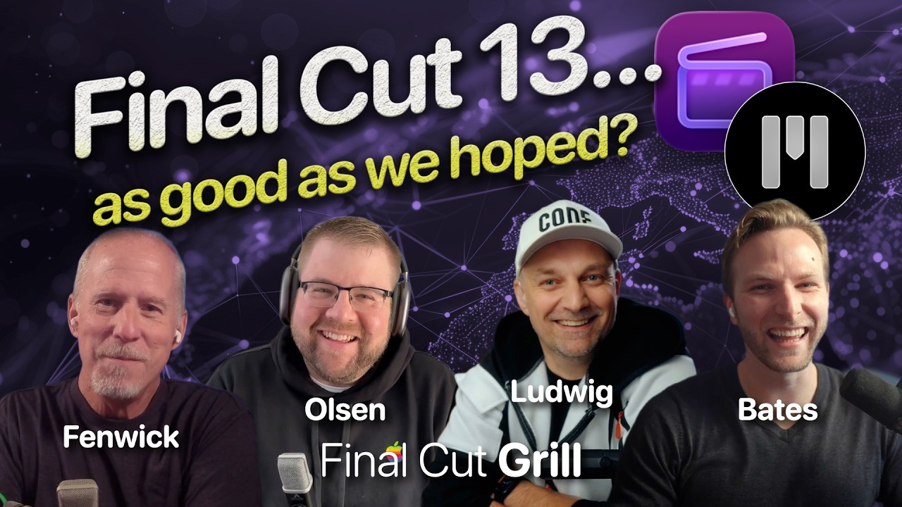
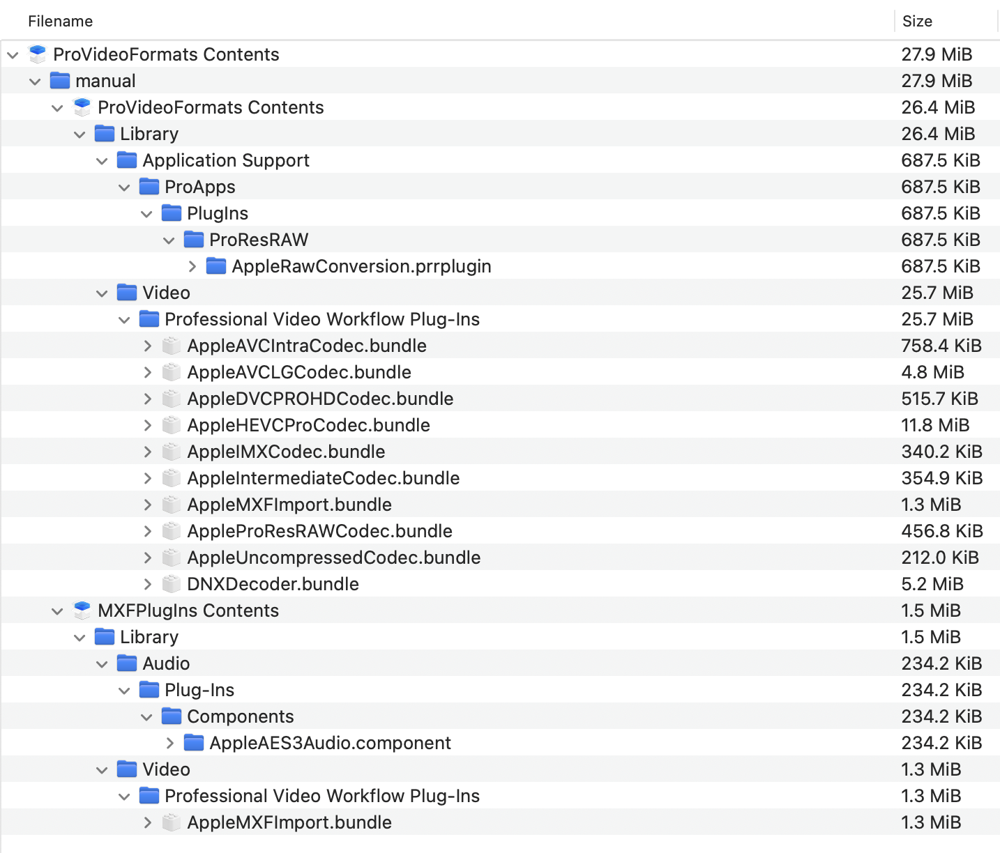
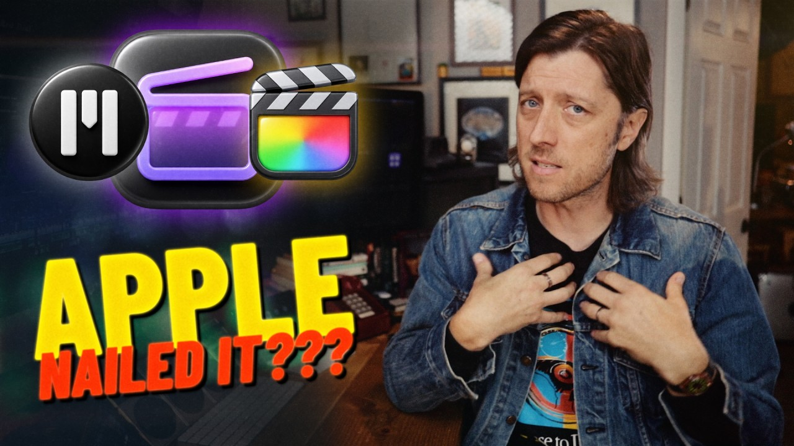
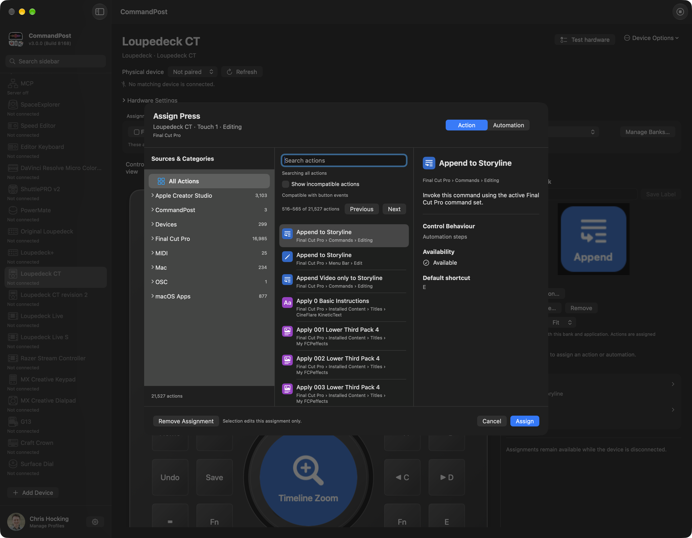
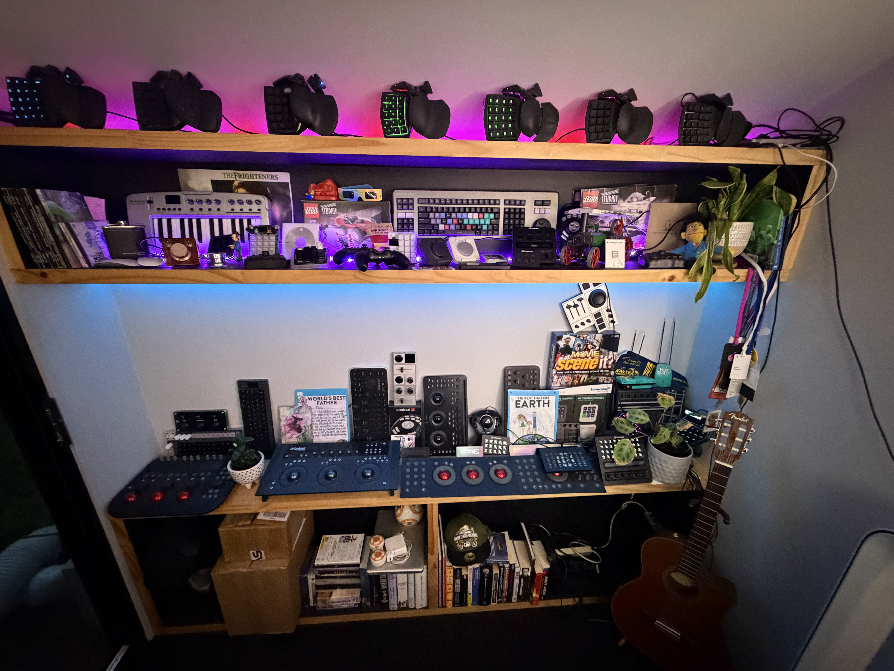
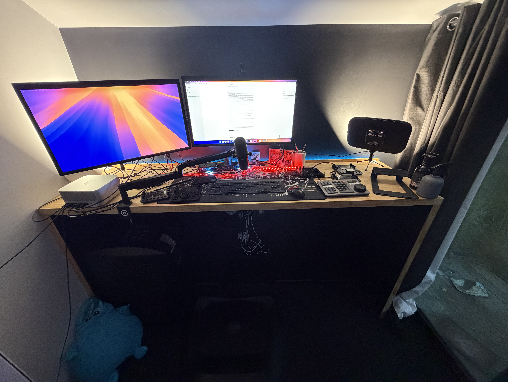
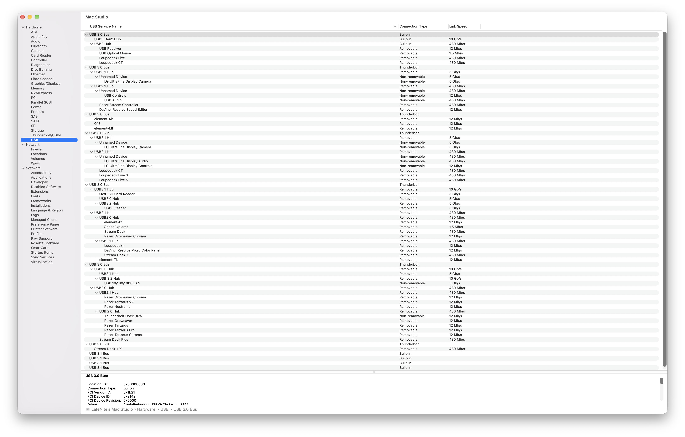
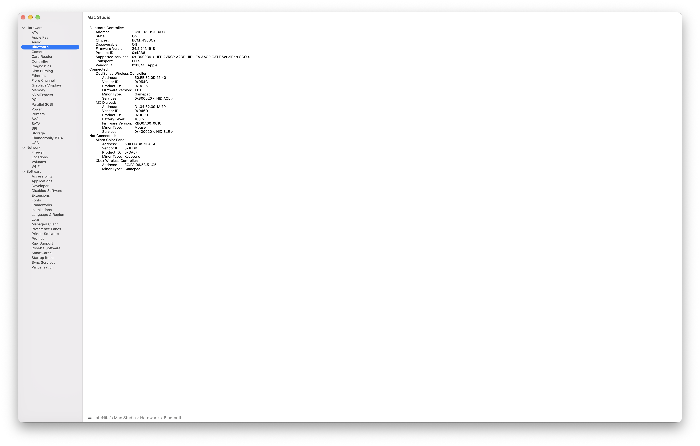

Happy Friday! 🥳

**ScriptStar v1.6.3 (Build 37)** is out now with support for Final Cut Pro v13.

You can learn more on the [ScriptStar website](https://scriptstar.fcp.cafe).

There's a new Final Cut Grill out on [YouTube](https://www.youtube.com/watch?v=4fFslPL4aFA), titled: **FCP 13, Finally here - Dylan, Rafael and Brad**:

One thing I forgot to mention yesterday...

**Pro Video Formats v3.2** was also released.

> The Pro Video Formats package includes the iPhone ProRes RAW plug-in, allowing supporting applications to provide more controls for ProRes RAW video shot on iPhone.
>
> It also provides support for the following codecs used in professional video workflows:
>
> - Apple ProRes RAW and ProRes RAW HQ³
> - Apple Intermediate Codec
> - Avid DNxHD® / Avid DNxHR® decoder
> - AVC-Intra 50 / 100 / 200 / 4:4:4 / LT
> - AVC-LongG
> - XAVC
> - XF-AVC
> - XF-HEVC
> - DVCPRO HD
> - HDV
> - XDCAM EX / HD / HD422
> - MPEG IMX
> - Uncompressed 4:2:2

It contains the following files:

This update should appear in System Settings if you have one of the ProApps installed.

Apple's released a new support article titled: [About the intelligence features in Apple Creator Studio](https://support.apple.com/en-au/127888)

Long story short - you only get certain amount of "credits" for Generate Image in Final Cut Pro, and if you go over the limit - you need to pay more.

Matthew O'Brien's post a new video on YouTube titled: **Is 13 The Best Final Cut Pro Update, Like, Ever???**

**Gerardo** writes:

> Hey everyone 👋
>
> I'm Gerardo, a video editor. I have been working a lot with SpliceKit, fixing some things for me and other friend. I've been building something for my own Final Cut workflow and I'd love some honest feedback from fellow FCP editors.
>
> It's called Glow Captions, a Mac app for animated captions that exports straight into Final Cut:
>
> • Real layered glow on the keywords (not a basic outer glow)
> • Speed curves on every word, plus stacked and zigzag layouts
> • A sound for every word, from my own sound designs
> • Transcribes on your Mac, nothing gets uploaded
> • Export → it lands in your timeline, synced, with the SFX on their own track
>
> FCP 13's new subtitles are cool for clean captions, but for reels and ads I wanted something more premium, so I built it.
>
> It's in closed beta. I'm picking 20–30 editors: free license if you use it on 2 real projects and tell me what breaks 🙏

You can learn more on the [Glow Captions website](https://glowcaptions.com/).

We're getting closer and closer to releasing **CommandPost v3** - it's looking so great!

We currently have a small group of people testing physical control surfaces via TestFlight whilst we wait for Apple's feedback for the Mac App Store.

You can see a HEAP of buttons connected in the LateNite Lab:

That's it for today. Chat later! 👋