Happy Friday! 👋

**Dylan Bates (aka The Final Cut Bro)** just 100K subscribers on YouTube! 🥳

HUGE congratulations Dylan - that's MASSIVE! Who knew there were 100K hardcore Final Cut Pro users! 🤯

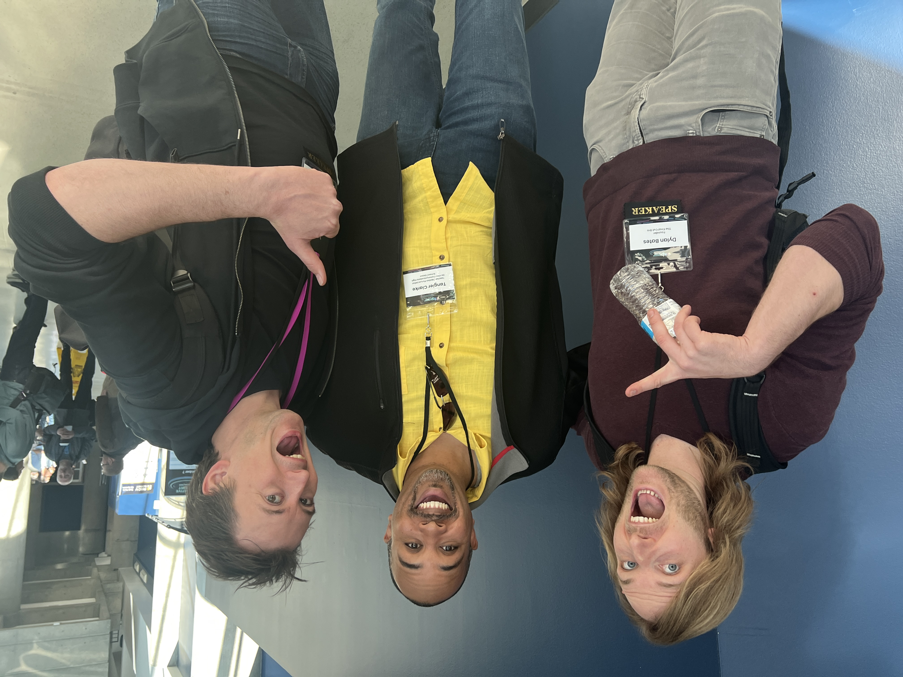

Reminder that he's also having a MASSIVE Black Friday sale on his [website](https://fcbplugins.com/collection/all).

**CommandPost v3** development continues at a rapid pace - I'm so excited about it!

Whilst Final Cut Pro remains the priority I've also added:

- DaVinci Resolve Panel & thousands of actions using the official APIs
- Adobe Premiere Panel & thousands of actions using the official APIs
- Avid Media Composer Panel  & thousands of actions using the official APIs

I'm currently working on adding **Lego Cybermaster** actions, because... well, it's cool.

Here's a sneak peak:

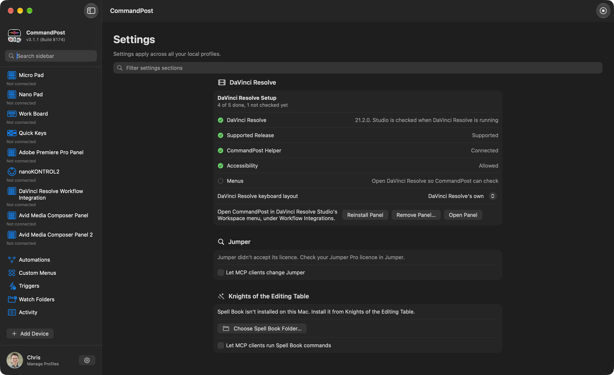

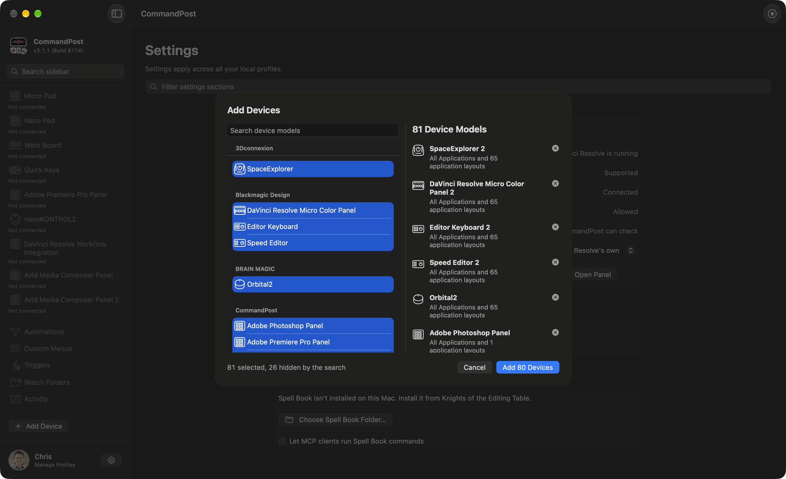

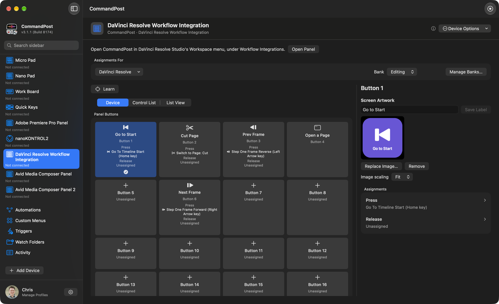

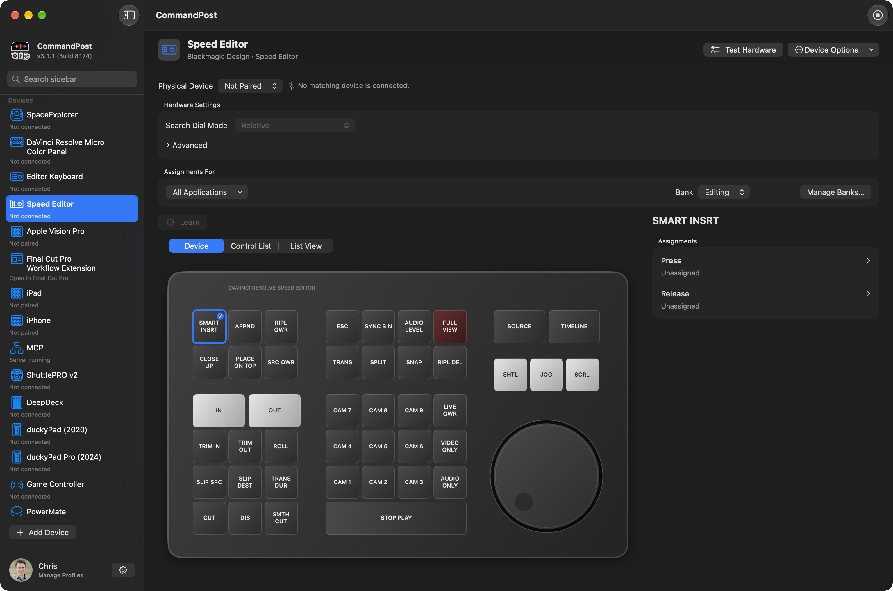

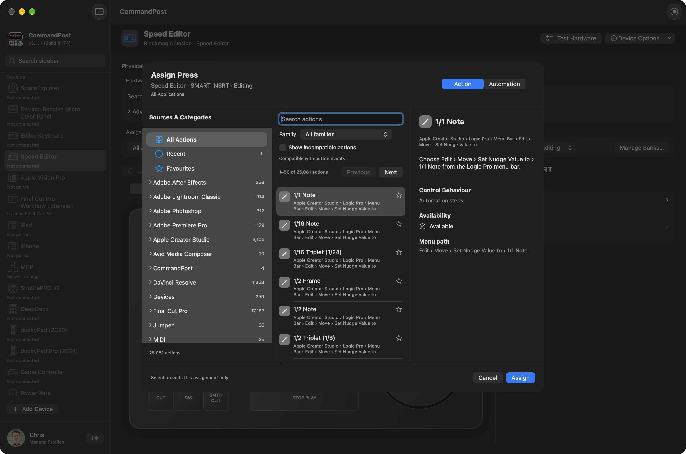

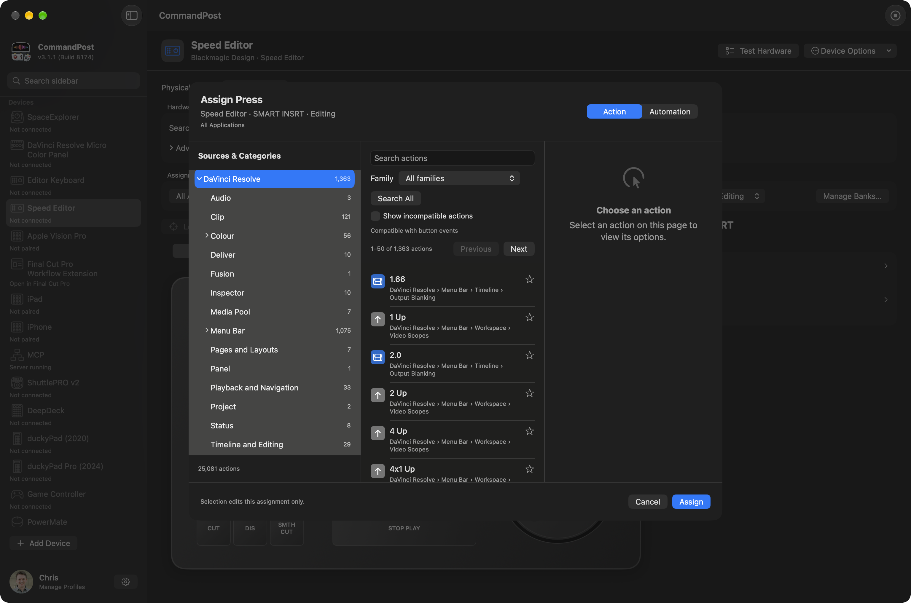

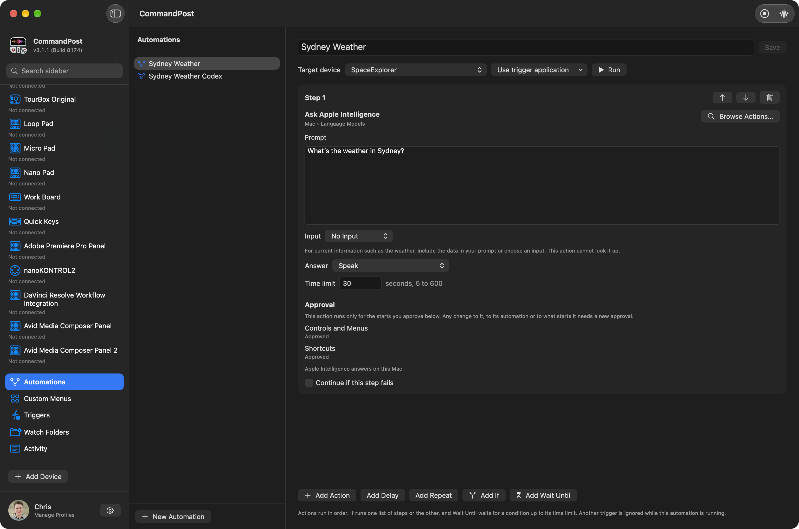

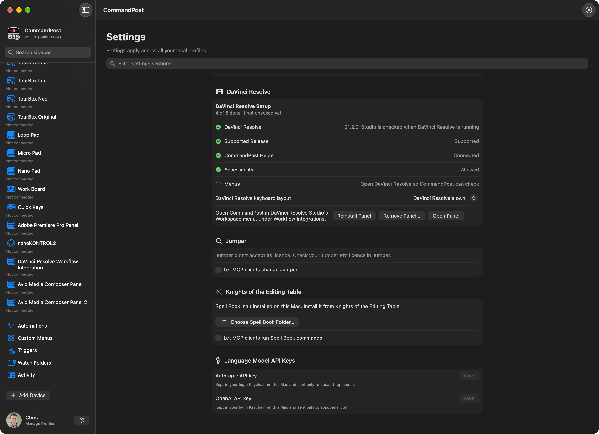

I recently posted on social media:

> CommandPost v3 is currently on TestFlight and coming to the Mac App Store soon (well, as soon as Apple eventually reviews it)! 🥳
>
> There's also a Vision Pro, iPhone, iPad, and Apple Watch app!
>
> The iPhone/iPad/Watch app is already live on the App Store.
>
> CommandPost v3 is a one-time payment of AUD$79.99 in Australia and USD$79.99 elsewhere in the world.
>
> This single payment gives you access to the Mac, iPhone, iPad, Apple Watch and Vision Pro versions of CommandPost v3.
>
> It has 81 control surfaces it supports - all directly and natively - no additional software required.
>
> This is a complete re-write from scratch in Swift & SwiftUI, using the last decade of experiences I had building CommandPost v2. This isn't another "vibe-coded" app - CommandPost v2 has been used by industry professionals for decades, well before LLMs changed the world. Unlike CommandPost v2 however, it will be closed source - for the simple reason that very few ever contributed to CommandPost v2.
>
> CommandPost v2 has been used for projects at Netflix, Pixar and the BBC. People at companies such as Apple, Avid and Adobe use it daily. All of the 2024-2026 Apple Worldwide Developer Conference (WWDC) videos were graded using Tangent panels in Final Cut Pro controlled by CommandPost v2. 🤯
>
> Originally CommandPost was entirely focussed on Final Cut Pro, but we've now added a DaVinci Resolve Panel, Avid Media Composer Panel and Adobe Premiere Panel. These new panels are still very much a work-in-progress, but we're getting there.
>
> It can do some insane things already. Watch Folders, Triggers, LLM support, deep MCP support - and soon Lego Cybermaster actions, because, you know... it's fun.
>
> If you're interested in learning more and trying out join the FCP Cafe Discord. Thanks team!
>
> [https://commandpost.fcp.cafe](https://commandpost.fcp.cafe)

Exciting times!

In other news Sebastian writes:

> **FidelityFuze 3.0 Released: Real-Time Upscaling That Tells Detail From Noise**
>
> Hi there, Sebastian here.
>
> **FidelityFuze 3.0** is out now.
>
> If you're new here, [FidelityFuze](https://fidelityfuze.com) is my plugin for upscaling footage directly in the Final Cut Pro timeline on Apple Silicon.
>
> At its core is a complete rebuild of Temporal Upscaling. Temporal is hard. Borrowing detail from neighboring frames sounds simple, until the camera moves or the shot cuts. Lean on the wrong frame, and you get ghosting. Lean on none, and you lose the very detail the neighbors were holding.
>
> 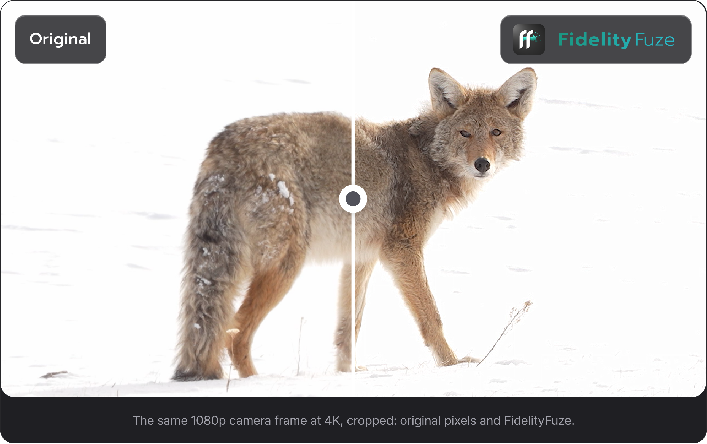
>
> Earlier versions asked whether a neighboring frame looked similar enough to trust. The trouble is that no single answer fits every camera. Set the bar loose, and grain slips through as detail. Set it strict, and real texture gets thrown away. So 3.0 asks a different question: **is this difference more than your footage's own noise would explain?** FidelityFuze no longer guesses where the line between detail and noise sits. It measures it, in your footage, and the new **Noise Profile** lets you keep that measurement for the whole clip.
>
> **The Noise Profile: Every Camera Has Its Own Signature**
>
> Every camera, sensor setting, and grade leaves its own pattern of noise, and it is not even the same across one frame: shadows carry more than highlights, and color noise behaves differently from brightness noise. **Temporal Upscaling now measures that signature** and judges every difference against it. Clean footage gets more room to reveal its fine detail. Noisy footage gets a more careful hand, so grain is less likely to be mistaken for something worth bringing forward.
>
> Without a profile, FidelityFuze works this out automatically. With one, the whole clip is judged against the same picture of your footage's noise, so the result stays consistent from the first frame to the last. Building a **Noise Profile** takes one click: turn on Temporal Upscaling, park the playhead on a representative frame, and click **Build** in the new Noise Profile section of the inspector. The profile stays with your project, and a status tag shows when it is in effect.
>
> Two new controls let you adjust the result to taste. **Noise Baseline** moves the measured line between detail and noise, from 50% to 200%. Raise it to allow more temporal smoothing, or lower it to keep more of the original frame. **Edge Emphasis** controls how strongly outlines stand out. Push it for a crisper image, or ease it back for a softer, more natural feel.
>
> 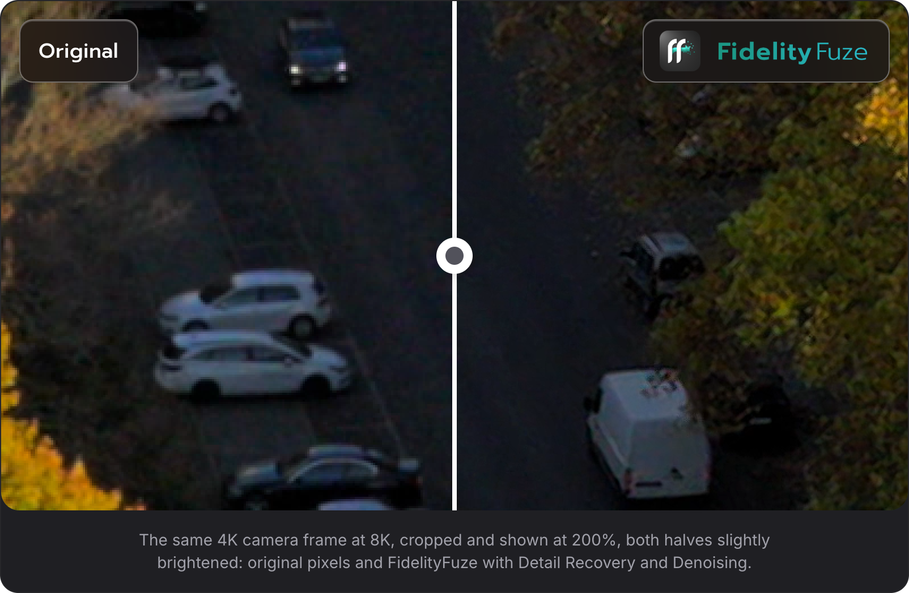
>
> If you have a grainy night shot you were never quite happy with, this is the release to try it on. Build a profile, move the sliders, and see where it starts to feel right.
>
> **Footage Rarely Makes It Easy**
>
> Slow pans across fine textures. A little camera shake. A light switching on halfway through the shot. Motion alignment is now FidelityFuze's own, built to follow those small movements precisely. It is measured on the denoised image, so grain no longer nudges each frame a little differently, and neighboring frames line up steadily, one after another. Exposure shifts and flicker are handled more carefully, too, so a change in one frame is less likely to spill into its neighbors.
>
> 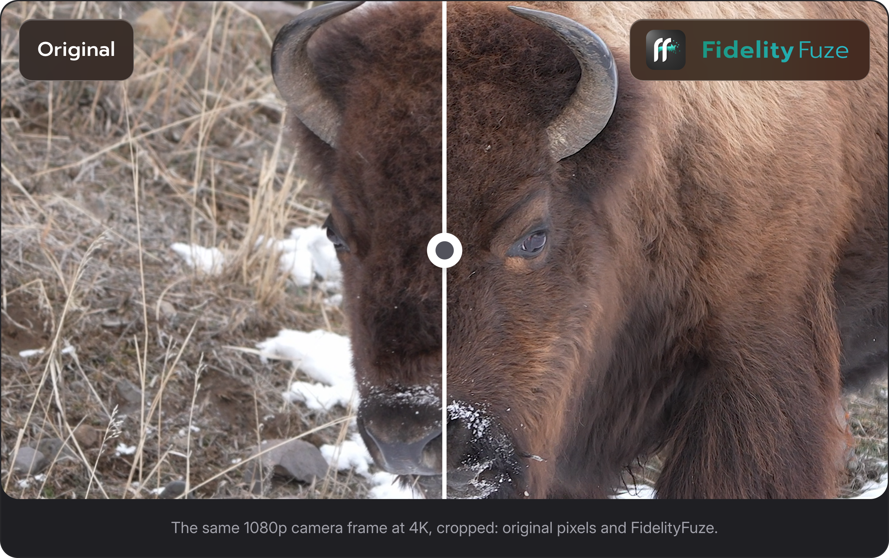
>
> And when in doubt, it lets go. A cut, a flash, or an abrupt change in the grade closes the door to the neighboring frames. Losing a little temporal help is better than blending two shots. In those moments, and during very fast motion, the current frame is still denoised on its own. It is not magic, and I would rather you see that on your own footage than read a promise here.
>
> **Lighter on Your Mac**
>
> Reaching further across time used to cost a lot of memory. Not anymore. Each neighboring frame is now taken in and let go before the next one arrives, so the Temporal Window can reach ±5 frames while **memory use no longer grows with it**. For a 4K-to-8K render with Supersampling and a ±4-frame window, peak memory drops from around **32 GB to around 15 GB**, and Final Cut Pro can render several frames at once again.
>
> 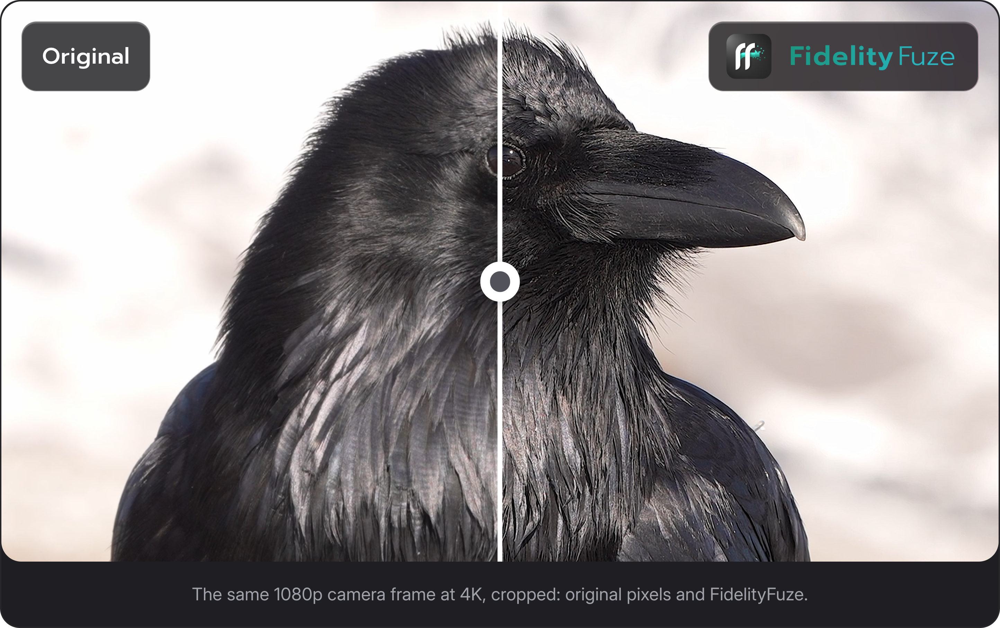
>
> There is one less setting to think about, too. FidelityFuze now reads Rec. 709 or Rec. 2020 directly from your project, so the manual Color Space setting is gone.
>
> **What Is FidelityFuze?**
>
> FidelityFuze is a native Final Cut Pro plugin that upscales your footage in real time, right in the timeline, from 1080p to 4K or 4K to 8K. No proxies, no exports, no round-tripping. Detail Recovery, Noise Reduction, and Temporal Upscaling are there for the shots that ask for more, and all of it is about keeping the character of your image.
>
> 
>
> It does not rely on generative AI. It adds clarity only where the footage can genuinely support it, and it runs exclusively on Apple Silicon, accelerated with Metal, so you see the result in the viewer while you edit.
>
> **Before You Update**
>
> If you're in the middle of a 2.7 project, I recommend **finishing it before updating**. Temporal Quality Mode, Temporal Window, and Noise Reduction Strategy return to their defaults in 3.0. Noise Reduction strength has also been recalibrated, so check any clips where you've used it.
>
> Major updates do not install themselves, so download 3.0 from the website. If you already own FidelityFuze, **3.0 and all 3.x updates are included at no additional cost**.
>
> **Requirements**
>
> - A Mac with Apple Silicon (M1 or newer); Intel Macs are not supported
> - macOS 13 Ventura or later
> - Final Cut Pro 11.0 or later (11.1 or newer recommended)
> - Recommended: M1 Pro, M1 Max, or newer
>
> Temporal processing and 8K projects ask for more. The [system requirements](https://fidelityfuze.com/user-guide#system-requirements) list the details.
>
> **Black Friday Offer**
>
> **Lifetime License:** no subscriptions.
>
> Use this code for **40% off**, valid until Monday, November 30th, 23:59 UTC:
>
> ```
> BLACKFRIDAY2026
> ```
>
> **Get FidelityFuze 3.0**
>
> If you want to judge FidelityFuze before trying it, the website has been rebuilt around real renders. No original was made worse and no render made better, so the imperfections FidelityFuze leaves are in there too. There is a full-resolution frame you can zoom into pixel by pixel and switch against the original.
>
> FidelityFuze 3.0 is available now, with a free trial if you would like to see it on your own footage first.
>
> → [https://fidelityfuze.com](https://fidelityfuze.com)
>
> Thank you to everyone who sent footage, questions, and honest feedback over the past year. A lot of this release started as one of your messages. If anything comes up, whether it is a question, a hiccup, or something you notice in your workflow, feel free to contact me at [contact@fidelityfuze.com](mailto:contact@fidelityfuze.com). I will have an open ear.
>
> Sebastian

Thanks team! Chat again soon!