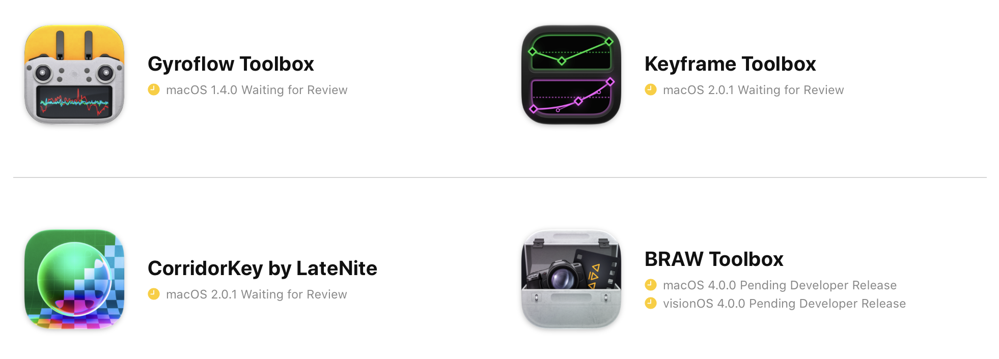
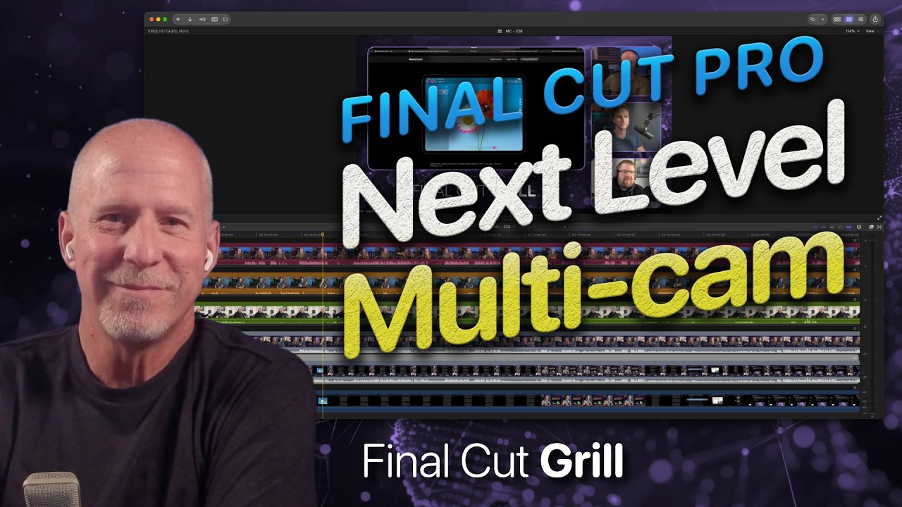

Greetings from the USA! 🇺🇸

Yes, this post is from the future, because I'm still working on Australian time.

I'm currently in Cupertino, for Apple's upcoming **Create immersive media experiences for spatial computing** event later this week.

I've also got a few exciting app updates in the pipeline - just waiting on Apple's App Review.

I now get HEAPS of emails every day from people writing their own software and website tools using LLMs - it's kinda crazy.

And because people are now hooking up their emails to LLMs as well, most, if not all those emails are automated.

Every time someone "vibe codes" an app, they now get their LLM to come up with a marketing and promotion strategy, and because FCP Cafe is an important news site for the Final Cut Pro community - I now get an email.

Now, I could counter this by getting my own "AI agent" to read all these emails and automate the posting of them on FCP Cafe... but, then what's the point?

I want FCP Cafe to always remain honest, real, and human. I want it to have an authentic voice, an opinion, and be of real-world use for professional video editors.

I'd rather miss posting for a few weeks when I'm busy, than have an LLM just post a bunch of stuff pretending to be human.

In other news...

Make sure you check out the latest episode of the **Final Cut Grill** on [YouTube](https://www.youtube.com/watch?v=i5slV2X6emQ):

You can also listen to the old Podcast Episodes on the [Final Cut Grill website](https://grill.fcp.cafe).

**Editor Toolkit 1.0 for SpliceKit** is out now!

**pratap** writes:

> Editor Toolkit for SpliceKit: 14 new Final Cut Pro plugins 🎬
>
> Small native plugins for Final Cut Pro. Most bring over a Resolve habit that Final Cut doesn't have. Grab all of them, a preset, or just the ones you want.
>
> Download on [GitHub](https://github.com/ishubhampratap/SpliceKit/releases/tag/editor-toolkit-v1.0.0)
> How to install: unzip → right-click Install.command → Open → restart Final Cut Pro
> (macOS asks once since it's from the internet. If there's no Open button: System Settings → Privacy & Security → Open Anyway)
>
> **RAW**
> - RAW Tab: Edit RAW Properties as its own inspector tab
> - RAW Multi: change RAW settings on many selected clips at once
> - RAW Gyro Presets: one-click gyro stabilisation + a strength dial
> - Shortcuts: assign keys to Edit RAW Properties, Toggle Stabilization, Zoom to Fit and more
>
> **Layered timelines (put "lock" in a clip's name)**
> - Grade Lock: grade layers can't be selected by accident
> - Grade Lock Skim: the inspector shows the shot under the grade
> - Paste Below Lock: pasted clips land under your grade layers
> - Topmost Clip Editing: Blade/Copy hit the top visible clip
>
> **Editing**
> - Batch Sync Audio: sync many clips to external audio at once
> - XML Clips: imported XML clips show up in the browser
> - Flip: Flip H/V + Image Orientation in Transform
>
> **Monitoring & workspace**
> - Playback Frame Rate: live FPS + dropped frames in the viewer
> - Workspace Collapse: full-height timeline in a vertical workspace
> - Workspace Fix: stops the custom-workspace crash
>
> Needs an Apple Silicon Mac with SpliceKit already working. Tested on FCP 12.4 / SpliceKit 3.3.9.
> Source + PR on [GitHub](https://github.com/elliotttate/SpliceKit/pull/100).

It's absolutely amazing to see what the editing community is doing with [SpliceKit](https://splicekit.fcp.cafe).

It's actually really interesting - originally I created CommandPost with the intention of building a community and open platform where ANYONE and EVERYONE could enhance Final Cut Pro.

However, aside from David Peterson, no one really ever jumped on-board the CommandPost train. Even though we were using [Lua](https://commandpost.fcp.cafe/developer/lua-overview/), which is SUPER fun and easy to code - the bar was too high, and very few people contributed.

Jump forward to 2026, and still, no one's really contributing to CommandPost. Instead, people are "vibe coding" their own apps that duplicate CommandPost functionality. And because CommandPost is open source, and LLMs have been trained on it's code - it's insanely easy for LLMs to build upon CommandPost's foundations.

Rather than enhancing CommandPost, and fixing bugs, issues and limitations for the CommandPost community - people are just building their own products - and in most cases attempting to sell them and keep them closed source.

SpliceKit on the other hand, is instead fostering what CommandPost always intended to do - video editors, without any real coding experience, are enhancing Final Cut Pro in all kinds of complex, weird and wonderful ways.

SpliceKit has become the open platform, that CommandPost always intended to be, but never really reached.

And CommandPost has kinda gone the opposite direction - it's still open source, but if you download it from the website, you need to have a paid LateNite app installed.

My original idea with this was that if I can generate enough income, I can spend more time on CommandPost, but it hasn't really worked out like that so far.

Ironically, I think if CommandPost to live on, it probably requires a complete re-write in Swift, and actually be closed source.

Although... now that anyone can build anything they want with LLMs - does CommandPost even need to exist?

Certainly interesting times!

[Kollaborate](https://www.kollaborate.tv) has recently had a big update, adding a bunch of transcription features to significantly improve your captioning workflow.

**Neat Video v6.1.4** is out now. It includes:

- New Apple hardware: support for macOS 27 (Golden Gate) and the latest Apple M5 Ultra & M6 GPUs.
- New Versions of Host Applications: support for Avid Media Composer 2026, Premiere Elements 2027, BorisFX Silhouette 2026, and the latest versions of MAGIX, Mistika, and DIAMANT.
- New Quick/Slow processing option for Premiere: Choose on-the-fly processing for faster hardware, or use the render cache when your hardware can't process the project fast enough.
- Improved stability: a fix for a rare render crash on systems with two or more GPUs, plus GUI improvements.

You can learn more on the [Neat Video website](https://www.neatvideo.com).

**Anthony Shorten** writes:

> **Source Cut v1.6 is out, and it's 40% off until 16 Nov**
>
> Source Cut is a small Mac app I built because Final Cut Pro can't batch-export timeline clips with their original camera filenames. Share your timeline to Source Cut and every clip lands as its own file, still named after its camera source. DJI_0042.MOV stays DJI_0042.MOV.
>
> What it does:
> • Works as a share destination right inside Final Cut, or drop a master export plus its FCPXML onto the app
> • Frame-accurate cuts with no re-encode (passthrough from a ProRes master)
> • Or encode every clip to H.264, HEVC or ProRes at 1080p, 4K or original size
> • Keeps the original camera timecode on every clip
> • Handles on the head and tail
> • Renames on export: prefix, suffix, numbering, tokens like {source}, {seq}, {project}, {date}, and saved presets
> • Relink XML, so your timeline reconnects to the cut clips in Final Cut or Resolve
> • CSV manifest with timeline and source timecodes
> • An .srt caption file for each clip, including from Final Cut's Generate Captions
> • Review copies for client dailies
> • Pre-flight check that warns about missing audio or a codec that can't cut cleanly
> • Handles multicam, compound and synced clips, repeated clips (_2), gaps and transitions
> • Everything stays on your Mac: no account, no upload, no subscription
>
> New in 1.6: cleaner names when you add a prefix or suffix, because it now puts the underscore in for you.
>
> It's US$17.99 until 16 Nov (normally US$29.99), and you pay once. Search "Source Cut" on the Mac App Store. Happy to answer questions. The last few releases came straight from editor requests, so tell me what you'd want next.

You can download Source Cut on the [Mac App Store](https://apps.apple.com/app/source-cut/id6779178347).

That's all for today team! Hopefully tomorrow Apple will approve a bunch of our updates.

Onwards & Upwards!

---

## Discuss this page

