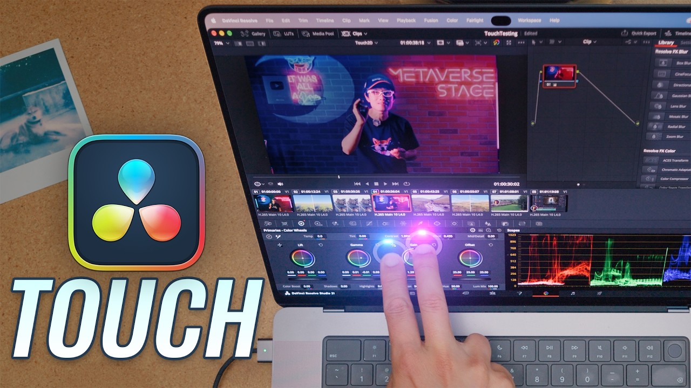

# 2026

## November

### [11th November 2026](/news/20261111)

Hello again from Cupertino! 🇺🇸

Tomorrow we'll finally be releasing **BRAW Toolbox v4** into the wild! 🥳

In the meantime, **Gyroflow Toolbox v1.4.0 (Build 31)** is out now, and it's a BIG update!

We now use the latest Gyroflow Core v1.7 renderer, and include a lot more parameters that you can also find in the official Gyroflow app and plugins.

There's a lot of under-the-hood changes too, which should improve performance.

As always, HUGE thank you to the amazing [AdrianEddy](https://github.com/AdrianEddy) for all his ongoing help, assistance, genius and support!

**🔨 Improvements:**
- We've updated to the latest Gyroflow Core v1.7 Renderer. HUGE thank you to the amazing [AdrianEddy](https://github.com/AdrianEddy) for all his ongoing help, assistance, genius and support!
- 16 lens profiles have been updated from the hero Gyroflow project. Thanks to EVERYONE who has submitted lens profiles and another HUGE thank you to [AdrianEddy](https://github.com/AdrianEddy) for all the work that goes into managing them.
- Added Metal-powered KLT and optional GMFlow (AI) tracking. Amazing work Yasunori Morishima!
- Reworked keyframe handling to use Gyroflow’s native keyframe engine. Added a **Use Gyroflow Keyframes** option to preserve animation saved in imported Gyroflow projects.
- Exported Gyroflow projects now include your current Inspector settings and animation.
- Added more stabilisation controls directly in Final Cut Pro, including smoothing methods, zoom modes and limits, automatic horizon locking, additional rotation and 3D translation.
- Added controls for rolling shutter correction, lens breathing compensation, focal length stabilisation, light refraction, output projection and image interpolation.
- Updated RED motion-data handling to recognise accurately timed gyro data, avoiding unnecessary automatic synchronisation.
- Added automatic motion-data synchronisation directly in Final Cut Pro, with manual adjustment available through Additional Sync Offset.
- Added optical stabilisation using Final Cut Pro’s background analysis. Analyse images to improve recorded motion data or stabilise footage without gyro data.
- Added **Save as Default** and named presets for saving and recalling stabilisation settings.
- Added focal-length-only lens setup and automatic lens metadata delay analysis for supported zoom footage.
- Improved rotation and framing for vertical footage, including portrait clips on matching vertical timelines.
- Improved renderer caching and memory management, and reduced unnecessary recalculation when adjusting settings.
- Improved preset importing so settings can be reused without replacing the current clip’s motion data or synchronisation offsets.
- Updated alerts to consistently display the Gyroflow Toolbox icon.

You can learn more on the [Gyroflow Toolbox website](https://gyroflowtoolbox.fcp.cafe).

**CorridorKey by LateNite v2.0.1 (Build 13)** is also out now with some improvements and bug fixes.

**🔨 Improvements:**
- The Final Cut Pro effect now only loads the CorridorKey v2 model when needed, reducing memory usage. Thanks for reporting Duvi19 and tommyw!
- Now runs on **macOS Sequoia 15.6** or later (on Apple Silicon only). Thanks for reporting tommyw!

**🐞 Bug Fix:**
- Fixed support for footage with non-square pixels.

You can learn more on the [CorridorKey by LateNite website](https://corridorkeybylatenite.fcp.cafe).

**Keyframe Toolbox v2.0.1 (Build 60)** is also out now, with a bug fix for people on older versions of Final Cut Pro.

**🐞 Bug Fix:**
- Downgraded the Motion Templates so that Keyframe Toolbox still works on older versions of Final Cut Pro. Thanks for reporting dedicatedfilm!

You can learn more on the [Keyframe Toolbox website](https://keyframetoolbox.fcp.cafe).

**Jumper v2026.11.09** is also out now.

**🥳 New Features:**
- Script Editor: correct transcripts word by word. Edit a line's text, use find and replace (with Match case and Whole words), and undo. Exports, Copy script, Copy transcript and Send transcript to Avid use the corrected text.
- Script Editor: push your corrections to the Analysis folder so that speech search and everyone's Script Editor use them. Teammates' corrections show their name and date.
- Script Editor: "Show edits" shows the transcribed words struck through next to each correction.

**🔨 Improvements:**
- The Media table stays responsive with hundreds of thousands of files.
- Script Editor: switching between transcripts is about twice as fast. Narrow panels now have a transcript dropdown with filter, running time and export menu.
- The update prompt is now a round green download button next to the version number.
- Analysis no longer starts when the Analysis folder's drive isn't connected. Jumper asks you to reconnect it or pick another folder.
- Final Cut Pro: when the Final Cut Pro Automation Engine (Jumper Accessibility Helper) doesn't answer, Jumper asks you to open FCP and the Jumper extension, instead of showing a connection error.
- AI agents: exporting transcripts accepts the segments the transcript tools return, several MCP clients can start sessions at the same time, and missing media files or Face Collections are explained instead of failing the job.

🐞 Bug Fixes
- People: drag-and-dropping reference face images on a person now adds them. Thanks for reporting Igor Geekademy!
- Avid: jumping to, marking and adding results now works in group clips where Media Composer says "Can't find timecode of loaded mob."
- Avid: Load Media no longer stops with "No media files received" when Media Composer sends an empty bin entry.
- Avid: SubCap export now works for audio-only clips and uses the project frame rate, so clips at another frame rate get the right timecodes. Thanks for reporting Fedmadboss!
- Avid: visual and face analysis now works on heavily compressed Avid MJPEG MXF files. Thanks for reporting Kevin O'Donnell!
- Windows: Avid and DaVinci Resolve marking, splice-in and overwrite now work with non-Latin keyboard layouts such as Hebrew. Thanks for reporting Nati!
- Windows: English transcription now works on computers where App Control blocks the onnx library.
- Windows: a settings file saved with a byte order mark no longer resets your settings and license key.
- Windows: non-English characters in file names and metadata are read correctly in AAF export.
- Speech Analysis: audio with many unlabeled channels, such as 20-channel MXF from broadcast recorders, is now transcribed, with speech from every channel and track at full level.
- A search including an MXF on a slow NAS no longer fails when reading that file times out.
- Finding media skips a network folder that refuses its listing, instead of stopping.
- A file whose analysis lock fails, for example because a sync client holds it open, is skipped instead of stopping the whole job.
- Watch folders no longer pick up files for speech analysis when the speech model is missing.
- The analysis of an offline media file can now be deleted.
- Deleted visual and speech models can be downloaded again without restarting Jumper. Thanks for reporting Steve!
- Quitting while a new Analysis folder is loading no longer saves the search index into the wrong folder.

You can learn more on the [Jumper website](https://getjumper.io/?ref=fcpcafe).

In other news **Jeff Roy** reports:
  ·
> **macOS 27.2** bug affecting .fcpbundle files on NTFS servers.
>
> Most of you probably were not affected by this, but I was. In **macOS 27.2** there was a bug that prevented you from copying `.fcpbundle` files from a SMB server to any other volume. It also prevented you from changing the extension or zipping it. I don’t know if this affected other server formats, but ours is NTFS and I tested it on eight different Macs. The **macOS 27.1** devices and earlier were not impacted.
> I’m happy to report that today’s **macOS 27.2.1** update fixed the issue! 🎉

This is great news for people editing with Final Cut Pro in a network shared storage environment!

**9to5Mac** writes: [Apple launches $50 ‘intelligence usage packs’ for select AI features](https://9to5mac.com/2026/11/09/apple-launches-50-intelligence-usage-packs-for-select-ai-features/).

I wonder if we'll see the same thing for Final Cut Pro in the next update?

**WaveXML v2.0.1** is out now. You can learn more on the [WaveXML website](https://wavexml.com/update).

Finally, Hugh Hou has released a great video titled [I Tested the Touchscreen MacBook Pro for Editing in DaVinci Resolve 21.2 - It Actually Works!](https://www.youtube.com/watch?v=yOmPybdkv0o):

It'll be interesting to see how things work in the next Final Cut Pro update!

Chat again tomorrow! Thanks team!

---

## Discuss this page

