Today's the day! **BRAW Toolbox v4.0.0 (Build 109)** is out today! 🥳

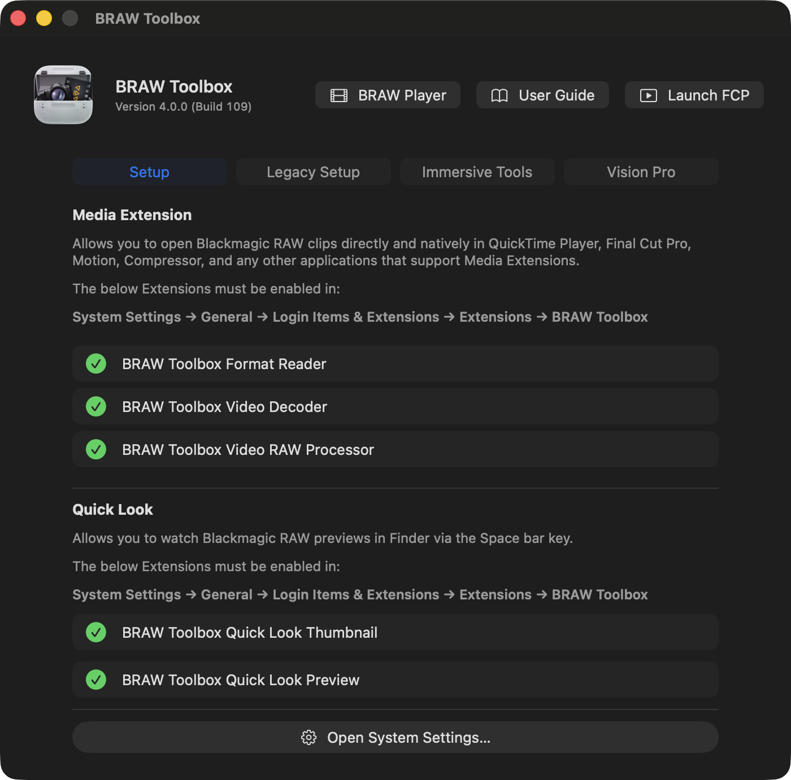

I'll be demoing this at Apple's **Create immersive media experiences for spatial computing** event today at the Apple Developers Centre in Cupertino.

You can watch the live stream of the event on [YouTube](https://www.youtube.com/live/iDbHBdI7nq0):

[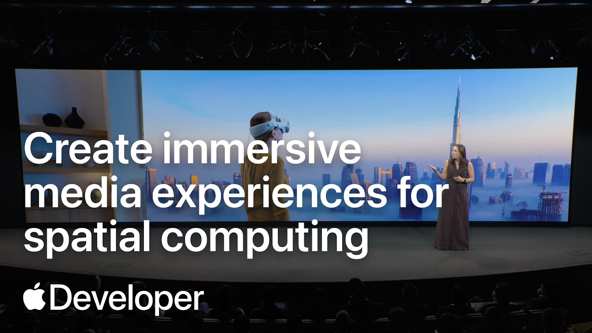](https://www.youtube.com/live/iDbHBdI7nq0)

I've been working on this since the start of July.

63,070 lines of code were added, 4,069 lines of code were removed.

We did 19 TestFlight builds.

This is a MASSIVE update - because BRAW Toolbox now has a **Vision Pro** app!

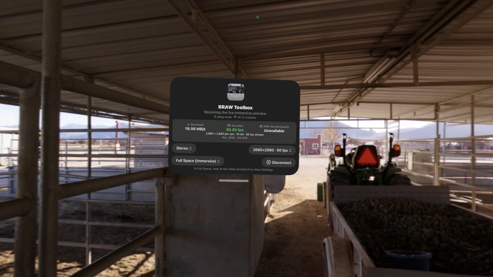

The Blackmagic URSA Cine Immersive camera shoots `16320x7200` at `90fps` - so that's a LOT of data to handle.

I wasn't sure streaming to Vision Pro would even be remotely possible - but after a lot of work... it is.

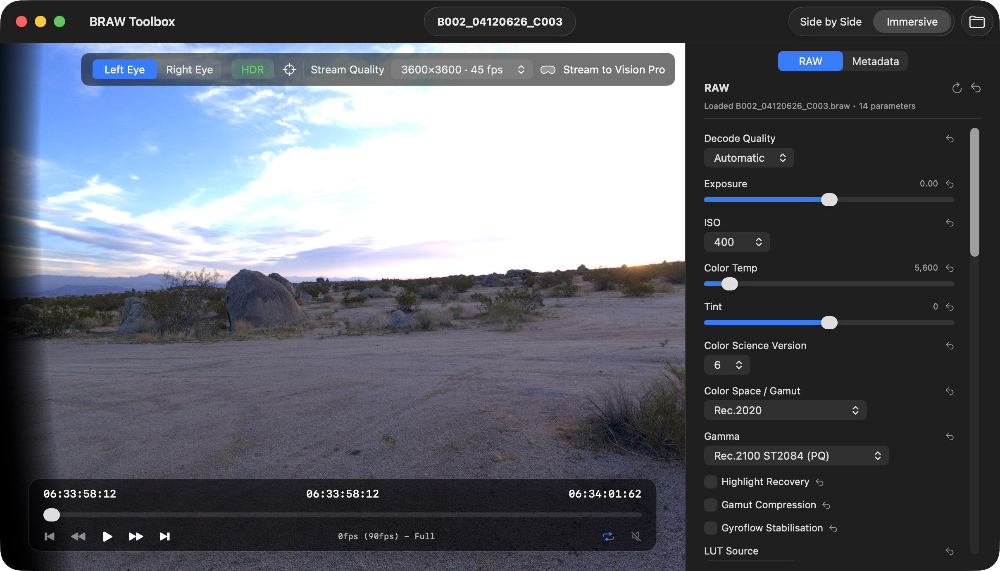

The release notes explain:

**🥳 New Features:**
- We've added a Vision Pro app! You can now stream Blackmagic URSA Cine Immersive clips from the BRAW Player and Final Cut Pro to your Vision Pro via Wifi and with the Developer Strap.
- We've added a new Quick Look extension, allowing you to better preview Blackmagic RAW clips in Finder. It includes an Immersive view and Debayer controls.
- We've added new Immersive Tools! **Batch Export** allows you to convert multiple Blackmagic URSA Cine Immersive clips into Apple Immersive Video Universal files that you can AirDrop to your Apple Vision Pro.
- The **Compressor** Immersive Tool allows you to create dual-track ProRes files that you can use in Apple's Compressor or Colorfront Immersive Utility.

**🔨 Improvements:**
- We've made various under-the-hood improvements to improve playback performance of the Media Extension. Thanks pratap!
- We've made various user interface improvements to make the BRAW Toolbox application more user friendly. Thanks for your feedback Iain Anderson!
- Updated from Blackmagic RAW SDK v5.1 to v6.0. Thanks Blackmagic team for all your amazing work and the new APIs!
- Added support for Blackmagic Generation 6 Color Science.
- Blackmagic URSA Cine Immersive clips in the Media Extension now display side-by-side with a QR code containing the camera identifier, so that the matching Immersive Lens Profile Data can be matched.
- We've improved the Immersive Transitions. There's now a checkbox in the Final Cut Pro Transition Inspector so you can globally enable and disable the transition rendering - so you can preview the transition in Final Cut Pro, and disable it in one click for exporting. You can also now Dip to Color.
- We've added a Static Foveation option to the Final Cut Pro Immersive Tool.
- The Media Extension now supports more than two audio tracks. Thanks for reporting Anthony Joey L!

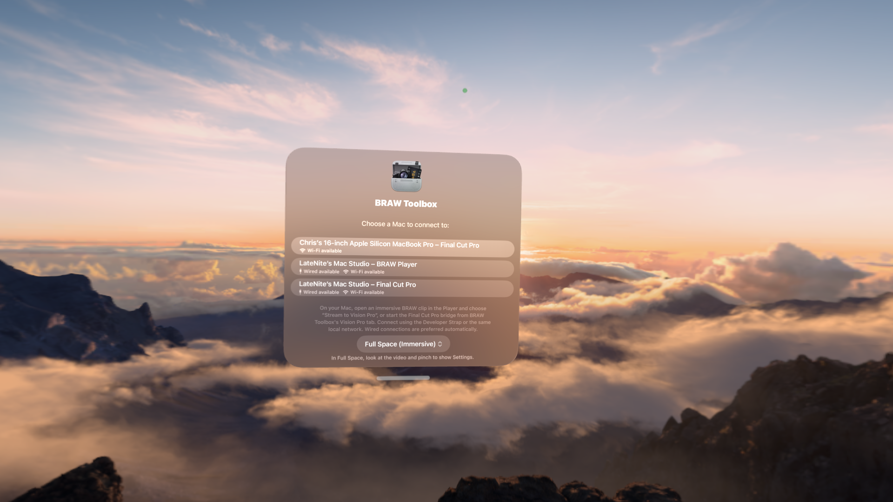

The Quick Look extension is also going to be incredibly handy for Immersive creators!

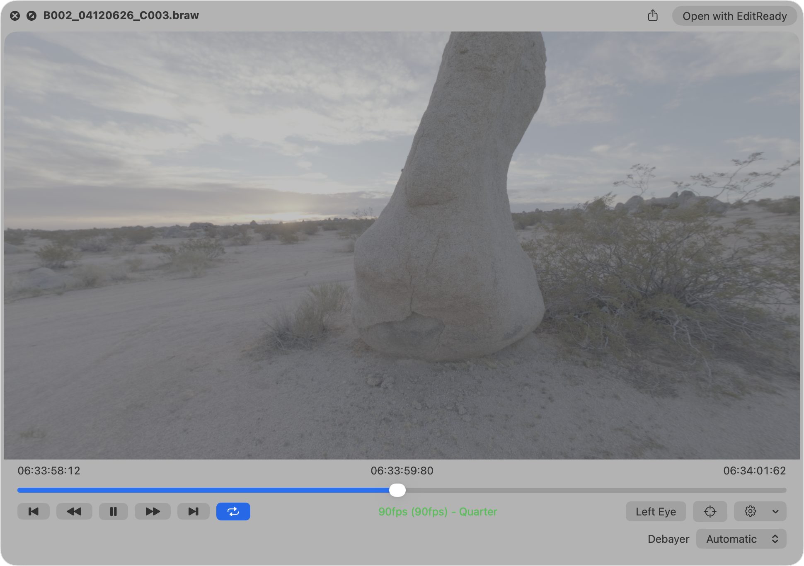

Back on [13th November 2024](/news/20241113/), at the Final Cut Pro Creative Summit, Bill Davis announced that Blackmagic would be adding official support for Blackmagic RAW to Final Cut Pro.

This is something I always knew that was coming - and once it happened, that would basically be the end to BRAW Toolbox.

However, jump forward to today, and it's CRAZY to be back in Cupertino, having Tim Dashwood showcase BRAW Toolbox to the world. 🤯

BRAW Toolbox has come a long back since 2024, and a heck of a long way since the first public beta back in 23rd December 2022.

The original version of BRAW Toolbox was a bit hacky - using an FxPlug Effect to trick Final Cut Pro from reading BRAW.

The Media Extension makes everything a lot more official and a lot more simple. Blackmagic RAW now just feels native in Final Cut Pro.

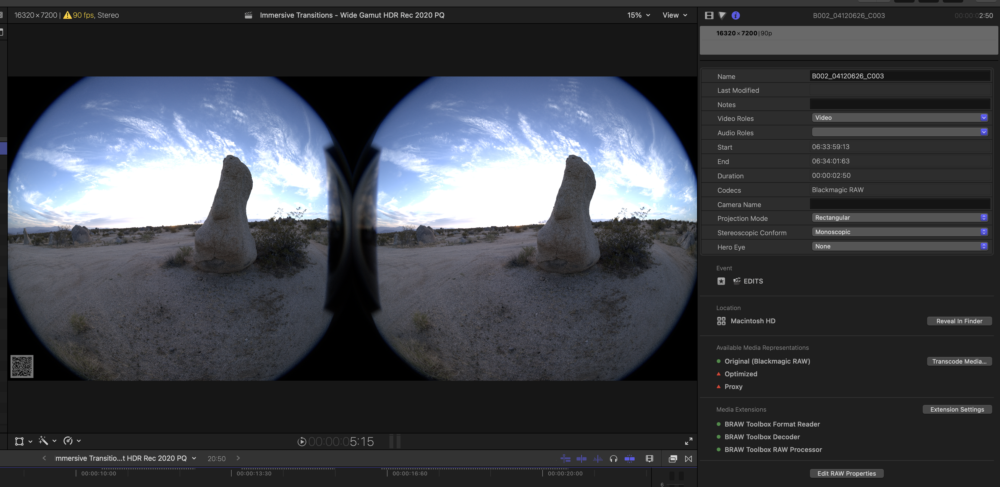

But to get Immersive content from Final Cut Pro to Vision Pro - that also required some similar out-of-the-box thinking.

To solve this, the Media Extension encodes the Immersive content as side-by-side, and puts a QR code in the bottom left with the Blackmagic camera's unique identifier.

This QR code allows us to match the live video content (playing from Final Cut Pro's A/V Output), with the Lens Profile Data (which is baked into the BRAW files).

So now, when you stream from Final Cut Pro to Vision Pro, the Vision Pro can use this Lens Profile Data (which is unique to each camera - and calibrated at manufacturing time using robots) to accurately display the Immersive content.

Up until today the only way to really edit Immersive content was with Blackmagic DaVinci Resolve - but now, thanks to BRAW Toolbox, you can finally use Final Cut Pro. 🥳

You can download **BRAW Toolbox v4.0.0 (Build 109)** from the Mac App Store today. BRAW Toolbox continues to be a one-time purchase, with no upgrade fee if you already own BRAW Toolbox.

The Vision Pro application is included with the Mac application - there's no additional cost.

HUGE THANK YOU to everyone that helped make BRAW Toolbox v4 happen! There was a lot of help behind the scenes with testing, as I'm totally new to this Immersive world.

You can learn more on the [BRAW Toolbox website](https://brawtoolbox.fcp.cafe).

There's a section on the website for [Immersive & Vision Pro](https://brawtoolbox.fcp.cafe/immersive/) explaining things in more detail.

And whilst this is the main exciting news for today, I also wanted to share a sneak peak.

Over the last few days, whilst I've been in Cupertino, I've been thinking a lot about CommandPost, and also chatting to a lot of very enthusiastic CommandPost users.

To be honest, I've been a little unsure about what to do with CommandPost, and how much time I should spend on it.

But after chatting to a bunch of people that really love and depend on CommandPost for their day-to-day editing work, I decided to start working on **CommandPost v3.0.0**.

One of my big goals for CommandPost has to always been to get it on the Mac App Store. Last year I tried a heap of things to make this happen, but App Review simply made it too hard.

I'm HOPING that with CommandPost v3, that I might FINALLY be able to bring it to the Mac App Store.

This is a MASSIVE mission, and I'm sure App Review will put up many roadblocks - but it's something I've always wanted to do.

CommandPost v3 will be a complete re-write and re-design - all written entirely in Swift and Swift UI.

Over the years, a lot of people have taken ideas from CommandPost and released new products.

For example, Dylan's [DropHawk Pro](https://fcbplugins.com/b/drophawkpro) makes CommandPost's watch folders redundant.

[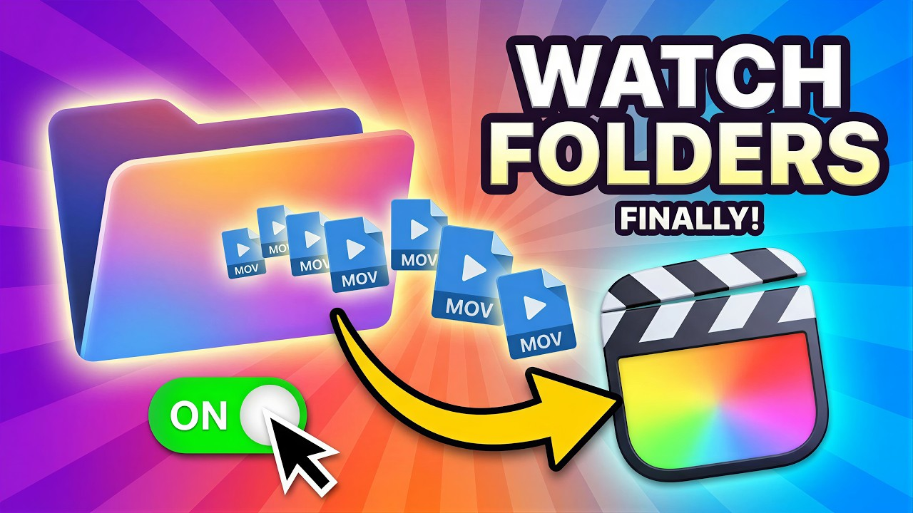](https://www.youtube.com/watch?v=0UtDuvGeoLA)

Knut's [ScriptSync Pro](https://www.studiomalibu.de/apps/syncscript-pro) makes a lot of CommandPost's Toolbox's redundant.

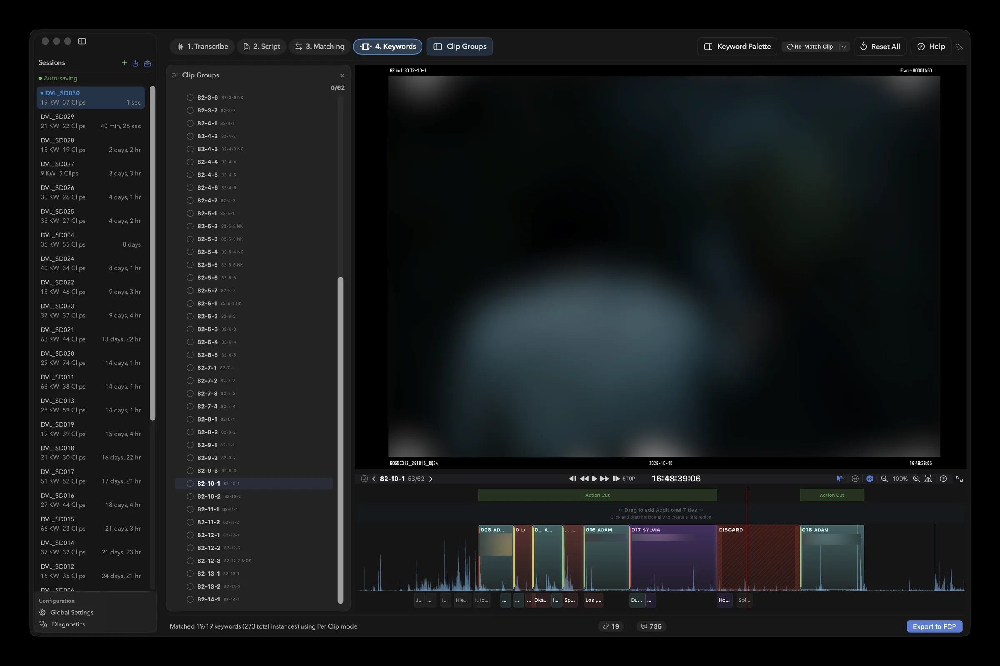

So, the focus of CommandPost v3 will really be on:

- Deep Control Surface Support
- Deep Automation Controls
- Deep Integration with Final Cut Pro
- Deep MCP Support

Whilst CommandPost v3 will never be able to do all the INSANE things that [SpliceKit](https://splicekit.fcp.cafe) can do, CommandPost can continue to be the tool that people use to automate Final Cut Pro, without having to mess with it's insides.

The idea is that CommandPost v3 will continue to be the most powerful tool for controlling and automating Final Cut Pro.

Of course, people will still be able to use CommandPost v3 to control other applications, and we may add deeper support for other applications in the future - but the main focus will be on good old Final Cut Pro.

Here's a quick sneak peak at the initial ideas for the re-design (subject to change of course!):

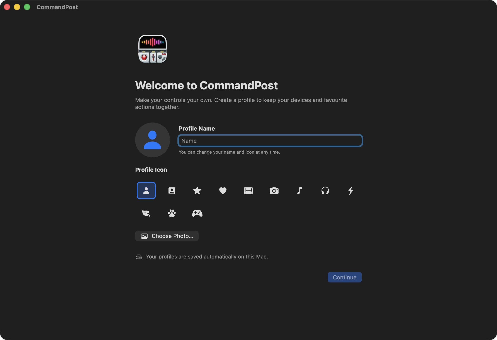

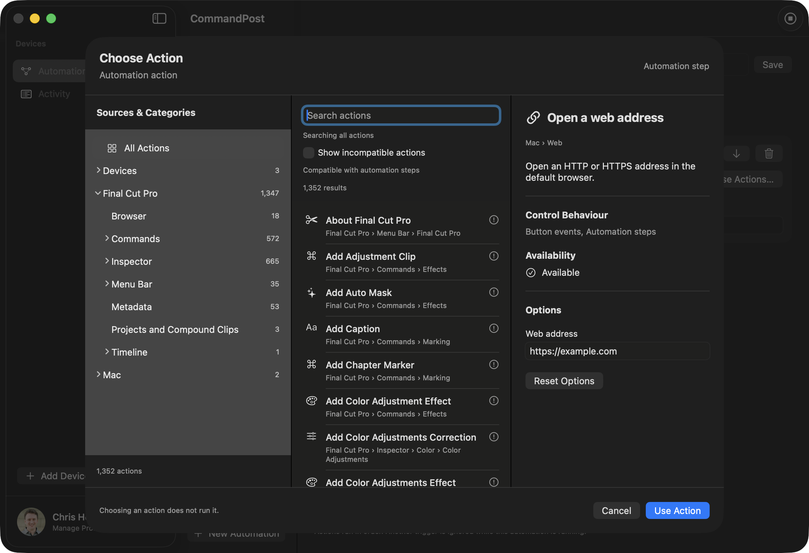

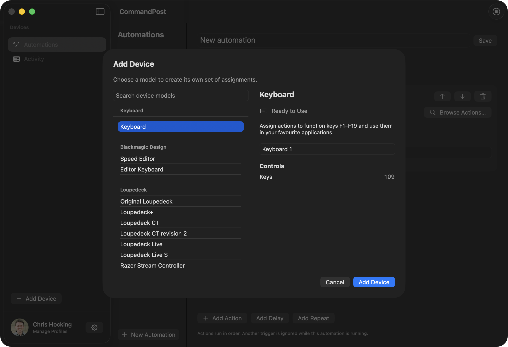

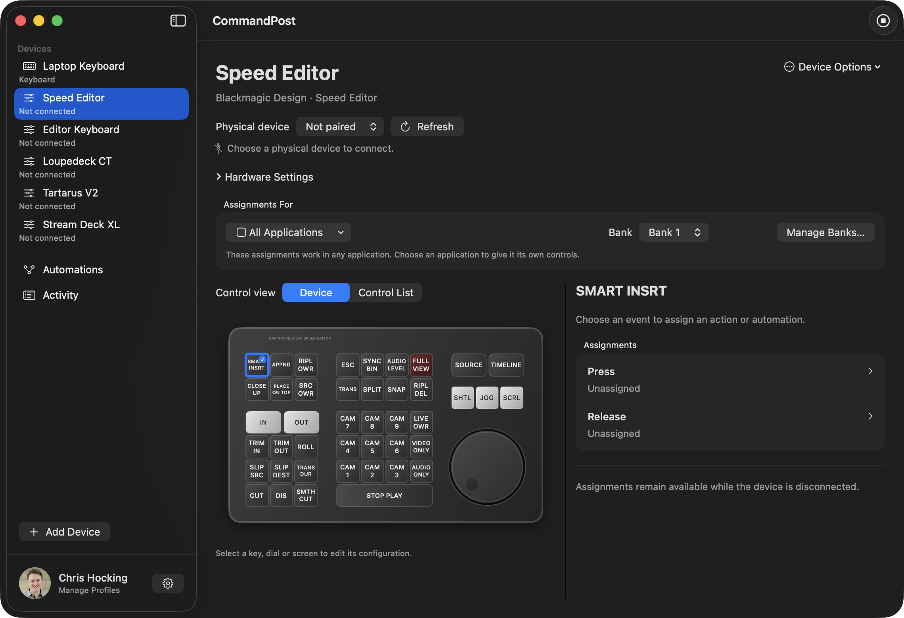

If you have any ideas, comments or suggestions, let me know!

In other news...

**Strada** is also here in Cupertino, and they're also releasing a Vision Pro application!

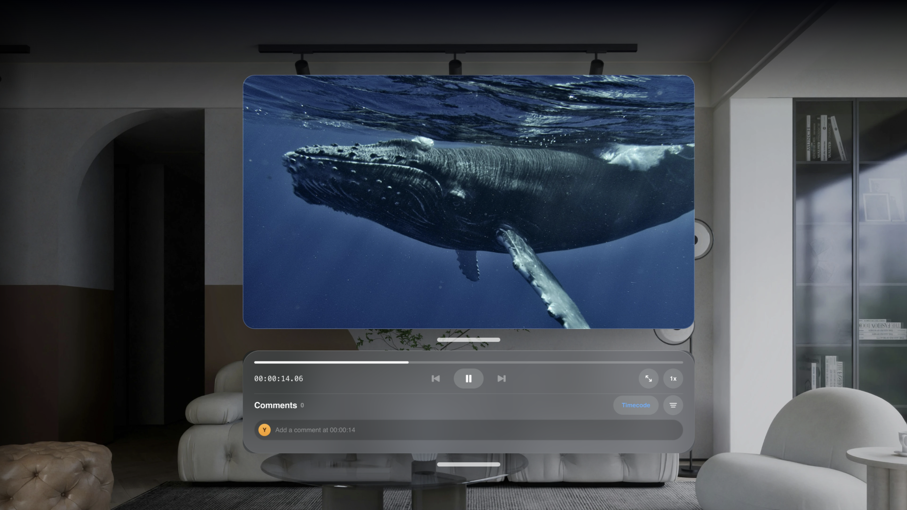

I've tested this Vision Pro app, and it's AWESOME. I can literally watch Blackmagic RAW clips that are sitting on my Mac Studio in the office back in Australia, from a Cupertino hotel room. INSANE.

You can learn more on the [Strada website](https://strada.tech/visionpro).

Sticking with our Immersive trend, the amazing **Hugh Hou** writes:

> Monitor and control a URSA Cine Immersive from inside Apple Vision Pro.
>
> Wired to a MacBook Pro. No Wi-Fi, no NDI, no expensive setup!
>
> This is the new **Spatial Film Live Camera v2.0**
>
> URSA Cine Immersive → 12G-SDI → MacBook Pro → Apple Vision Pro, wired with Apple's Developer Strap (or wireless with WiFi 6)
>
> What the director sees is the final format: correct 3D 180 Apple Immersive Video, built from the camera's own lens profile and streamed at up to 80 Mbps. No STMap to build and no converter in the chain.
>
> From the headset, you can change ISO, shutter, white balance and ND, roll the camera, and instant replay the last take in 3D 180 Apple Immersive Video format.
>
> Then there is progressive immersion. The director watches the immersive frame and still sees the talent and the real set. A true mixed reality directing experience.
>
> Spatial Film Live Camera on VisionOS and our new desktop livestream app Spatial Film AirStream are FREE. From one filmmaker to another! We love the immersive filmmaking community and are willing to share our knowledge to help everyone to succeed!

You can watch him explain on YouTube:

[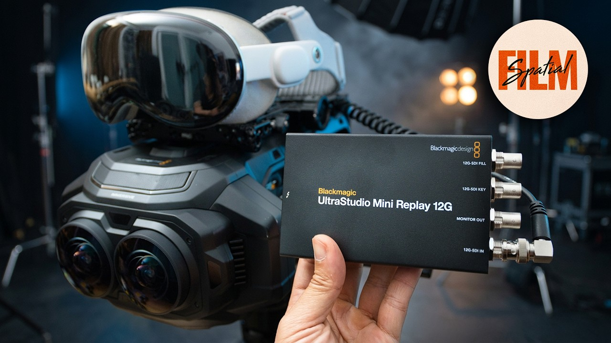](https://www.youtube.com/watch?v=jdz6AjiDxwo)

**CoreMelt** has released a bunch of **free** assets online, and are putting up new ones every week!

You can download Motion Templates, USDZ 3D Models and LUT files, from the [CoreMelt website](https://coremelt.com/pages/coremelt-free-assets-for-final-cut-pro).

Also, all their [5 Pack's](https://coremelt.com/collections/5-packs) are currently free too!

Everything's been [tested and confirmed compatible](https://coremelt.com/blogs/news/coremelt-information-on-macos-27-golden-gate-and-final-cut-pro-12-4) with macOS 27 Golden Gate and Final Cut Pro 12.4.

The **Doza** team writes:

> **Doza Assist v1.1.15** is out. It transcribes your interviews, finds the best moments and sends them to Final Cut Pro.
>
> What's new:
> - Simpler layout
> - Faster chat
> - Soundbite and story finder is smarter
> - Works with Claude and ChatGPT over MCP, so your assistant can read a transcript and pull selects for you
>
> We also launched [Doza Cuts](https://doza.ai/cuts/). It switches your multicam podcast or interview to whoever is talking and hands back a live multicam in Final Cut Pro.
>
> [Free guide](https://doza.ai/final-cut-pro-mcp/) on the MCP workflow.
>
> [Release notes](https://doza.ai/changelog/1.1.15/).
>
> The direct download updates in the app, and the FxFactory version of Doza Assist is on its way.

That's it for today! Tomorrow I'll be posting stories from Apple's Immersive Event! Stay tuned.

---

## Discuss this page

