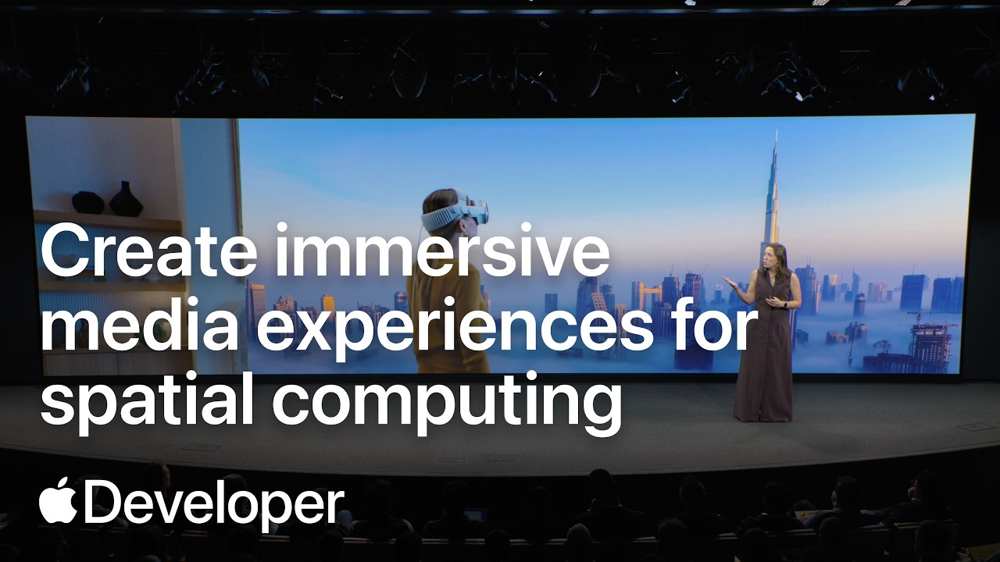
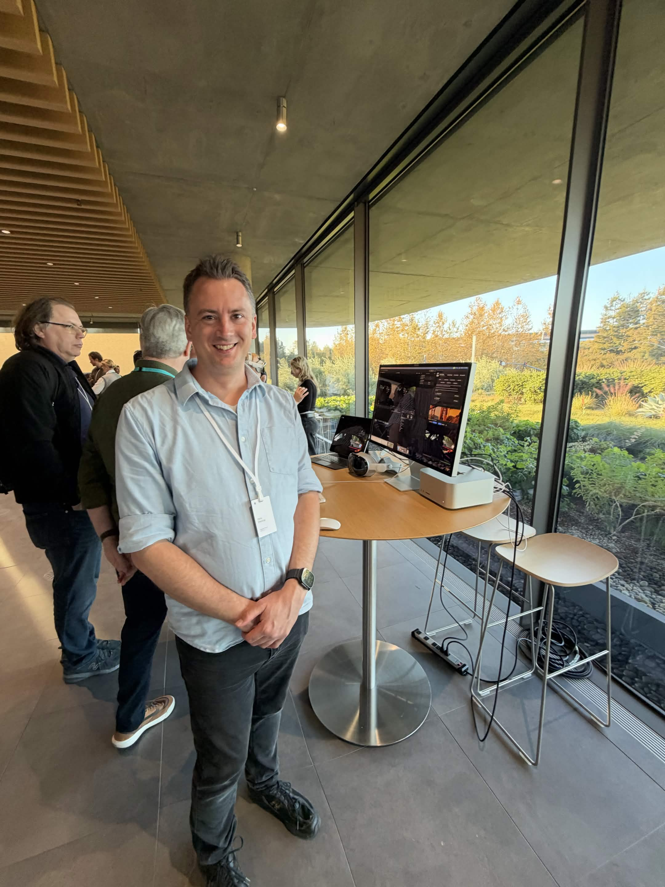
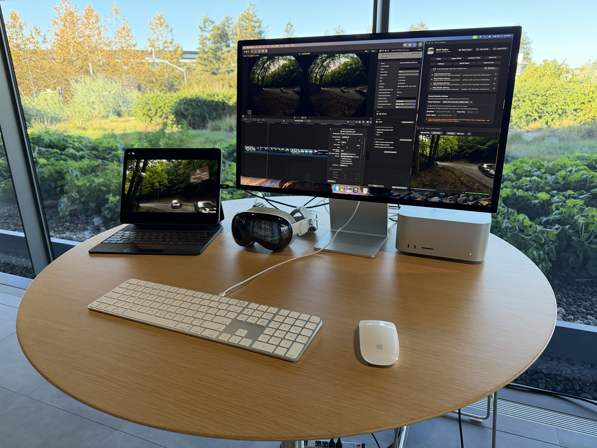
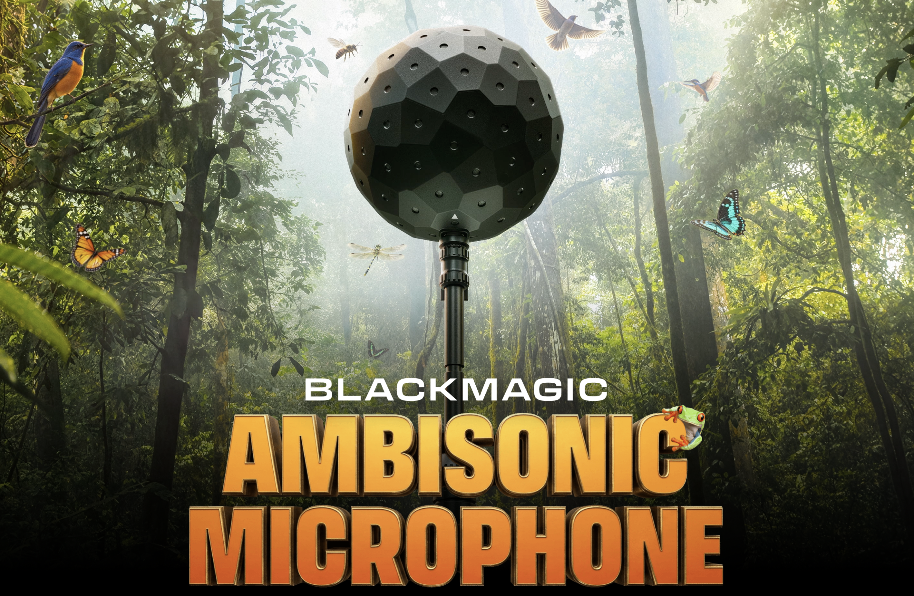
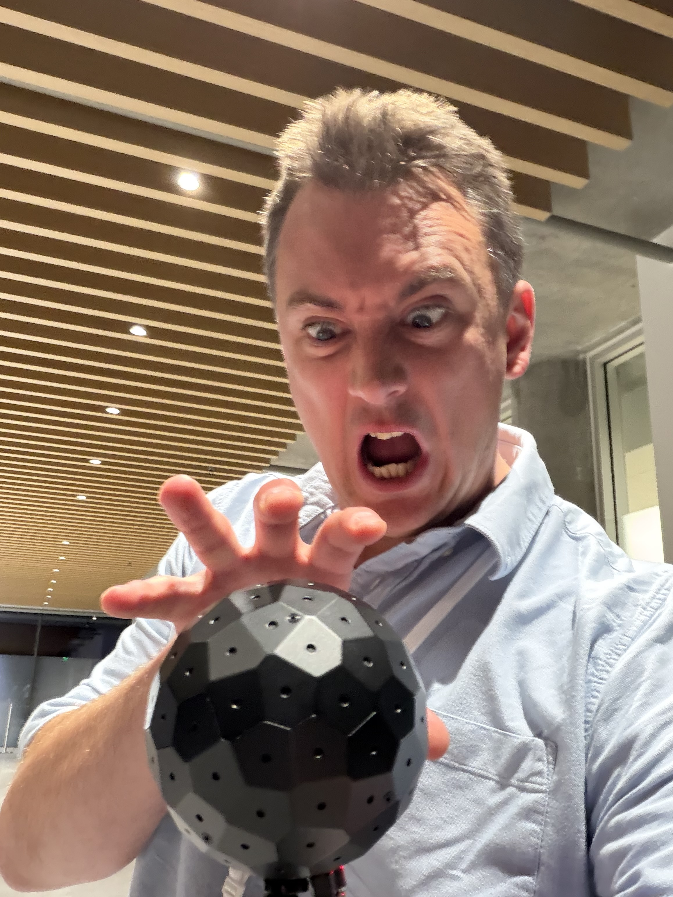
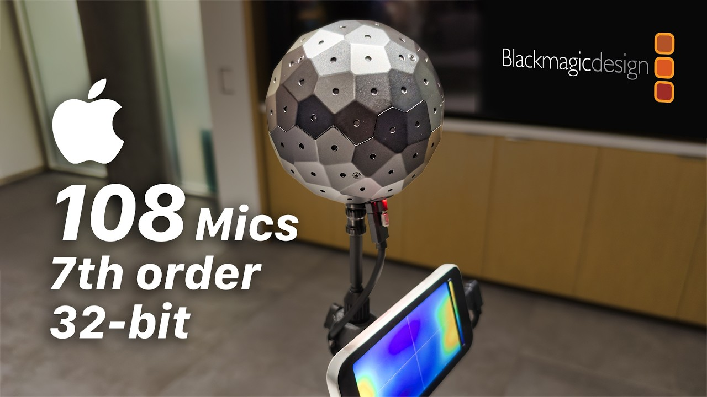
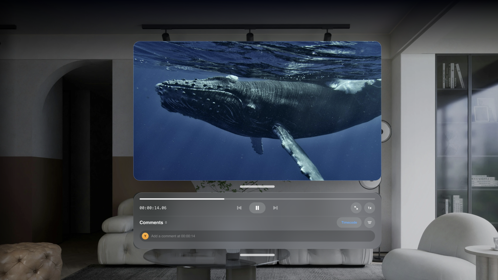

Today's my last day in sunny Cupertino - I fly back to Melbourne tonight. 🛫

Apple's **Create immersive media experiences for spatial computing** event yesterday was absolutely fantastic.

You can watch the recording of the event on [YouTube](https://www.youtube.com/live/iDbHBdI7nq0):

Thanks to EVERYONE at the event that came up to me to get a demo of **BRAW Toolbox v4**!

You can read more about BRAW Toolbox v4 on [yesterday's post](/news/20261112/), and on the [BRAW Toolbox website](https://brawtoolbox.fcp.cafe).

It was actually amazing, and kinda surprising how many people came up to me and told me they love cutting in Final Cut Pro.

The biggest news of the event was without a doubt the new B.A.M - **Blackmagic Ambisonic Microphone**. 💥

I got to see it up close, and it looks AWESOME.

More importantly though, it sounds AMAZING.

Designed and built by Australian's - so cool. 🦘

You can download the **Blackmagic Ambisonic Recorder** on the [Blackmagic website](https://www.blackmagicdesign.com/products/blackmagicambisonic) to hear what it sounds like on Apple AirPods.

If you drag this sample file into Final Cut Pro, you'll just get the 64 mono tracks.

The amazing **Hugh Hou** has posted an awesome video titled: [Blackmagic Ambisonic Microphone: 108 Mics, 7th Order Spatial Audio for Apple Immersive](https://www.youtube.com/watch?v=L8MTyqy6erE)

**Strada** was on the table next to me - again, you can learn more about their new Vision Pro app on [their website](https://strada.tech/visionpro).

I've played around with the Vision Pro app, and it's insanely impressive.

**Colorfront** was also on a table next to me demoing the awesome **Colorfront Immersive Utility**.

You can buy the Colorfront Immersive Utility on the [Mac App Store](https://apps.apple.com/app/colorfront-immersive-utility/id6758009531).

Aside from BRAW Toolbox there wasn't really any other Final Cut Pro news yesterday.

My experiments with **CommandPost v3** continue! Once I get back to Australia I'll start testing with different control surfaces.

That's all for today team! Chat again when I'm back down under.

Onwards & Upwards!

---

## Discuss this page

