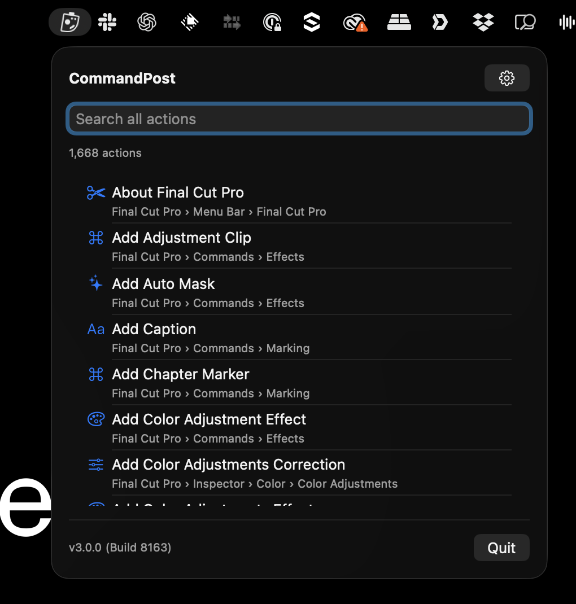
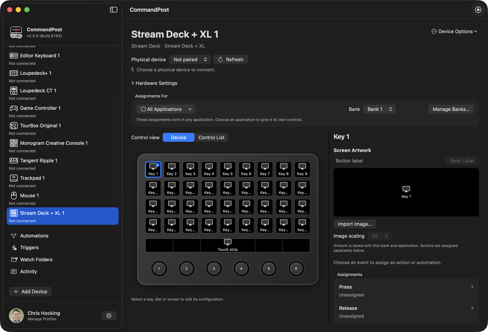
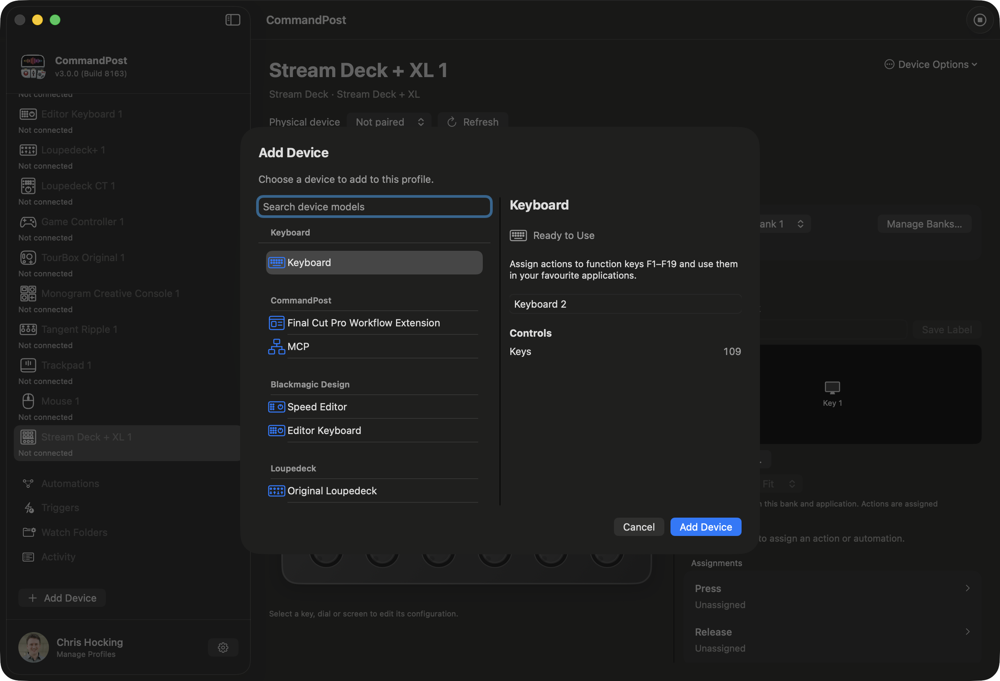
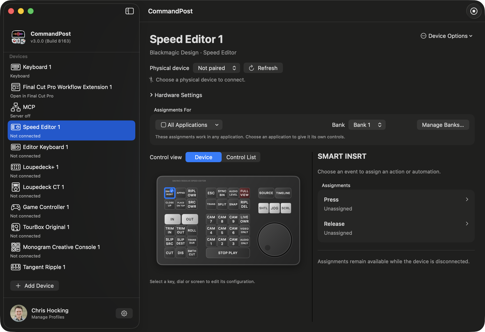

Greetings from Melbourne, Australia! 🇦🇺

I'm back down under, after an amazing week in Cupertino!

**CommandPost v3** is now full steam ahead. 🥳

Here's a sneak peak of what I'm currently working on:

I'll continue to work over this over the coming weeks and months, and hopefully push to TestFlight in the not-so-distant future.

In other news...

There's a new kid on the block... introducing **Density*.

> Grade groups instead of single clips, set up a whole timeline in one go, and finish with a film look you can keep shaping. All inside Final Cut Pro, no round trip to Resolve. Try Density free.

I haven't played with it yet - but it looks interesting.

You can learn more on the [Density website](https://density.film).

**Watch Import v1.4.1** is out now with the following improvements:

- New Help menu item to prepare diagnostic flies for support

You can learn more on the [Mac App Store](https://apps.apple.com/app/watch-import/id6805610470).

**GPS to FCP Converter v1.4.1** is out now with the following improvements:

- Faster and more accurate for long recordings
- Long recordings spanning several hours now export reliably, and maps and videos render much faster.
- More accurate data: GPS outliers are filtered out, and speed, distance and elevation gain are more realistic and consistent across maps and overlays.
- Smoother track line with clean colour transitions.
- Overlays are exported as HEVC with transparency: files up to 90x smaller, faster rendering, and the same size and position in Final Cut Pro as before.

You can learn more on the [Mac App Store](https://apps.apple.com/app/gps-to-fcp-converter/id6772071749).

**ATEM to FCP v1.6.3** is out now with the following improvements:

- Added a complete in-app User Guide with searchable Help.
- Added quick access to the product website and Terms & Privacy.
- Updated documentation and improved overall reliability.

You can learn more on the [Mac App Store](https://apps.apple.com/app/atem-to-fcp/id6760610577).

**Worx4 X v1.3.12** is out now with the following improvements:

- Built with support for ARM64 chips.
- Support for FCP XML 1.14.

You can learn more on the [Mac App Store](https://apps.apple.com/app/worx4-x/id1195903030).

That's it for today. Chat later! 👋

---

## Discuss this page

