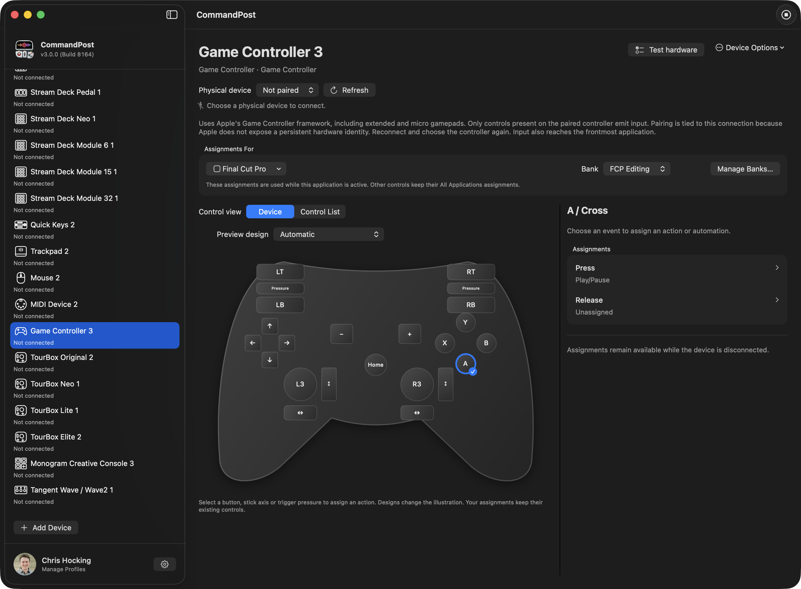
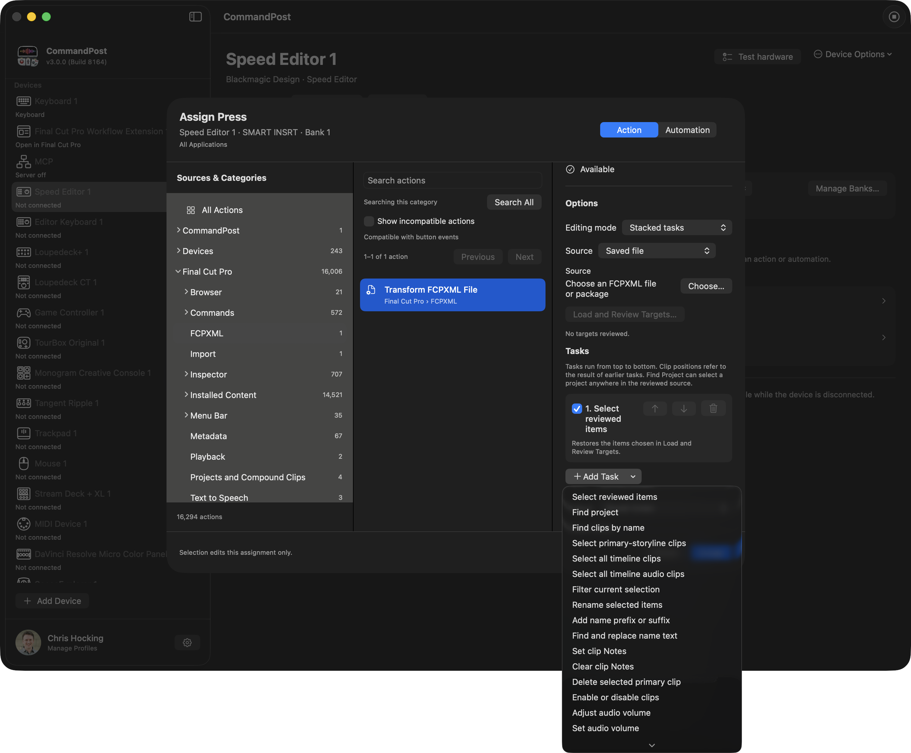
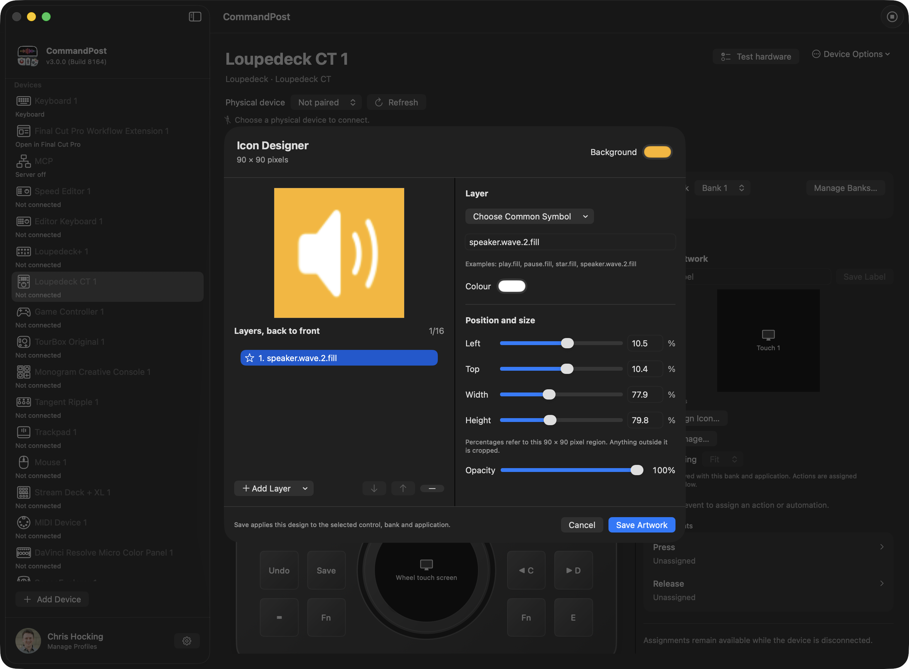
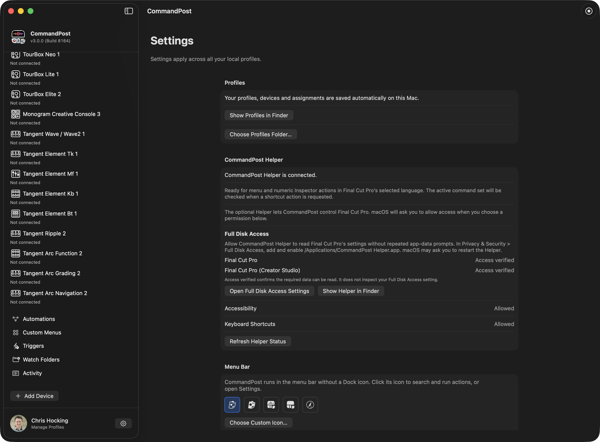
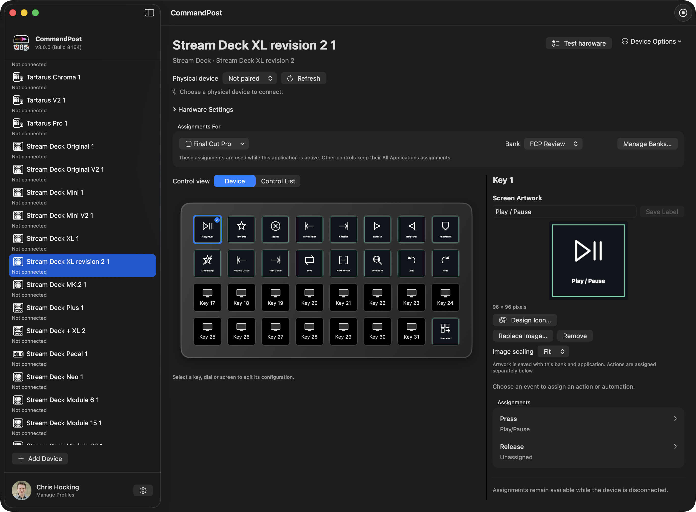

**CommandPost v3** continues development and testing. Exciting times ahead!

Here's a sneak peak...

In other news...

**WaveXML 2.0.2** is out now. You can download on the [WaveXML website](https://wavexml.com).

**Doza v1.1.16** is out now:

> For editors who cut multicam interviews and for anyone working in more than one language.
>
> One timeline in story order. A collection of multicam interviews now exports as one Final Cut timeline.
> The sound Final Cut plays. Doza Assist now plays every sound angle that is switched on in your multicam clip.
> Clips keep their volume and grades. A clip sent back to Final Cut carries the volume, color corrections and switched-off channels of the clip it was cut from.
> Translate a transcript. A switch on the Transcript tab shows the original, the translation, or both side by side.
> Other languages are more accurate by default. Languages other than English are transcribed by the model that is told the language and stays in it. It takes longer than before.
> Quiet recordings are raised in the player. Your files and your exports are not changed.
> Studio: a share link can include a translation, and your client chooses the language.

You can find the full release notes on the [Doza website](https://doza.ai/changelog/1.1.16/).

I'm off to Sydney today for a fast-turnaround edit. Chat later this week!

---

## Discuss this page

