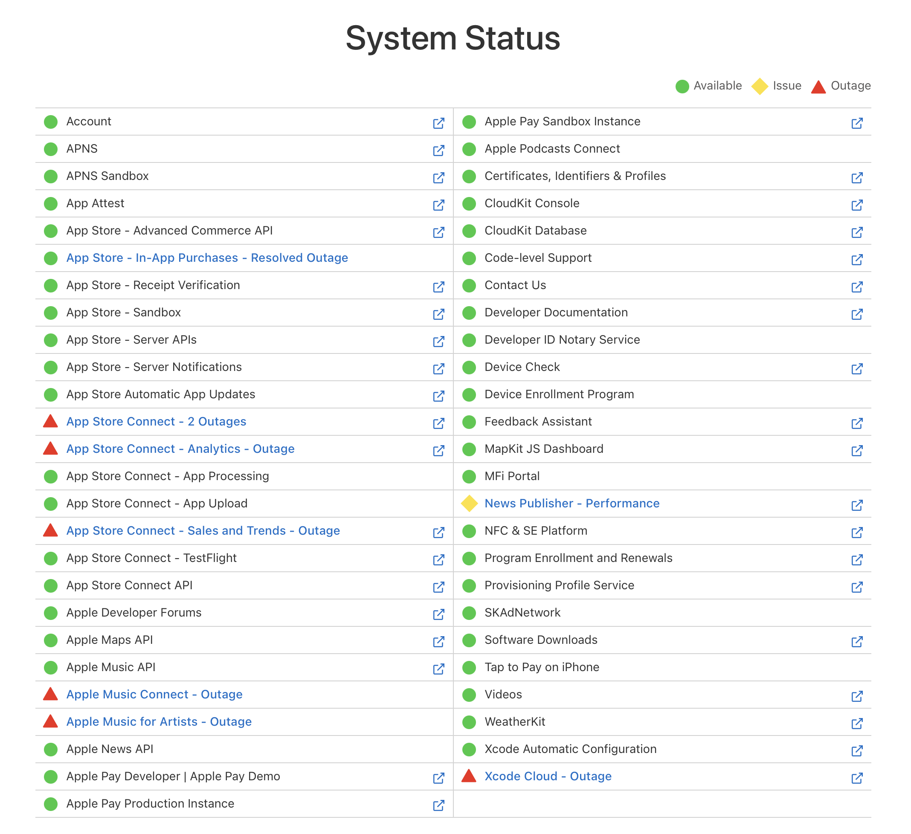
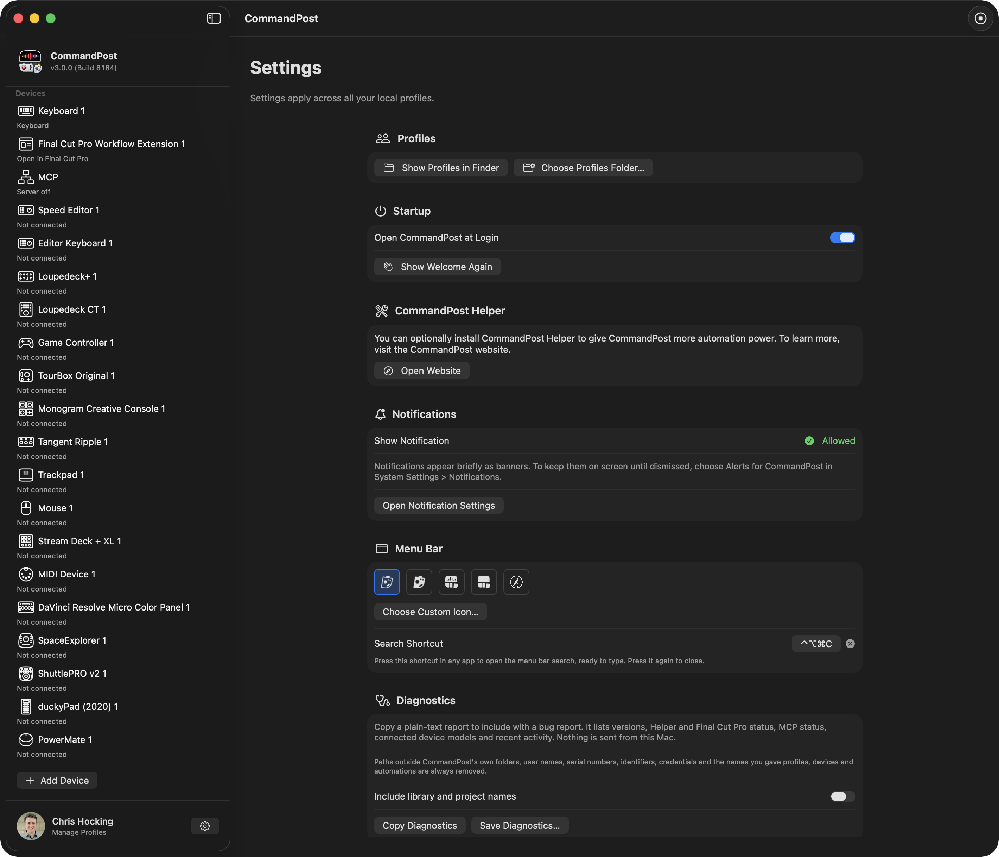
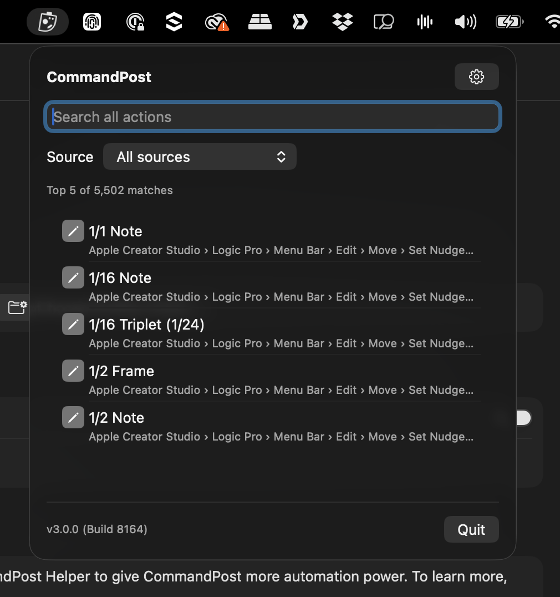
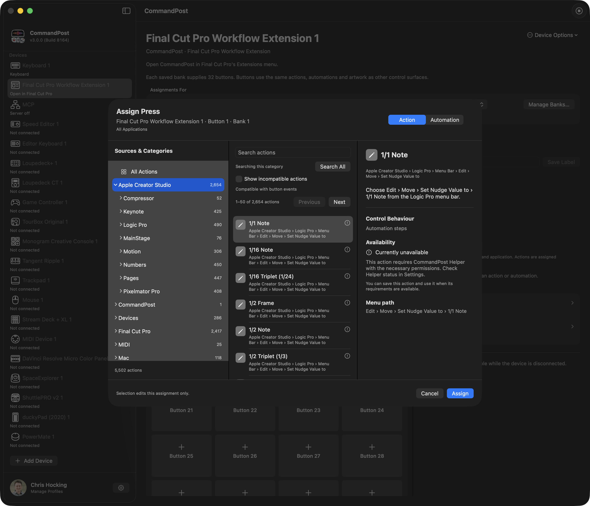
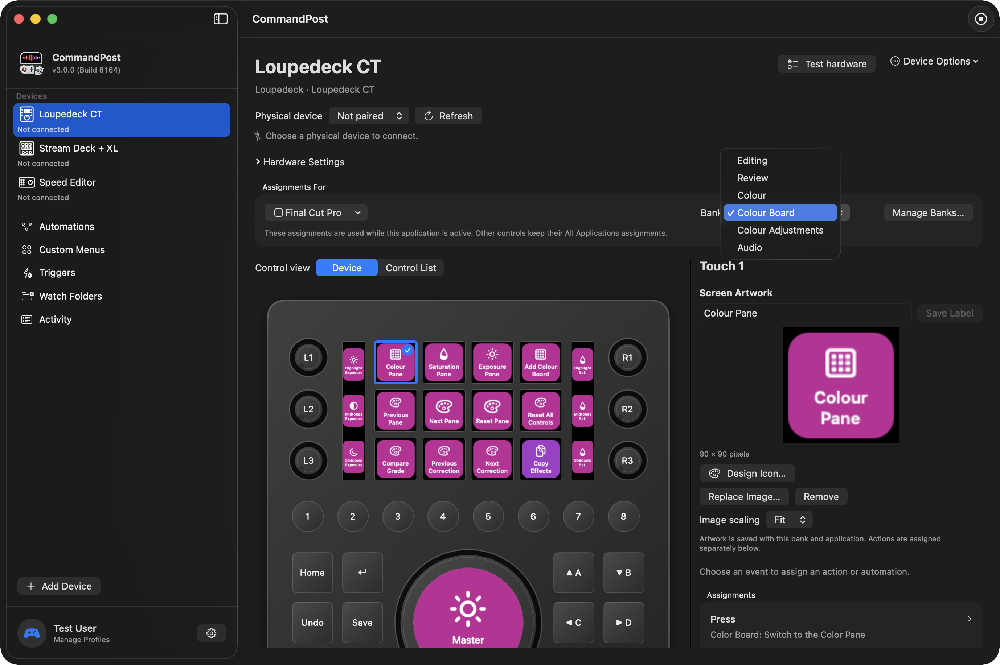
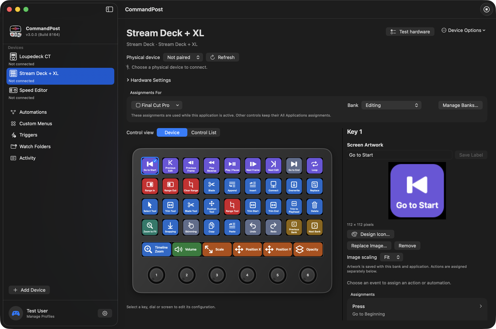
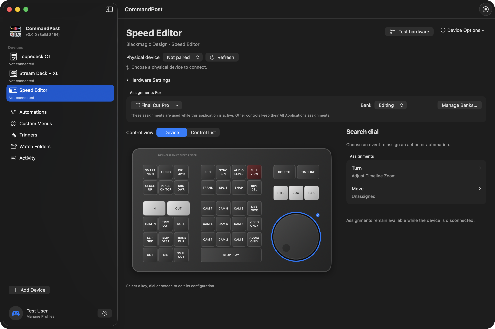
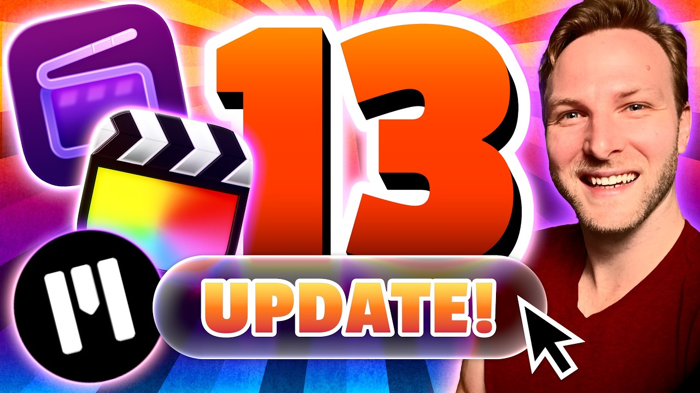
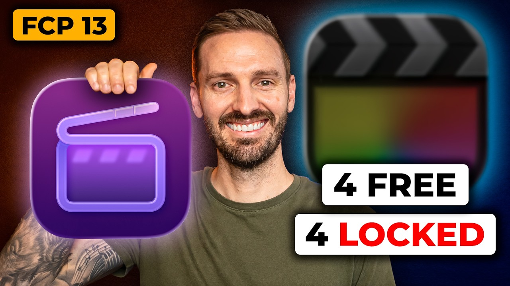
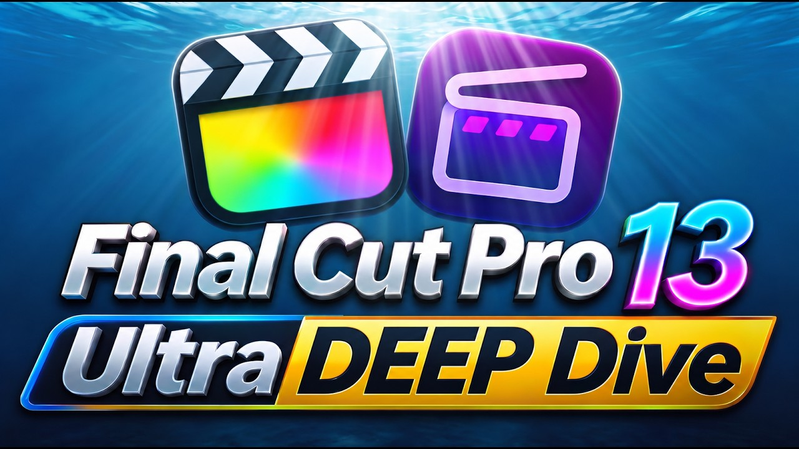

Happy Wednesday from sunny Sydney! 🇦🇺

It's **Final Cut Pro v13** release day! 🥳

However, unfortunately as of right now, it's looks like poor Apple is having some serious issues:

Apple's support pages are also down, so I can't even get to the release notes.

I'm GUESSING that the poor ProApps team can't actually get into App Store Connect to press publish.

In the meantime...

**CommandPost v3** continues development and testing - it's coming together really nicely!

Here's another sneak peak...

Whilst we're all waiting for the Final Cut Pro v13 update to appear...

**Dylan Bates (The Final Cut Bro)** has posted a video on [YouTube](https://www.youtube.com/watch?v=0sUBpg8N6j8):

**Brad West** has also posted a video on [YouTube](https://www.youtube.com/watch?v=e1d6m_2fxNc):

**Ripple Training** has also posted a video on YouTube:

**CineD** writes: [Final Cut Pro 13 First Look – The MotionVFX Library Is Why I Am Subscribing to Apple Creator Studio](https://www.cined.com/final-cut-pro-13-first-look-the-motionvfx-library-is-why-i-am-subscribing-to-apple-creator-studio/).

I'm on a fast turnaround edit today, so I won't be looking at Final Cut Pro v13 deeply until tomorrow unfortunately, so if you get a chance to play, please share your feedback in the comments!

In other news today...

**AudioSwift v3.0.1** is out now:

> This version fixes an issue with updating within the app, so future updates will work smoothly from inside AudioSwift again.

It's also **30% off** until November 30th.

You can learn more on the [AudioSwift website](https://audioswiftapp.com).

The incredible **Ian Failes** has a new book!

It's called **WHOA! Great Moments in Effects History Vol. 1**.

> The book is the first volume in a series about my favorite effects shots and moments from films, TV shows and more. There's 50 in this first book.

You can learn more on the [Befores & Afters website](https://beforesandafters.com/whoa/).

Chat again tomorrow! 👋

---

## Discuss this page

