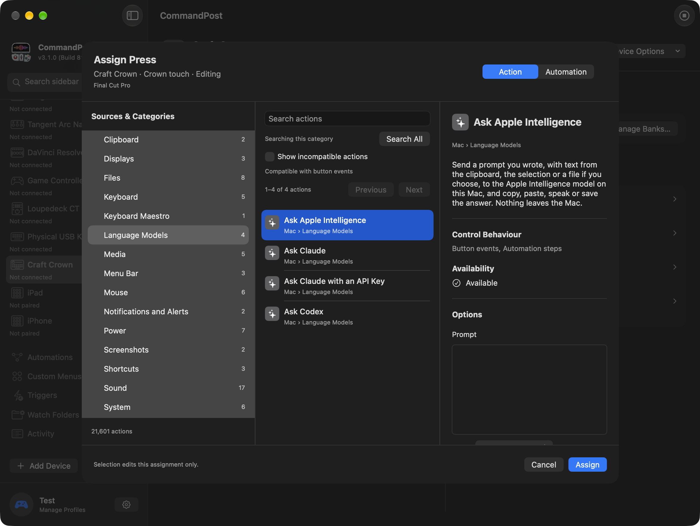
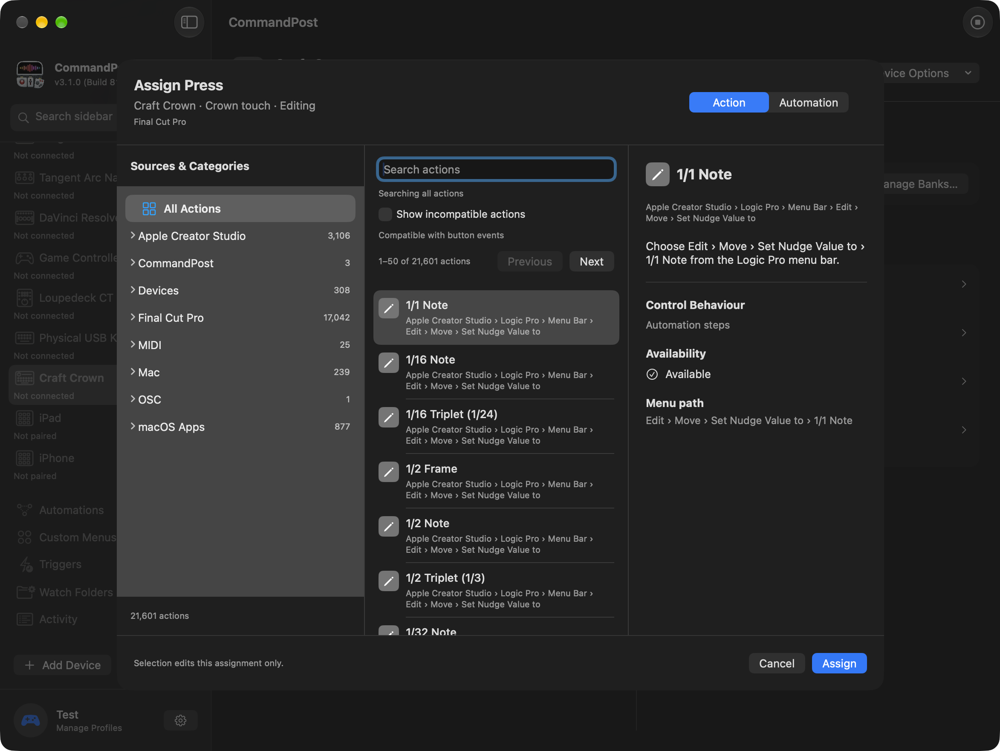
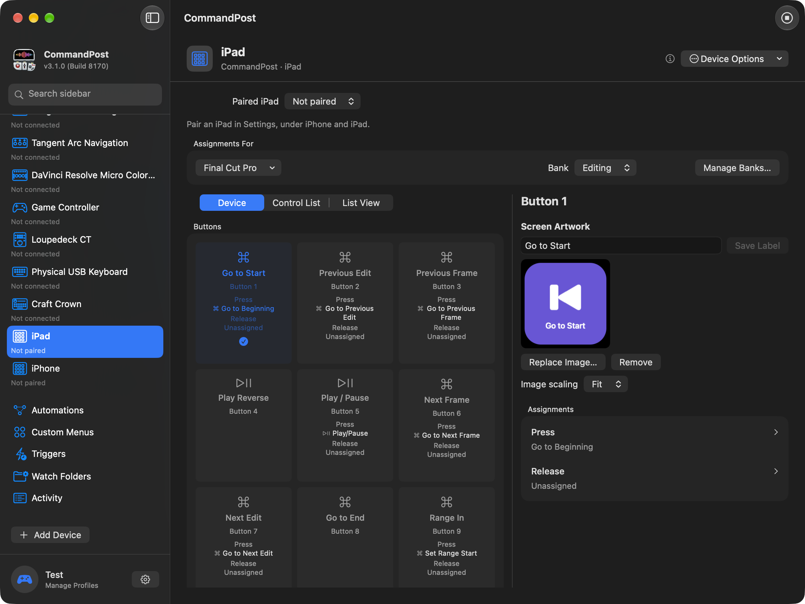
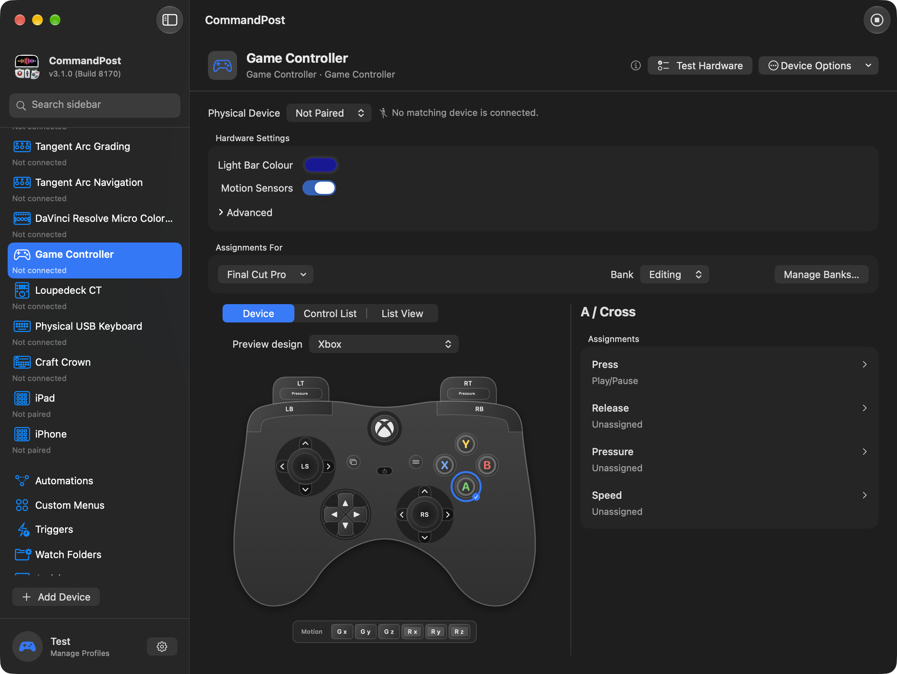
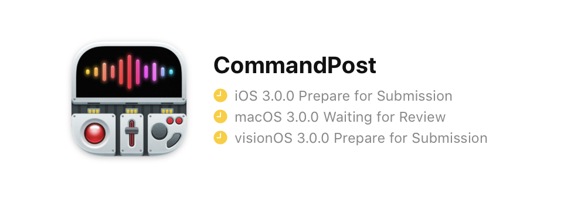

# 2026

## November

### [22nd November 2026](/news/20261122)

Happy Sunday! 👋

A couple of updates for you...

**Transfer Toolbox v2.1.0** is out now! 🥳

**🔨 Improvements:**
- Added support for Final Cut Pro v13 (for Mac), Final Cut Pro Creator Studio v13 (for Mac) and Final Cut Pro Creator Studio v4.0 (for iPad).

You can learn more on the [Transfer Toolbox website](https://transfertoolbox.fcp.cafe).

**Capacitor v1.3.0 (Build 8)** is out now too!

**🔨 Improvements:**
- Added support for Final Cut Pro v13.0, Final Cut Pro Creator Studio v13.0 and FCPXML v1.15.
- Added support for Final Cut Pro 7 XML.

You can learn more on the [Capacitor website](https://capacitor.fcp.cafe).

**Keyframe Toolbox v2.1.0 (Build 61)** has been sent out to our awesome TestFlight testers, so once we get the tick of approval from them, we'll release.

**CommandPost v3.0.0 (Build 8169)** is also currently on TestFlight.

We've already received SO MUCH amazing feedback - THANKS TEAM!

I hope to submit a new build with LOTS of improvements today or tomorrow.

Here's a sneak peak of some of the new features:

Yes... there'll be an iPhone, iPad and even an Vision Pro app. 🤯

In other news from the community...

**Marker Data v2.2.0** has been released.

> Support for FCPXML 1.15 and have been tested and verified with Final Cut Pro 13.

You can learn more on the [Marker Data website](https://markerdata.theacharya.co).

**Swift DAW File Tools v0.9.4** is also out now with Final Cut Pro v13 support.

You can learn more on [GitHub](https://github.com/orchetect/swift-daw-file-tools).

That's is for today. Enjoy the rest of your weekend!

---

## Discuss this page

